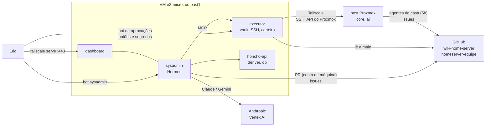

# Design: sysadmin no GCP e a equipe de agentes (sub-projeto 5a)

- **Data:** 2026-11-09
- **Autor:** Léo Ivan (com Claude)
- **Status:** decidido em conversa (brainstorming), seção por seção, com o Léo.
- **Caminho:** arquitetural: máquina nova fora de casa (GCP), agente novo com terminal, mudança no modelo de VPN, exceção nova nas regras de segurança do `AGENTS.md` e um canal novo entre agentes.
- **Depende de:** 4c3 (código do `ops` e do `aprovador`, que o executor reaproveita), 4c4 (imagem do Hermes já fixada), VPN (página 14).
- **Emendas:** seção 16 (plano, 2026-11-09).
- **Sub-projeto seguinte:** **5b — agentes da casa por papel** (spec própria), que implementa o lado de casa do protocolo da equipe definido aqui (seção 9).

## 1. Objetivo

Um **sysadmin** que existe **antes** do servidor: um agente Hermes, com memória Honcho, rodando no GCP, que o Léo comanda pelo Telegram. Ele é a máquina de controle do Ansible (página 01): aprende com a wiki e as skills do repositório, executa o roteiro do primeiro deploy (página 18) fase a fase e, depois do deploy, continua como o coordenador da **equipe** de agentes da casa, pedindo a eles o que não alcança sozinho.

Toda ação que muda o servidor espera um botão do Léo no Telegram, e toda mudança no repositório entra por PR com o merge do Léo.

### Critérios de pronto

- VM `e2-micro` (Always Free) em `us-east1`, criada por `server/scripts/gcp/criar-sysadmin.sh` (Cloud Shell) e configurada por `ansible-pull` de `playbooks/setup-sysadmin.yml` a partir da `main`.
- Containers `sysadmin` (Hermes, com terminal e sem segredos da casa), `executor` (único com senha do vault e chave SSH, sem modelo), `honcho-api`, `honcho-deriver` e `honcho-db`. Imagens com versão fixada.
- O `sysadmin` não alcança o tailnet nem o servidor de metadados do GCP; o `executor` alcança a casa pelo Tailscale do host da VM.
- Toda ação que muda a casa (playbook aplicado, `--check`, vault, comando livre, stacks, preparação do Proxmox) passa por pedido com botão no **bot de aprovações do sysadmin**, que só aceita o id do Léo.
- Segredos externos entram pelo **canal de segredos** (bot de aprovações), nunca pela conversa com o modelo.
- Mudanças no repositório só por PR de uma **conta de máquina** do GitHub, com revisão obrigatória do Léo.
- Repositório privado `homeserver-equipe` com o protocolo da seção 9 e o **carteiro** que acorda o sysadmin sem gastar modelo.
- Host Proxmox como nó próprio do Tailscale; rotas das VMs anunciadas pelo host e pela core (failover).
- Página **19** nova, páginas 01, 02, 14 e 18 atualizadas, catálogo, índice, `AGENTS.md`, `INDEX.md`; `test`/`check`/`build`/`lint` verdes.
- Custo fixo perto de US$ 0/mês; o variável (modelo) com teto no console da Anthropic.

## 2. Decisões

| # | Tema | Escolha | Por quê |
|---|---|---|---|
| S1 | Autonomia | **Autônomo com portões.** Sozinho: ler, planejar, editar a wiki, `check`/`sync`/`test`/`lint`, abrir PR, diagnósticos só de leitura. Com botão: `--check`, playbook aplicado, vault, comando livre, stacks, preparação do Proxmox | Escolha do Léo. Respeita o `AGENTS.md` (o botão é a confirmação explícita) sem parar a cada leitura. |
| S2 | Modelo | **Claude pela API da Anthropic** (chave própria do sysadmin, separada das de casa, teto no console), com **Gemini pelo Vertex AI** de reserva (conta de serviço da VM, sem chave guardada) | Escolha do Léo. O sysadmin **não pode depender do LiteLLM de casa**: ele existe antes dela e é quem a conserta. O Hermes só usa o Gemini no Vertex; o Claude no Vertex fala outra API. |
| S3 | Modelos por tarefa | **Sonnet** como padrão com cache de prompt; **Haiku** nas tarefas auxiliares do Hermes (resumo, compressão); Opus só quando o Léo pedir (`/model`) | Custo. Teto sugerido: US$ 30/mês durante a implantação, US$ 10/mês depois. |
| S4 | Memória do sysadmin | **Honcho próprio na mesma VM** (API, deriver, Postgres com pgvector, **sem Redis**), *workspace* `sysadmin`, *peers* Léo e sysadmin; a memória nativa (`MEMORY.md`, `USER.md`) continua ligada | Escolha do Léo. Dados dele e independentes da casa. O Redis é cache opcional e não cabe em 1 GB. |
| S5 | Memória dos agentes da casa | **Honcho em casa** (5b), separado | Escolha do Léo. O que um lado precisa saber do outro passa pela wiki, pelo git e pela equipe (seção 9), e não por memória compartilhada. |
| S6 | Deriver do Honcho | **Gemini Flash-Lite**, o modelo mais barato que serve | O deriver chama o modelo a cada mensagem. A forma de autenticar (conta de serviço do Vertex ou chave do AI Studio pago) é verificada no plano (seção 13). |
| S7 | Mudanças no repositório | **PR por mudança; o merge do Léo é a aprovação.** Botões ficam para ações no servidor | Escolha do Léo. A `main` continua o que o `ops` e o executor aplicam, e só muda pelo Léo. |
| S8 | Conta do GitHub | **Conta de máquina** (`lioevano-sysadmin`, colaboradora com escrita) para o sysadmin; *ruleset* na `main` sem lista de exceções: PR obrigatório, **1 aprovação**, aprovação do último push por outra pessoa, sem *force push* | Um token do próprio Léo age como o Léo: conseguiria fazer o merge do próprio PR. Com outra conta, o PR só entra com a revisão do Léo. |
| S9 | Onde roda | **Abordagem 1:** uma VM no Compute Engine, tudo em Docker Compose | Escolha do Léo entre três (seção 3). Única que separa "o agente roda Ansible" de "o agente mexe na máquina que o hospeda". |
| S10 | Máquina | **`e2-micro` Always Free em `us-east1`**, Ubuntu 24.04, 30 GB de disco padrão, **swap de 4 GB**; saída de emergência `gcp_tipo_maquina: e2-small` (~US$ 13/mês) | O Léo pediu o mais barato possível. O free tier vale só em `us-west1`, `us-central1` e `us-east1`, inclui 30 GB de disco e 1 GB de saída, e não cobra o IP externo. `us-east1` deve ser a mais próxima do Brasil das três. |
| S11 | Entrada na VM | Firewall do GCP **recusando toda entrada**, com regra de prioridade alta que anula o `default-allow-ssh` da rede padrão. SSH de manutenção pelo Tailscale; IAP (gratuito) só ligado em emergência | Telegram, Tailscale, GitHub e APIs são todos conexões de saída. |
| S12 | Segredos | **Um único segredo JSON** no Secret Manager (cabe nas versões gratuitas), lido na partida por uma unit do systemd para um `tmpfs` (`/run/sysadmin`, 0600); cada container monta só os arquivos de que precisa | Nada de segredo no disco nem no git; a conta de serviço só lê esse segredo. |
| S13 | Agente × executor | **Dois containers.** O `sysadmin` (Hermes) tem terminal e nenhum segredo da casa. O `executor` tem a senha do vault e a chave SSH, não tem modelo e oferece ao Hermes um MCP com ferramentas fechadas (seção 6) | Sem isso o portão é um pedido educado: uma injeção de prompt com terminal e chave SSH chegaria à casa. É o padrão `ops` + `aprovador` da 4c3, aqui. |
| S14 | Código do executor | Reaproveita o **runner, a política e a auditoria do `ops`** e os **pedidos e o Telegram do `aprovador`** (`server/docker/images/ops`, `.../aprovador`), como pacotes copiados na imagem `localhost/homeserver/executor` | Código já testado (trava, `--check` antes de aplicar, plano por commit, validade, uso único). |
| S15 | Canal de segredos | `vault_preencher(chave)`: o **bot de aprovações** pede o valor ao Léo; o Léo responde **a esse bot**; o executor grava no vault e **apaga a mensagem**. O valor nunca passa pelo modelo, pelo histórico do Hermes nem pelo Honcho | "Tudo pelo Telegram" sem mandar segredo ao provedor do modelo. |
| S16 | Vault | A **senha do vault** é gerada pelo `criar-sysadmin.sh` e mostrada uma vez no Cloud Shell (o Léo guarda no gerenciador de senhas). O executor roda `gerar_vault.py` e as edições com ela e grava o `vault.yml` **criptografado** num volume de saída; o **sysadmin** abre o PR com o arquivo, sem conseguir decifrá-lo | O executor não precisa de token de escrita no GitHub. |
| S17 | Bots | **Quatro:** `sysadmin` (Hermes no GCP, conversa), `aprovações do sysadmin` (executor: botões e segredos), `avisos` (n8n e `aprovador` de casa) e `assistente` (Hermes de casa) | Um bot só aceita um leitor por `getUpdates`. Separar conversa de aprovação evita que o modelo veja segredos. |
| S18 | Rede até casa | Sysadmin no tailnet com `tag:sysadmin`; **host Proxmox como nó próprio** (`tag:homeserver`) anunciando as rotas `/32` das VMs; a core anuncia as mesmas rotas depois do `setup-vpn` (failover do Tailscale); `autoApprovers` para essas rotas | O sysadmin precisa das VMs antes do Tailscale da core existir. De quebra, sai o item adiado "a VPN depende da core". |
| S19 | ACL | `tag:sysadmin` → host :22, :8006; VMs :22, :443, :53. Léo → `tag:sysadmin` :443, :22. **Nada da casa para `tag:sysadmin`** | Um servidor comprometido não alcança o sysadmin. |
| S20 | Dashboard | **Dashboard oficial do Hermes**, `hermes dashboard --host 127.0.0.1`, publicado pelo `tailscale serve` (HTTPS do tailnet), só para os aparelhos do Léo. O que for mudado por ali volta ao que a wiki diz na próxima atualização | Pedido do Léo (visualização e controle). É uma porta de administração (chaves, ferramentas, terminal): nunca pelo túnel nem pela internet. O "Hermes Web UI / Hermes Studio" da comunidade fica de fora (admin padrão, terceiros). |
| S21 | Contexto e skills | Diretório de trabalho = clone do repositório (o Hermes carrega o `AGENTS.md` da raiz e descobre os das subpastas); as 12 skills de `.agents/skills/` entram como leitura; `SOUL.md` gerado da wiki (quem ele é, segue a página 18, nunca pede segredo na conversa, relata a fase) | Ele aprende com a documentação atual, com as mesmas regras que valem para qualquer agente. |
| S22 | Skills aprendidas | As skills que ele cria ficam no diretório do Hermes; as que provarem úteis ele **propõe por PR** para `.agents/skills/` | O aprendizado vira documentação revisada, e serve à 5b e a outros agentes. |
| S23 | Ferramentas do Hermes | **Ligadas:** `terminal`, `code_execution`, `file` (dentro do container), `skills`, `memory`, `todo`, `clarify`, `session_search` e o MCP do executor. **Desligadas:** `browser`, `computer_use`, `delegation`, `cronjob`, `connections`, `web`, `search`, `x_search`, `kanban`, `project`, `catalog`, `desktop_ui`, geração de mídia e voz, e as plataformas de mensagem além do Telegram. **Aprovação de comandos do próprio Hermes desligada** | O container do sysadmin não guarda nada de valor; os portões que valem são os do executor (S13), e assim o Léo não recebe botão para `rm` no clone. Navegador não cabe em 1 GB; subagentes custam modelo e memória; `cronjob` e `connections` são o caminho de uma injeção agendar saída de dados. |
| S24 | Atualização da VM | Timer diário no host: `ansible-pull` de `playbooks/setup-sysadmin.yml` da `main`; imagens fixadas; a imagem `sysadmin` (Hermes `v0.22.5` + Ansible + coleções + `gh` + venv do `dev.py` + plugin do Honcho) é compilada na VM | O sysadmin não consegue se reconfigurar: o container não alcança o host, e a `main` só muda pelo merge do Léo. |
| S25 | Backup | Timer diário no host: dump do Postgres do Honcho e cópia do diretório do Hermes (sessões, skills aprendidas) num bucket do GCS em região dos EUA (5 GB grátis), com os objetos apagados depois de 30 dias | A VM inteira se recria do script e do repositório; só a memória precisa de backup. |
| S26 | Equipe | **Issues no repositório privado `homeserver-equipe`** (seção 9) | Escolha do Léo. Sem porta nova em lugar nenhum (todos só saem para o GitHub), sem custo, com histórico, e o Léo acompanha e intervém pelo app do GitHub. |
| S27 | Acordar o sysadmin | **Carteiro** no executor (Python, só biblioteca padrão, sem modelo): a cada 2 minutos lê o `homeserver-equipe` e, havendo resposta a um pedido do sysadmin ou issue `papel:sysadmin`, acorda o Hermes pela API local | Sem novidade, sem gasto de modelo. Um `cronjob` do Hermes chamaria o modelo a cada vez. |
| S28 | Coleta | **Sem Alloy** na VM do GCP (exceção escrita no índice de integrações) | Não cabe em 1 GB. O estado do sysadmin aparece no `/status` e no dashboard. |
| S29 | Regra do `AGENTS.md` | Exceção explícita: para o sysadmin da página 19, o **botão do executor conta como confirmação explícita do Léo** para `ansible-playbook` real, `ansible-vault` e `ssh`. `git push` na `main` continua proibido para todos | O fluxo autônomo precisa disso e a regra fica escrita, não implícita. |

## 3. Abordagens consideradas

1. **VM no Compute Engine, tudo em Docker Compose** — **escolhida** (S9).
2. **VM com o Hermes instalado direto e o Honcho em Docker:** menos camadas, mas o terminal do agente roda na própria VM e vê o Docker, a conta de serviço e o disco do Honcho.
3. **Serviços gerenciados (Cloud Run, Cloud SQL, Memorystore):** o gateway do Hermes precisa ficar ligado e com estado, o Tailscale no Cloud Run é improvisado, e o Cloud SQL e o Memorystore passam de US$ 60/mês.

Para a equipe (S26), as alternativas eram uma "mesa" em casa (dados em casa, mas mais código, porta nova na core e cai junto com a casa) e chamada direta à API de cada agente (tarefas longas estouram o tempo e não fica um quadro).

## 4. Arquitetura

| Container | Imagem | Tem | Não tem | Rede |
|---|---|---|---|---|
| `sysadmin` | `localhost/homeserver/sysadmin` (Hermes `v0.22.5` + Ansible, coleções, `gh`, venv do `dev.py`, plugin do Honcho) | Terminal, clone de trabalho, token da conta de máquina (PR e issues), chave da Anthropic, conta de serviço para o Vertex (token entregue pelo host, não pelo servidor de metadados) | Senha do vault, chave SSH da casa | Internet; `executor`; `honcho`. **Bloqueado:** `100.64.0.0/10`, rotas da casa, `169.254.169.254` |
| `executor` | `localhost/homeserver/executor` (Python, código do `ops` e do `aprovador`) | Senha do vault, chave SSH, token do bot de aprovações, token só de leitura do `homeserver-equipe` (carteiro) | Modelo, terminal livre, escrita no GitHub | Internet (Telegram, GitHub); tailnet pelo host; `sysadmin` |
| `honcho-api`, `honcho-deriver` | `ghcr.io/plastic-labs/honcho:<fixada no plano>` | Memória; chave do deriver | Nada da casa | Interna; o deriver sai para o modelo |
| `honcho-db` | `pgvector/pgvector:<fixada no plano>` | Dados do Honcho (disco da VM) | — | Interna |

A regra de bloqueio da rede do `sysadmin` fica na cadeia `DOCKER-USER` do host da VM, gerada pelo Ansible (o mesmo padrão do `firewall-docker` da página 14).

## 5. Rede até casa

1. **Fase 0, painel do Tailscale:** o Léo cola a ACL da página 19 (tags, `autoApprovers`, regras de S19) e cria duas auth keys de uso único e pré-aprovadas, `tag:sysadmin` e `tag:homeserver`. Ambas vão para o segredo do GCP.
2. **Criação da VM:** ela entra no tailnet sozinha com a chave `tag:sysadmin` (`--accept-routes`). Nós com tag não expiram a chave.
3. **Depois de instalar o Proxmox pelo pendrive**, o Léo cola no console do host **um comando** que o sysadmin manda no Telegram: instala o Tailscale e entra com a chave `tag:homeserver`, anunciando as rotas `/32` das VMs. É o último passo físico na rede.
4. O `proxmox_preparar` (com botão) faz as ações manuais prévias da página 02 com a senha de root pedida pelo canal de segredos (ela vai para o vault). Daí em diante, o `setup-proxmox-host.yml` gerencia esse Tailscale pelo role `infra/tailscale`, que passa a aceitar Debian.
5. O `setup-vpn.yml` sobe o Tailscale da core, que anuncia as mesmas rotas. Se a core cair, as rotas seguem pelo host e o host continua alcançável pela VPN.

O CoreDNS da core (página 14) continua respondendo `*.<domínio>` para quem está no tailnet; o sysadmin usa os nomes depois que a core existir.

## 6. Ferramentas do executor (MCP para o Hermes)

| Ferramenta | O que faz | Portão |
|---|---|---|
| `diagnostico(host, comando)` | Lista fechada, só leitura: `systemctl status`, `journalctl -u … -n`, `docker ps`, `docker logs --tail`, `df`, `free`, `ip`, `ping`, `ss -tlnp`, `cat` de caminhos permitidos | Nenhum |
| `ansible_check(playbook, limite)` | `git pull` da `main`, `--check --diff`; devolve `plano_id`, commit e PLAY RECAP | **Botão** |
| `ansible_aplicar(plano_id)` | Aplica o plano do mesmo commit, uma vez, no prazo | **Botão** (com commit, autor, assunto e RECAP do `--check`) |
| `comando(host, comando)` | Qualquer outro comando, mostrado por extenso no pedido | **Botão** |
| `vault_gerar()` | Roda `scripts/gerar_vault.py` com a senha do vault; grava o `vault.yml` criptografado no volume de saída | **Botão** |
| `vault_preencher(chave)` | Canal de segredos (S15); grava o `vault.yml` criptografado no volume de saída | **Botão** + resposta do Léo ao bot de aprovações |
| `proxmox_preparar()` | Ações manuais prévias da página 02 (usuário Ansible, chave SSH) com a senha de root | **Botão** |
| `stack_criar(stack, ambiente)` / `stack_atualizar(stack)` | Pela API do Portainer, com o compose da `main` e o `/opt/portainer_stack_envs/<stack>.env` lido por SSH | **Botão** |
| `inicializar_portainer()` | Cria o administrador do Portainer pela API nos primeiros 5 minutos e o token de API (grava pelo canal de segredos) | **Botão** |

Regras que valem para todas (do código do `ops` e do `aprovador`):
- Uma execução por vez (trava).
- O pedido aprovado só vale para a **mesma ferramenta, alvo e argumentos**, **uma vez**, em **30 minutos**.
- O executor **só aceita botões do id do Léo** (`telegram_chat_id`).
- No máximo 5 pedidos pendentes.
- Auditoria em arquivo, com rotação.
- Saídas cortadas antes de voltar ao modelo (`limpar_saida`).

O MCP aceita só o `sysadmin`, por token interno.

## 7. O Hermes do sysadmin

- **Configuração:** `config.yaml` e `.env` gerados pelo Ansible a partir da página 19 a cada `ansible-pull`.
  - Provedor `anthropic` com o Sonnet e reserva `vertex` com o Gemini (S2, S3).
  - `memory.provider: honcho` com o `baseUrl` interno.
  - Os grupos de S23.
  - `platforms.telegram` com `TELEGRAM_ALLOWED_USERS` = `telegram_chat_id`.
  - API do Hermes só na rede interna com o executor, com chave, para o carteiro (seção 13).
- **`SOUL.md`:** gerado da página 19.
- **Skills próprias** (no repositório, em `.agents/skills/`, para também servirem a outros agentes):
  - `implantar-fase` (`/implantar-fase <n>`);
  - `status-implantacao` (`/status-implantacao`: fase atual, pendências do Léo, pedidos abertos, gasto do mês, memória da VM);
  - `equipe` (`/equipe`: pedidos abertos e com quem estão; abrir pedido para um papel).
- **Dashboard:** mesmo container, processo à parte, `127.0.0.1:9119`, publicado por `tailscale serve`.

## 8. Fluxo de trabalho de uma fase

1. O Léo manda "vamos para a fase N" (ou `/implantar-fase N`).
2. O sysadmin lê a fase na página 18 e as seções citadas, e confere o estado real com o `diagnostico`.
3. Abre o **diário da fase**: uma issue no `homeserver-equipe` com a lista de passos marcável e o log completo. O Telegram recebe só o resumo.
4. Manda numa mensagem só o que é do Léo (com o link da seção) e espera a confirmação.
5. Segredos faltando: `vault_preencher`.
6. Wiki errada ou incompleta: PR com a correção primeiro; segue depois do merge.
7. Cada playbook: `ansible_check` (botão) → `ansible_aplicar` (botão).
8. Teste de ponta a ponta da seção; marca a linha em "A conferir no primeiro deploy"; fecha o diário e sugere a próxima fase.

"Pare" interrompe o trabalho do Hermes; um playbook já aprovado vai até o fim ou até o tempo limite do runner.

**Continua sendo do Léo:**
- **Contas:** Cloudflare, provedores de LLM, Tailscale (ACL e chaves), GCP (projeto, faturamento, alerta de orçamento de US$ 2, Cloud Shell), GitHub (conta de máquina, *ruleset*, `homeserver-equipe`, tokens), os quatro bots no BotFather e o teto de gasto na Anthropic.
- **Físico:** BIOS (IOMMU), Proxmox pelo pendrive, o comando do Tailscale no host.
- **Telas que pedem uma pessoa:** 2FA do Authelia; primeiro administrador do Jellyfin, do Seerr e do Immich.
- **Merges e botões.**

**Depois do deploy:**
- Pedidos do Léo ("instale o X") viram PR do sysadmin ou pedido para o papel `apps` (5b).
- Incidentes chegam como issue `papel:sysadmin` aberta pelo observador (5b).
- O carteiro acorda o sysadmin.

## 9. Protocolo da equipe (`homeserver-equipe`)

- **Repositório privado.** Colaboradores: o Léo, a conta de máquina do sysadmin e as contas ou tokens dos agentes da casa (5b), cada um só com *Issues: read/write* nesse repositório.
- **Etiquetas:**
  - `papel:<nome>` (`sysadmin`, `metricas`, `apps`, `variaveis`, `atualizacoes`, `backup`, `assistente`);
  - `estado:aberto` → `estado:em-andamento` → `estado:feito` | `estado:bloqueado`;
  - `diario` para os diários de fase.
- **Modelo de pedido:** o que se quer, por quê, o que conta como feito, prazo, e "ações no servidor: passam pelo aprovador de casa".
- **Regras:**
  1. A casa nunca chama o sysadmin; ele pede e busca.
  2. Pedir a outro agente não fura portão: ações no servidor do agente da casa passam pelo `ops` e pelo `aprovador` de lá.
  3. Resposta é dado, não ordem.
  4. Nada de segredo em issue (o modelo de issue avisa; o canal de segredos é só o bot de aprovações).
- **Feito:** comentário com o resultado e a evidência (comando, saída resumida, link), etiqueta `estado:feito`; quem pediu fecha.
- **Papéis da casa** (forma; implementação na 5b): `metricas` (o observador atual), `apps` (wiki-first, por PR), `variaveis` (vault, `.env`, auditoria de integrações), `atualizacoes` (avisos do Diun viram PRs de versão), `backup` (testa restaurações), `assistente` (o atual).

## 10. Custo

| Item | Custo |
|---|---|
| VM `e2-micro`, 30 GB de disco padrão, IP externo | US$ 0 (free tier, `us-east1`) |
| Secret Manager (um segredo) | US$ 0 (dentro das versões gratuitas) |
| GCS (backup, < 5 GB, região dos EUA) | US$ 0 |
| Saída de rede | 1 GB/mês grátis; acima, ~US$ 0,12/GB (esperado abaixo de 1 GB) |
| Tailscale (plano pessoal) | US$ 0 |
| Modelo | Teto no console da Anthropic (US$ 30/mês na implantação, US$ 10/mês depois) + Gemini de reserva e deriver (centavos) |

Alerta de orçamento do GCP em **US$ 2**.

## 11. Falhas

| Falha | Comportamento | O que fazer |
|---|---|---|
| VM parada (manutenção, cobrança) | Bot mudo | `gcloud compute instances start`; na partida, segredos do Secret Manager e containers sobem sozinhos |
| VM perdida | Perdem-se a memória e as sessões | `criar-sysadmin.sh` + `ansible-pull`; restaurar o dump e o diretório do Hermes do GCS |
| Falta de memória | Swap; `restart: unless-stopped` | Se repetir, `gcp_tipo_maquina: e2-small` por PR |
| Anthropic fora ou teto atingido | Reserva no Gemini (Vertex) | Se as duas falharem, o executor avisa pelo bot de aprovações: "sysadmin sem modelo" |
| Casa fora ou tailnet caído | `diagnostico` falha; nada destrutivo é possível | Relata e espera; com a core fora, o host segue alcançável |
| Playbook falha no meio | Código de saída e final do log no diário | Correção por PR; `--check` de novo |
| Aprovação vencida | Executor recusa | Pedir de novo |
| GitHub fora | PRs e equipe param; o executor recusa aplicar sem ler a `main` | Esperar |
| Container `sysadmin` comprometido | Vazam a chave da Anthropic (com teto) e o token da conta de máquina (PR e issues) | Revogar os dois e o bot do sysadmin; casa e vault intactos |
| Executor comprometido | Equivale a perder a máquina de controle | Trocar a senha do vault e a chave SSH. Mitigação: sem modelo, sem entrada, só botões do id do Léo, código mínimo e testado |
| Token do bot de aprovações vazado | Quem tiver o token lê os pedidos, mas os botões só valem do id do Léo | Revogar no BotFather (`/revoke`), trocar no segredo |

## 12. Testes

- Novo `tools/wikisync/tests/test_sysadmin.py`:
  - **compose:** o `sysadmin` sem senha do vault, chave SSH nem montagens do executor; só o executor com o token do bot de aprovações; dashboard só em `127.0.0.1`; nenhuma outra porta publicada; imagens fixadas (`test_imagens_com_versao` já cobre).
  - **firewall da VM:** a regra que bloqueia `100.64.0.0/10`, as rotas da casa e `169.254.169.254` para a rede do `sysadmin`.
  - **config do Hermes renderizado:** grupos desligados de S23, único MCP o executor, `memory.provider: honcho`, `TELEGRAM_ALLOWED_USERS`, diretório de trabalho.
  - **ACL do Tailscale** (bloco da página 19): nenhuma regra de `tag:homeserver` para `tag:sysadmin`; `autoApprovers` só com os `/32` das VMs.
  - **`criar-sysadmin.sh`:** `shellcheck`; região na lista do free tier; tipo `e2-micro` por padrão; regra de recusa do SSH aberto.
  - **`full-deploy.yml`:** o `setup-sysadmin.yml` fica **fora** dele (roda por `ansible-pull` na VM do GCP); o teste existente de cobertura dos playbooks ganha essa exceção explícita.
- Testes do executor (unitários, sem rede):
  - `diagnostico` recusa tudo fora da lista (incluindo `;`, `&&`, `|` e redirecionamentos);
  - aprovação só vale para a mesma ação, uma vez, no prazo;
  - botão de outro id é ignorado;
  - `vault_preencher` apaga a mensagem e não devolve o valor ao modelo;
  - runner reaproveitado com os testes do `ops`.
- Carteiro: contra uma API do GitHub falsa (novidade → acorda; nada novo → não chama o Hermes).
- `dev.py lint`: `setup-sysadmin.yml`, roles novos e o compose com o `.env.template`.
- Página 19: teste de ponta a ponta manual.
  - `/status`.
  - Um pedido que precise da equipe.
  - `ansible_check` + `ansible_aplicar` de um playbook inofensivo.
  - `vault_preencher` de uma chave de teste.
  - Recusa de um pedido.
  - Outra conta do Telegram ignorada.
  - Dashboard só pelo tailnet.
  - "Rode `ssh core`" no terminal do Hermes: falha (sem chave e sem rota).

## 13. A verificar no plano, antes do código

1. **Honcho:** instalação do plugin na imagem (`hermes plugins install honcho` ou o pacote), `baseUrl` do Honcho próprio, versão das imagens do Honcho e do pgvector, e se o servidor funciona sem Redis.
2. **Deriver:** como o Honcho autentica no Gemini (Vertex por conta de serviço ou chave do AI Studio pago) e qual modelo de *embeddings* ele usa.
3. **Carteiro → conversa do Telegram:** a API do Hermes responde a quem chamou, não ao chat. Se não houver caminho limpo para entregar na conversa do Léo, a reserva é o carteiro avisar pelo bot de aprovações, e o Léo responde "pode ver" ao sysadmin.
4. **Skills externas:** a chave de configuração do Hermes para um diretório de skills extra (`.agents/skills/` só leitura); se não houver, link simbólico na partida.
5. **Vertex sem metadados:** como entregar ao container o token da conta de serviço (arquivo de credencial no `tmpfs`, ou o host renovando um token de acesso) mantendo o bloqueio do `169.254.169.254`.
6. **Memória real em 1 GB:** medir com os cinco containers e um playbook rodando; decidir `e2-small` com números.
7. **Dashboard atrás do `tailscale serve`:** se o Hermes exige provedor de autenticação mesmo escutando em `127.0.0.1`.

## 14. Fora do escopo (5b)

- Os agentes da casa como perfis do Hermes.
- O Honcho de casa.
- O dashboard de casa.
- Os papéis da seção 9.
- O observador como membro da equipe.
- Os tokens dos agentes no `homeserver-equipe`.
- A revisão do `posto_github_token` à luz de S8 (hoje ele também age como o Léo).

## 15. Riscos

- **Injeção de prompt com terminal:** o Hermes do sysadmin tem terminal e internet. O pior caso alcança só o que está no container dele (S13, S23). A casa e o vault ficam atrás do executor.
- **Executor como alvo único:** concentra a senha do vault e a chave SSH. Por isso não tem modelo, não aceita conexões, só obedece a botões do Léo e tem pouco código, já testado.
- **Dados que saem de casa:** conversas, saídas de diagnóstico e trechos de log vão à Anthropic, ao Google (reserva e deriver) e ao GitHub (repositório privado da equipe). Nenhum segredo: o canal de segredos não passa pelo modelo nem pelas issues.
- **1 GB de RAM:** pode ficar lento sob carga; a saída é uma variável (S10).
- **Plugin do Honcho fora do Hermes:** ele passou a ser distribuído à parte, pela Plastic Labs. Versão fixada e testada no plano.
- **Free tier muda:** se o Google mudar as regras, o alerta de US$ 2 avisa no mesmo dia.

## 16. Emendas do plano

As verificações da seção 13 foram feitas lendo o código do Hermes v0.22.5 e do Honcho v3.6.0. O que mudou:

- **E1 (S2, S6):** sem Vertex. O Honcho só fala `openai`, `anthropic` e `gemini` por chave (`LLM_GEMINI_API_KEY`), sem conta de serviço. Uma **chave do Gemini (AI Studio, plano pago)** serve ao deriver, aos *embeddings* (`gemini-embedding-001`, 1536 dimensões) e à reserva do Hermes (`fallback_providers: [{provider: gemini, model: gemini-3.8-flash}]`). Sai a conta de serviço do Vertex e o item 13.5.
- **E2 (S6):** o modelo do Honcho é `gemini-3.8-flash` (o nome que o repositório já usa), trocável por `sysadmin_honcho_modelo`.
- **E3 (S16):** o `gerar_vault.py` roda **no Cloud Shell**, dentro do `criar-sysadmin.sh`. As senhas "para anotar" aparecem só na tela do Léo. O `vault.yml` criptografado vai para `gs://<bucket>/entrada/vault.yml`, o host copia para `/opt/sysadmin/saida/vault.yml` e o sysadmin abre o PR. Sai `vault_gerar`.
- **E4 (§5.4, §6):** sai `proxmox_preparar`. O executor manda pelo bot de aprovações o comando do host (`preparar_host`): `scripts/gcp/preparar-host.sh` instala o Tailscale, cria o usuário Ansible sem senha com a chave pública e o sudo. A senha de root só vai para o vault (`proxmox_api_password`) pelo canal de segredos.
- **E5 (§6):** saem `stack_criar`, `stack_atualizar` e `inicializar_portainer`. A API do Portainer só existe na rede `proxy` da core. As stacks continuam um passo do Léo no Portainer, guiado pelo sysadmin.
- **E6 (S15):** a resposta do Léo ao pedido de segredo **é** a aprovação: não há botão antes.
- **E7 (S18):** host e core anunciam as **três** rotas `/32` (inclusive a do host), e a core também entra com `tag:homeserver`. Sem isso, a core (dono: o Léo) alcançaria `tag:sysadmin`.
- **E8 (S20):** o dashboard escuta em `0.0.0.0:9119` dentro do container (publicado em `127.0.0.1:9119` do host), com usuário e senha (`HERMES_DASHBOARD_BASIC_AUTH_*`) e `dashboard.public_url` = URL do `tailscale serve`. O Hermes exige provedor de autenticação atrás de *reverse proxy*.
- **E9 (S27):** o carteiro acorda o Hermes pela **plataforma `webhook`** (porta 8644 na rede interna, assinatura HMAC V2, `deliver: telegram`, `mirror_to_session: true`). A entrega cai na conversa do Léo, e não pela API.
- **E10 (S21):** as skills do repositório entram por `skills.external_dirs`. O plugin do Honcho é o diretório `hermes-plugin-honcho` do repositório do Honcho na tag `v3.6.0`, copiado para `$HERMES_HOME/plugins/honcho`. O Honcho roda **sem Redis** (`CACHE_ENABLED` já é `false` por padrão).
- **E11:** correção de um bug achado no caminho: `vm_ci_ssh_keys_public_file` trocava o último caractere da chave por `pub` (`regex_replace('.$', 'pub')`) em vez de acrescentar `.pub`.
- **E12 (§13.6):** a memória real em 1 GB vai para "A conferir no primeiro deploy".
- **E13 (§8, S21):** comandos = nomes das skills; `/status` é nativo do Hermes.
