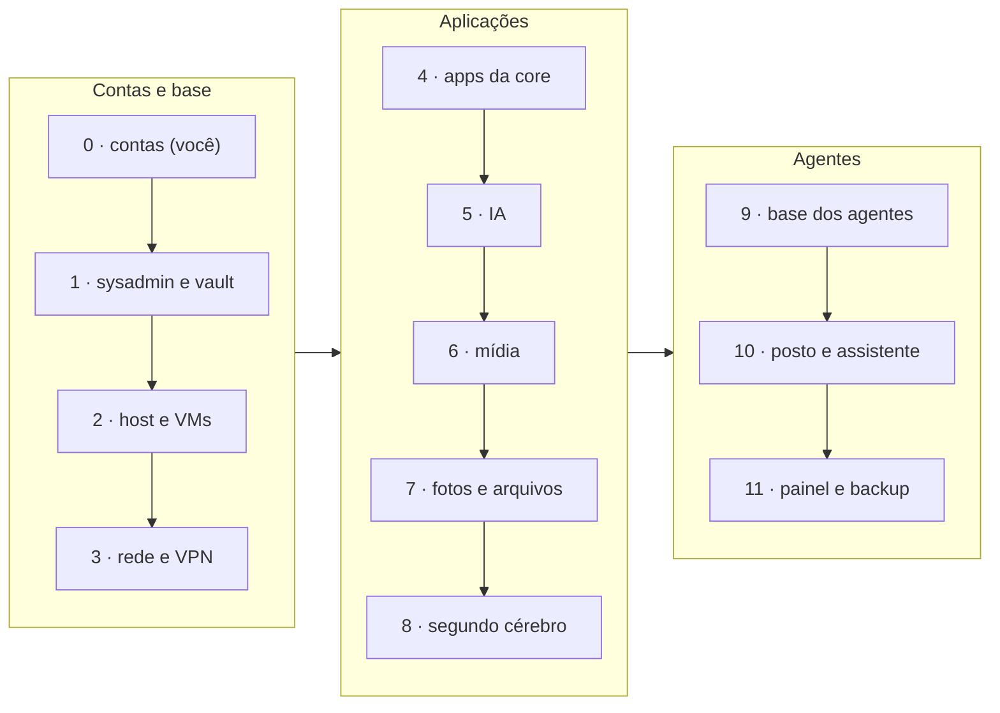

# Seção 1: Roteiro do primeiro deploy

Esta página põe tudo **na ordem da primeira subida**. As seções seguintes explicam cada parte e trazem os arquivos: a [seção 2](02-sysadmin-gcp.md) cria o sysadmin, a [seção 3](03-maquina-controle-ansible.md) é o vault, o inventário e as variáveis que ele usa, e as seções 4 a 19 são o servidor. O vault nasce do `scripts/gerar_vault.py` ([seção 3](03-maquina-controle-ansible.md#caminho-recomendado-scriptsgerar_vaultpy)), rodado pelo próprio `criar-sysadmin.sh`: como os segredos aleatórios já estão nele, os passos "gere o segredo X" das seções viram só "rode o playbook". Siga as fases em ordem; dentro de cada uma, os detalhes estão no link.

**Quem conduz.** A fase 0 é sua. A fase 1 cria o sysadmin, e dela em diante quem conduz é ele: você manda `/implantar-fase N` no Telegram, ele faz o que pode, entrega numa mensagem só o que é seu e pede o seu botão para cada `--check` e cada aplicação. Os comandos abaixo continuam sendo o que ele executa; se preferir fazer à mão, rode-os numa [máquina de controle local](03-maquina-controle-ansible.md#a-máquina-de-controle-local), a partir de `server/ansible`. Antes de cada playbook, rode-o com `--check`; depois, sem.

```bash title="Exemplo: o padrão de cada playbook"
ansible-playbook -i inventories/home/hosts.ini playbooks/<playbook>.yml --ask-vault-pass --check
ansible-playbook -i inventories/home/hosts.ini playbooks/<playbook>.yml --ask-vault-pass
```

"Stack no Portainer" quer dizer: **Stacks → Add stack** (ou **Update the stack**, se ela já existe), no ambiente indicado, com o compose do repositório no *Web editor* e o `/opt/portainer_stack_envs/<stack>.env` colado em **Environment variables → Advanced mode** ([seção 9](09-deploy-apps.md#deploy-via-portainer)).

As doze fases, em três blocos (a 0 é sua; da 1 em diante, o sysadmin conduz):



## Fase 0 — Fora do servidor

**Para criar o sysadmin**, nesta ordem (a ACL do Tailscale vem antes das chaves). O passo a passo, com telas e permissões, está em [Criar o sysadmin](02-sysadmin-gcp.md#1-o-que-você-leva-para-o-cloud-shell):

| Passo | Onde | Detalhe |
|---|---|---|
| **Projeto do GCP dedicado**, com faturamento ligado (o script cria o alerta de US$ 2) | console.cloud.google.com | [Seção 2, passo 1.1](02-sysadmin-gcp.md#11-projeto-do-google-cloud) |
| Chaves do sysadmin: Anthropic (própria, com teto de gasto no console) e Gemini (AI Studio, plano pago) | Console de cada um | [Seção 2, passo 1.2](02-sysadmin-gcp.md#12-chaves-dos-modelos) |
| **Quatro bots** no @BotFather (sysadmin, aprovações do sysadmin, avisos e assistente) e o id do seu chat | Telegram | [Seção 2, passo 1.3](02-sysadmin-gcp.md#13-bots-do-telegram) |
| Conta de máquina `lioevano-sysadmin` (2FA, colaboradora do `wiki-home-server` e do `homeserver-equipe`); *ruleset* da `main` (PR obrigatório, **1 aprovação**, aprovação do último push, sem *force push*; exceção só para você, e só por PR); `homeserver-equipe` privado com as etiquetas; o token **clássico** (`repo`) da conta de máquina e o *fine-grained* do carteiro, na sua conta | GitHub | [Seção 2, passo 1.4](02-sysadmin-gcp.md#14-github) |
| **Primeiro** a ACL de `scripts/tailscale/acl.json` e o HTTPS do tailnet; **depois** as **três chaves de uso único**, pré-aprovadas: `tag:sysadmin` (VM do GCP) e `tag:homeserver` (host), para o `criar-sysadmin.sh`, e `tag:homeserver` (core), para o vault na fase 1 | login.tailscale.com | [Seção 2, passo 1.5](02-sysadmin-gcp.md#15-tailscale), [seção 16](16-vpn-tailscale.md#primeira-configuração) |

**Para a casa** (o sysadmin pede estes valores pelo `vault_preencher` na fase 1, e o token do posto na fase 10; você só precisa tê-los à mão):

| Passo | Onde | Detalhe |
|---|---|---|
| Domínio na Cloudflare, token de API com edição de DNS e o túnel criado (token do conector) | Painel da Cloudflare | [Seção 8](08-deploy-core.md#pré-requisitos) |
| Chaves dos provedores de LLM da casa (Anthropic, OpenAI, Gemini, TypeSafe) | Console de cada um | [Seção 10](10-stack-ia.md#deploy) |
| O bot de avisos e o do assistente (já criados acima) entram no vault | Telegram | [Seção 11](11-painel-notificacoes.md#bot-do-telegram-e-importação-do-workflow), [seção 19](19-assistente.md#primeira-configuração) |
| Configuração WireGuard da ProtonVPN com NAT-PMP | account.protonvpn.com | [Seção 12](12-midia.md#primeira-configuração) |
| Disco externo para o backup e bucket B2 com chave de aplicação | Host e Backblaze | [Backup](../04-manutencao-recuperacao/02-backup-restore-estrategia.md) |
| Para os agentes de casa (posto e assistente), um token *fine-grained* da sua conta **sem** escrita neste repositório | GitHub (*Developer settings*) | [Seção 18](18-posto-agentes.md#ansible-duas-aprovações) |

## Fase 1 — Criar o sysadmin e mesclar o PR do vault

1. No Cloud Shell, `gcloud config set project <projeto>` e rode o `criar-sysadmin.sh` ([seção 2](02-sysadmin-gcp.md#2-criar-a-vm-cloud-shell)). Ele pede as chaves e os tokens da fase 0, gera o `vault.yml` cifrado com todos os segredos aleatórios e cria a VM. **Anote** o que ele mostra no gerenciador de senhas: a senha do vault, a do painel do Hermes e, do `gerar_vault.py`, a do **restic** (sem ela nenhum backup se restaura).
2. Espere a VM se configurar (20 a 40 minutos), o nó `sysadmin` aparecer no Tailscale e o bot responder. Faça o [teste de ponta a ponta da seção 2](02-sysadmin-gcp.md#teste-de-ponta-a-ponta), menos o item do `ansible_check` e do `ansible_aplicar`: ele só vale depois da fase 2 (ainda não há host).
3. Peça "abra o PR do vault" e **mescle** o PR do sysadmin com o `vault.yml` criptografado ([seção 2](02-sysadmin-gcp.md#3-o-pr-do-vault)); o `python tools/dev.py check` acusa se não estiver cifrado. O runner do `ops` e o executor leem o vault da `main`.
4. Ajuste o `group_vars/all/main.yml` **pela wiki** ([seção 3](03-maquina-controle-ansible.md#variáveis-globais-não-sensíveis-ansibleinventorieshomegroup_varsallmainyml)): IPs, gateway, CIDRs, discos, por PR do sysadmin. O `notes_nextcloud_usuario` fica para a fase 8.
5. O sysadmin pede, uma a uma, pelo `vault_preencher`, as chaves que vêm de fora e que a fase 0 trouxe: Cloudflare, `base_domain`, `letsencrypt_email`, chaves de LLM, `telegram_bot_token`, `telegram_chat_id`, `hermes_telegram_bot_token`, ProtonVPN, `tailscale_auth_key`, B2. Você responde ao **bot de aprovações**, nunca na conversa. Os tokens criados nas telas (Grafana, Portainer, Home Assistant, n8n, widgets) ficam para depois. Ao fim, mescle o novo PR do vault.

## Fase 2 — Host e VMs

1. Instale o Proxmox VE e crie o pool ZFS e os datasets, incluindo o `data/notes` da [seção 14](14-segundo-cerebro.md#deploy) ([seção 4](04-proxmox-ve-host.md)).
2. **Cole no console do host o comando do `preparar_host`** que o sysadmin lhe manda pelo bot de aprovações ([seção 2](02-sysadmin-gcp.md#4-preparar-o-host-proxmox)): Tailscale, usuário Ansible com `sudo` e a chave SSH do sysadmin. A senha de root do Proxmox (`proxmox_api_password`) entra pelo `vault_preencher`, e o PR do vault com ela é mesclado **antes** do playbook (o executor roda os playbooks com o vault da `main`). Isso substitui as [ações manuais prévias](04-proxmox-ve-host.md#ações-manuais-prévias-no-host-proxmox-essencial-para-ansible) (que só valem para quem não usa o sysadmin). Depois, `setup-proxmox-host.yml` (NFS, Alloy, restic) e, logo em seguida, a linha do firewall do PVE em [A conferir no primeiro deploy](index.md#a-conferir-no-primeiro-deploy) e o item do `ansible_check` e do `ansible_aplicar` do [teste da seção 2](02-sysadmin-gcp.md#teste-de-ponta-a-ponta).
3. Template Cloud-Init ([seção 5.1](05-provisionamento-vms.md#51-criação-de-template-de-vm-base-ubuntu-server-cloud-init)) e `vm-deploy.yml`.
4. `setup-base-ubuntu.yml` (Docker, UFW, firewall das portas do Docker, Alloy, Portainer na core e o agente na VM de IA) ([seção 6](06-configuracao-base-vms-ubuntu.md)).
5. A chave pública do runner que o `gerar_vault.py` mostrou vai para o `~/.ssh/authorized_keys` do usuário Ansible das **duas VMs** (não no host) ([seção 15](15-agentes-base.md#tokens-e-chaves)).

## Fase 3 — Rede, VPN e Portainer

1. `setup-core-networking.yml`: sobe a stack `core` (Traefik, Cloudflared, Authelia) ([seção 8](08-deploy-core.md)).
2. Public Hostnames do túnel ([seção 7.5](07-rede-segura.md#75-configuração-de-dns-na-cloudflare)); abra `auth.` e registre o 2FA. A senha do admin do Authelia é a que o `gerar_vault.py` mostrou.
3. `setup-vpn.yml` e, no painel do Tailscale, conferir as rotas (o `autoApprovers` da ACL da fase 0 já as aprova), desligar a expiração da chave e configurar o DNS ([seção 16](16-vpn-tailscale.md#primeira-configuração)). A core passa a anunciar as mesmas rotas do host (failover).
4. **Portainer, nos primeiros 5 minutos:** administrador, ambiente `local` e o agente `ai-desktop-vm`; crie o token de API e grave em `portainer_api_key` ([seção 9](09-deploy-apps.md#primeiro-acesso-ao-portainer)).

## Fase 4 — Apps da core

1. `setup-productivity-automation-volumes.yml`, `setup-n8n-volumes.yml` e `setup-monitoring-stack-volumes.yml`.
2. Stack `apps` no ambiente `local` ([seção 9](09-deploy-apps.md)).
3. Importe e ative o workflow `notificar` do n8n ([seção 11](11-painel-notificacoes.md#bot-do-telegram-e-importação-do-workflow)) e configure o Home Assistant ([seção 9](09-deploy-apps.md#notas-por-serviço)).

## Fase 5 — IA

1. `setup-ai-volumes.yml` (imagem do Ollama, LiteLLM, `ai.env`).
2. Stack `ai` no ambiente `ai-desktop-vm` ([seção 10](10-stack-ia.md#deploy)).
3. `setup-ai-keys.yml`: cria no LiteLLM **todas** as chaves do vault (Open WebUI, Claude Code, n8n, observador, agentes, assistente) com os orçamentos.
4. `docker exec -it ollama ollama pull llama3.2:3b`.

## Fase 6 — Mídia

1. `setup-media-stack-volumes.yml` e stack `media` no ambiente `local` ([seção 12](12-midia.md#deploy)).
2. **Logo em seguida**, Jellyfin e Seerr (quem chegar primeiro vira administrador); depois o resto da [primeira configuração](12-midia.md#primeira-configuração).
3. `sudo docker restart prometheus grafana`, para carregar os alertas da mídia.

## Fase 7 — Fotos e arquivos

1. `setup-photos-stack-volumes.yml`, `setup-cloud-stack-volumes.yml` e as stacks `photos` e `cloud` no ambiente `local` ([seção 13](13-fotos-arquivos.md#deploy)).
2. **Logo em seguida**, o administrador do Immich com o e-mail do Authelia; depois o Nextcloud ([primeiro acesso](13-fotos-arquivos.md#primeiro-acesso)).

## Fase 8 — Segundo cérebro

1. `notes_nextcloud_usuario` no `group_vars` (pela wiki) com o seu id no Nextcloud.
2. `setup-notes-volumes.yml`, stack `notes` no ambiente `ai-desktop-vm` e **Update the stack** da `ai` ([seção 14](14-segundo-cerebro.md#deploy)).
3. Timers `notes-documentos` e `notes-indice`, pareamento do Syncthing e os conectores do Claude.

## Fase 9 — Base dos agentes

1. Tokens nas telas: as duas service accounts do Grafana, o MCP do Home Assistant e o do n8n ([seção 15](15-agentes-base.md#tokens-e-chaves)); grave no vault.
2. `setup-agents-volumes.yml`, `setup-langfuse-volumes.yml`, `setup-ai-volumes.yml` e `setup-monitoring-stack-volumes.yml`.
3. Stack `langfuse` (ambiente `ai-desktop-vm`), **Update the stack** da `ai`, stack `agents` (ambiente `local`) e **Update the stack** da `apps` (o Grafana recebe o token do observador) ([seção 15](15-agentes-base.md#deploy), [seção 17](17-ia-observa.md#primeira-configuração)).
4. Conecte o Claude: o conector **Servidor** no claude.ai e a rota de controle no Claude Code, com o Tailscale ligado ([seção 15](15-agentes-base.md#conectar-o-claude)).

## Fase 10 — Posto e assistente

1. `setup-posto-volumes.yml` (a primeira compilação do Vibe Kanban leva dezenas de minutos) e stack `posto` no ambiente `ai-desktop-vm` ([seção 18](18-posto-agentes.md#primeira-configuração)).
2. `setup-assistente-volumes.yml` e stack `assistente` no ambiente `ai-desktop-vm`; mande `/start` ao bot ([seção 19](19-assistente.md#primeira-configuração)).

## Fase 11 — Painel e backup

1. Chaves dos widgets nas telas de cada aplicação, gravadas em `homepage_widget_keys`; `setup-monitoring-stack-volumes.yml` e **Update the stack** da `apps` ([seção 11](11-painel-notificacoes.md#chaves-de-api-dos-widgets)).
2. Rode um backup e **teste uma restauração** ([backup](../04-manutencao-recuperacao/02-backup-restore-estrategia.md)).

## Depois de cada fase

Faça o teste de ponta a ponta da seção correspondente e confira a linha dela em [A conferir no primeiro deploy](index.md#a-conferir-no-primeiro-deploy). Depois de tudo de pé, o `full-deploy.yml` reaplica a configuração inteira de uma vez (sem criar VMs nem subir stacks).
