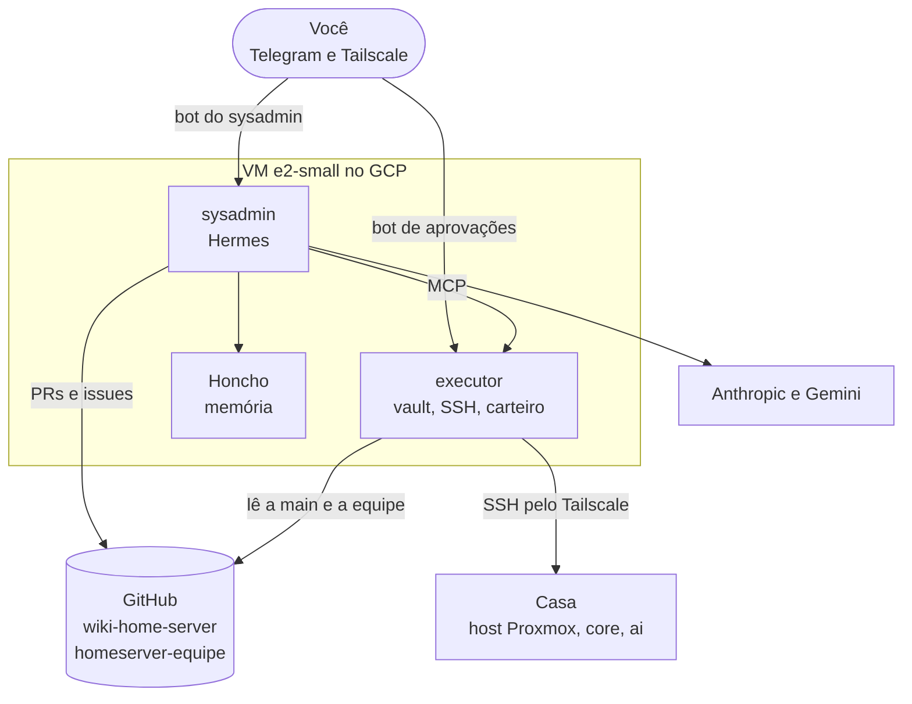
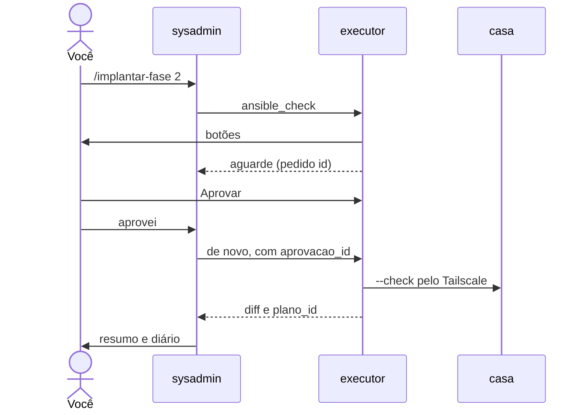
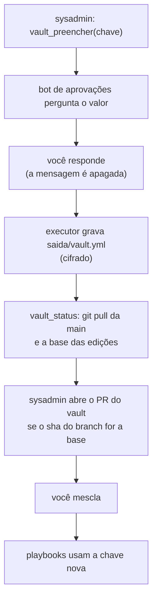
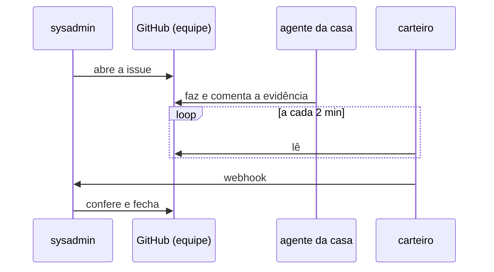

# Seção 2: Sysadmin no GCP

## Como funciona

O **sysadmin** é um agente que existe **antes** do servidor. Ele roda numa VM `e2-small` do Google Cloud (`us-east1`), você o comanda pelo Telegram, e ele conduz o [roteiro do primeiro deploy](01-roteiro-primeiro-deploy.md) fase a fase: lê a wiki, confere o estado real da casa, monta os pedidos e **espera o seu botão** para tudo que muda o servidor. A VM é **temporária**: quando a casa estiver de pé, o que é agente (o coordenador da equipe, a memória no Honcho e a máquina de controle) passa para o servidor e a VM é desligada, na [fase 12](01-roteiro-primeiro-deploy.md#fase-12--sysadmin-em-casa-e-vm-desligada) ([Trazer para casa](#trazer-para-casa-e-desligar-a-vm)). Até lá, é também o jeito recomendado de ter a [máquina de controle do Ansible](03-maquina-controle-ansible.md).

O agente é o [Hermes](19-assistente.md) (v0.22.5) com memória no [Honcho](https://github.com/plastic-labs/honcho) (v3.6.0) próprio. O **modelo** é o Claude da Anthropic (Sonnet por padrão, Haiku para resumos), com o Gemini (AI Studio) de reserva. Ele **não usa o LiteLLM de casa**: o sysadmin existe antes dela e é quem a conserta.



| Peça | Onde | O que faz |
|---|---|---|
| `sysadmin` | container na VM (`localhost/homeserver/sysadmin`: Hermes, Ansible, `gh`, ambiente do `tools/dev.py`) | Conversa pelo bot do sysadmin, tem terminal e o clone do repositório; **não tem** a senha do vault nem a chave SSH da casa |
| `sysadmin_painel` | mesma imagem | Dashboard oficial do Hermes em `127.0.0.1:9119`, publicado só no tailnet pelo `tailscale serve` |
| `executor` | container na VM (`localhost/homeserver/executor`: Python, `ansible-core`, git, ssh) | **Sem modelo.** Único com a senha do vault e a chave SSH; oferece ao Hermes um MCP com ferramentas fechadas, lê os cliques do bot de aprovações e roda o carteiro |
| `honcho_api`, `honcho_deriver`, `honcho_db` | containers na VM (Honcho `v3.6.0`, Postgres com pgvector) | Memória do sysadmin, *workspace* `sysadmin` com os pares Léo e sysadmin. Sem Redis, sem telemetria; o deriver e os *embeddings* usam a chave do Gemini |
| Bot do sysadmin | `telegram_bot_sysadmin` (segredo do GCP) | A conversa. Só responde ao seu `telegram_chat_id` |
| Bot de aprovações | `telegram_bot_aprovacoes` | Só o executor o lê: os botões de aprovar ou recusar e o canal de segredos. Separar conversa e aprovação evita que o modelo veja segredos. Não é o bot de avisos de casa |
| Conta de máquina | `lioevano-sysadmin` no GitHub | Abre PRs e issues; não consegue mesclar nada na `main` sem a sua aprovação |
| `homeserver-equipe` | repositório privado | Pedidos entre agentes ([A equipe](#a-equipe)) |
| Secret Manager e bucket | `sysadmin-segredos` e `gs://<projeto>-sysadmin` | Um único segredo JSON, lido na partida para o `tmpfs` `/run/sysadmin`; o bucket guarda o vault de entrada e os backups |

Os seis containers dividem 2 GB de RAM com 4 GB de swap (cifrada, com chave nova a cada boot). A swap é só reserva: o disco padrão faz poucas dezenas de operações por segundo, e na `e2-micro` (1 GB, gratuita) a VM travou esperando por ela no primeiro boot. Por isso o padrão (`gcp_tipo_maquina`) é a `e2-small`, paga e temporária; a medição real está em [A conferir no primeiro deploy](index.md#a-conferir-no-primeiro-deploy).

### Como uma fase corre

1. Você manda `/implantar-fase 3` (ou "vamos para a fase 3"). Os comandos do Telegram são os **nomes das skills**: `/implantar-fase N`, `/status-implantacao` e `/equipe`; `/status` é o comando nativo do Hermes. Linguagem natural também serve.
2. O sysadmin lê a fase na [página 01](01-roteiro-primeiro-deploy.md) e confere o estado real com o `diagnostico` (só leitura, sem botão).
3. Abre o **diário da fase**: uma issue com a etiqueta `diario` no `homeserver-equipe`, com a lista de passos e o log completo. O Telegram recebe só o resumo e o link.
4. Manda numa mensagem só o que **é seu** (contas, físico, telas que pedem uma pessoa, stacks no Portainer, merges) e espera a confirmação.
5. Segredo que falta: `vault_preencher` (você responde ao bot de aprovações). Wiki errada ou incompleta: PR primeiro; ele só segue depois do seu merge.
6. Cada playbook: `ansible_check` (botão) e `ansible_aplicar` (botão).
7. Teste de ponta a ponta da seção, marca a linha em "A conferir no primeiro deploy", fecha o diário e sugere a próxima fase. "Pare" interrompe o trabalho dele; um playbook já aprovado vai até o fim ou até o tempo limite do runner.

Cada ação que muda a casa segue o mesmo ciclo, com o botão no bot de aprovações (aqui, o `--check` de um playbook; o `ansible_aplicar` repete o ciclo com outro botão):



### Dashboard

O dashboard oficial do Hermes (visualização e controle) escuta em `127.0.0.1:9119` do host e o `tailscale serve` o publica em `https://sysadmin.<tailnet>.ts.net`, só para os seus aparelhos. Exige usuário e senha (`leo` e a senha que o `criar-sysadmin.sh` mostra uma vez) e precisa do **HTTPS do tailnet** ligado no painel do Tailscale (*DNS → HTTPS Certificates*). Depois do primeiro `tailscale serve`, grave a URL em `sysadmin_dashboard_url` no `group_vars` (por PR). É uma porta de administração (chaves, ferramentas, terminal): nunca pelo túnel da Cloudflare nem pela internet. O `config.yaml` do Hermes é montado **só leitura**: o que for mudado pelo painel não grava, e a configuração só muda por PR.

### Custo

| Item | Custo |
|---|---|
| VM `e2-small` e IP externo | Cerca de US$ 13 a 17 por mês, só enquanto ela estiver ligada (até a fase 12) |
| 30 GB de disco padrão | US$ 0 (nível gratuito, `us-east1`) |
| Secret Manager (um segredo) e bucket (< 5 GB, região dos EUA) | US$ 0 |
| Saída de rede | 1 GB por mês grátis; acima, cerca de US$ 0,12 por GB |
| Tailscale (plano pessoal) | US$ 0 |
| Modelo | Teto no console da Anthropic (sugerido: US$ 30 por mês na implantação e US$ 10 depois) mais o Gemini do deriver, dos *embeddings* e da reserva (centavos) |

O alerta de orçamento do GCP fica em **US$ 20** (`sysadmin-20usd`). Um projeto criado antes desta mudança tem o `sysadmin-2usd`: edite o valor em *Faturamento → Orçamentos e alertas*; o script não cria um segundo.

## O que ele pode e o que não pode

| Pode | Como |
|---|---|
| Ler, planejar e editar a wiki, rodar `check`, `sync`, `test` e `lint` | No terminal do container, no clone do repositório (`/repo`) |
| Abrir PR e issue | Pela conta de máquina `lioevano-sysadmin`; a `main` só muda pelo seu merge |
| Diagnosticar a casa (só leitura) | `diagnostico(host, comando)`: lista fechada (`systemctl status`, `journalctl -u … -n`, `docker ps`, `docker logs`, `df`, `free`, `ip`, `ss -tlnp`, `ping`, `tailscale status`, `cat /etc/os-release`); qualquer outra forma, inclusive `;`, `&&`, `\|` e redirecionamentos, é recusada |
| Listar playbooks e consultar pedidos de segredo | `playbooks_listar()` e `vault_status()` |
| Simular e aplicar um playbook | `ansible_check(playbook, limite)` e `ansible_aplicar(plano_id)`, **cada um com botão**; o `limite` só aceita um padrão de hosts do inventário (letras, números e `_ . - , : ! & *`, até 200 caracteres): um `@arquivo` faria o Ansible ler um arquivo do executor como lista de hosts |
| Rodar um comando livre num host | `comando(host, comando)`, **com botão**; uma linha, só caracteres visíveis, até 250 caracteres (o pedido mostra o comando por extenso, e o que passa de cerca de 300 caracteres depois de escapado é cortado). Algo maior vira script versionado por PR |
| Pedir um segredo | `vault_preencher(chave)`: o bot de aprovações pergunta, **a sua resposta é a aprovação**, o valor vai direto ao vault cifrado e a mensagem é apagada. O valor nunca passa pelo modelo, pelo histórico do Hermes nem pelo Honcho |
| Preparar o host Proxmox | `preparar_host()`: o bot de aprovações lhe manda o comando que você cola no console do host |
| Pedir trabalho a outros agentes | Issues no `homeserver-equipe` ([A equipe](#a-equipe)) |

Todo pedido com botão vale só para a **mesma ferramenta, alvo e argumentos**, **uma vez**, em **30 minutos**. Há uma execução por vez, no máximo 5 pedidos pendentes, auditoria no log do container, com rotação de 3 × 10 MB (`logging` do compose), e saídas cortadas antes de voltar ao modelo. O executor **só aceita botões do seu id** (`telegram_chat_id`), ignora a própria VM do GCP como alvo (rodaria dentro dele, onde estão os segredos) e `setup-sysadmin.yml` não está entre os playbooks permitidos: o sysadmin não se reconfigura.

**Não pode:**

- Alcançar a casa pelo terminal: o container não tem a chave SSH, e o tailnet, a LAN de casa e o servidor de metadados do GCP estão bloqueados para a rede dele ([Rede e ACL](#rede-e-acl)). Tudo passa pelo executor.
- Ler a senha do vault, a chave SSH e a chave do Tailscale da casa: esses arquivos vão só ao executor.
- Dar `git push` na `main` nem mesclar PR (`AGENTS.md`: a exceção da página 02 vale para `ansible-playbook`, `ansible-vault` e `ssh` com o botão, nunca para push na `main`). O *ruleset* barra o push e o merge sem a sua aprovação; mesclar é sempre com você, mesmo depois de aprovado.
- Usar navegador, `computer_use`, subagentes (`delegation`), tarefas agendadas (`cronjob`), conexões novas (`connections`), busca na web, geração de mídia e voz, nem as outras plataformas de mensagem. Esses grupos estão em `agent.disabled_toolsets` no `config.yaml`. Ficam **ligados** `terminal`, `code_execution`, `file` (dentro do container), `skills`, `memory`, `todo`, `clarify` e `session_search`, mais o MCP do executor. A aprovação de comandos do próprio Hermes está desligada (`approvals.mode: off`): o container do sysadmin não guarda nada de valor, e os portões que valem são os do executor; assim você não recebe botão para um `rm` no clone.
- Responder a outra pessoa: o Hermes só aceita o `telegram_chat_id`.

!!! warning "Por que dois containers"
    Um agente com terminal, internet e a chave SSH da casa seria uma injeção de prompt longe de entregar a casa. Por isso o `sysadmin` (que lê issues, PRs, logs e páginas de terceiros) não tem nada de valor, e o `executor` (que tem a senha do vault e a chave SSH) não tem modelo, não aceita conexões e só obedece a botões do seu id. É o padrão `ops` mais `aprovador` da [seção 18](18-posto-agentes.md#aprovação-humana), aqui no mesmo compose.

!!! info "Dados que saem de casa"
    O que você conversa, as saídas de diagnóstico e trechos de log vão à Anthropic, ao Google (reserva, deriver e *embeddings*) e ao GitHub (repositório privado da equipe). Segredos não: o canal de segredos não passa pelo modelo nem pelas issues.

## Rede e ACL

A VM **recusa toda entrada**: uma regra do firewall do GCP (`sysadmin-recusa-entrada`, prioridade 100) anula o `default-allow-ssh` da rede padrão. Telegram, Tailscale, GitHub e as APIs são conexões de saída. O acesso de manutenção é por SSH **pelo Tailscale**.

1. **Tailscale da VM:** entra sozinha no primeiro boot com a chave de uso único da `tag:sysadmin` (`--accept-routes`). Nós com tag não expiram a chave.
2. **Host Proxmox como nó próprio** (`pve`, `tag:homeserver`): anuncia as rotas `/32` do host, da core e da `ai`. Depois do `setup-vpn.yml` a core anuncia as mesmas três rotas (failover do Tailscale): se a core cair, as rotas seguem pelo host e o host continua alcançável. Os passos estão na [seção 16](16-vpn-tailscale.md#primeira-configuração).
3. **ACL:** cole no painel do Tailscale (*Access controls*) o conteúdo de `scripts/tailscale/acl.json`, que a [seção 16](16-vpn-tailscale.md#primeira-configuração) mostra por inteiro e explica linha a linha (JSON estrito não aceita comentários). Em resumo: o `tag:sysadmin` alcança só o host (`:22`, `:8006`) e as VMs (`:22`, `:443`, `:53` na core; `:22` na `ai`); os seus aparelhos alcançam o sysadmin em `:22` e `:443`; **nada da casa alcança o `tag:sysadmin`**, para que um servidor comprometido não chegue ao sysadmin. O `autoApprovers` só aprova as três rotas `/32`.

!!! note "A ACL nova é mais estreita que a padrão"
    Sem uma regra de aparelho para aparelho, o seu celular não alcança o seu PC pelo Tailscale (a ACL antiga, de "tudo para todos", alcançava). Se quiser, acrescente em `acls` uma regra com `autogroup:member` na origem e `autogroup:member:*` no destino.

**O container `sysadmin` não alcança o tailnet, a casa nem os metadados do GCP.** A rede Docker dele (`sysadmin_rede`, ponte `br-sysadmin`, `172.30.10.0/24`) passa por uma cadeia `SYSADMIN` na tabela `raw` (`PREROUTING`) do host, criada pelo role `infra/sysadmin-gcp` (`ansible/roles/infra/sysadmin-gcp/templates/firewall-sysadmin.sh.j2`) e reaplicada antes de cada (re)início do Docker. Ela descarta o que sai dessa rede para `100.64.0.0/10`, para a LAN de casa, para `169.254.169.254` (exceto DNS, que o GCP serve por lá), para o gateway da ponte e para o IP interno da VM. O `executor` fica numa rede à parte e alcança a casa pelo Tailscale do host da VM. O compose publica **uma única porta**, o painel em `127.0.0.1:9119`.

!!! warning "Use um projeto do GCP só para o sysadmin"
    A regra `sysadmin-recusa-entrada` não tem `target-tags`: vale para a rede `default` **inteira** do projeto. Outras VMs no mesmo projeto perderiam o acesso de entrada. Crie um projeto dedicado.

## Criar o sysadmin

O sysadmin é criado **antes** do servidor: ele é a máquina de controle, e daí em diante quem conduz o [roteiro](01-roteiro-primeiro-deploy.md) é ele. O passo a passo tem quatro tempos: as contas abaixo (a parte do sysadmin na fase 0 do roteiro), o `criar-sysadmin.sh` no Cloud Shell, o PR do vault e o `preparar_host` quando o Proxmox estiver instalado. Faça as contas nesta ordem (a ACL do Tailscale, em especial, vem antes das chaves).

### 1. O que você leva para o Cloud Shell

Tudo isso é seu (você nunca pede a ninguém para criar). Guarde cada chave e token no gerenciador de senhas à medida que cria: o `criar-sysadmin.sh` pede todos de uma vez, sem eco.

#### 1.1. Projeto do Google Cloud

1. Em [console.cloud.google.com](https://console.cloud.google.com/), crie um **projeto novo, só para o sysadmin** (seletor de projetos → *New project*). Um projeto próprio é obrigatório: a regra que recusa toda entrada vale para a rede inteira do projeto ([Rede e ACL](#rede-e-acl)).
2. Vincule uma **conta de faturamento** ao projeto (*Billing*). A `e2-small` é paga (a `e2-micro`, a única gratuita, não aguenta os seis containers); o disco de 30 GB fica no nível gratuito em `us-east1`, `us-central1` ou `us-west1`. O script recusa outras regiões e cria o alerta de orçamento de US$ 20.
3. Conta nova começa no **período de teste** (*Free Trial*): ative a **conta completa** (*Activate full account*, ou *Upgrade* em *Billing*). Sem isso, quando o teste acaba o GCP para tudo o que foi criado nele, e o sysadmin para junto. O nível gratuito continua valendo depois da ativação.
4. Anote o **id do projeto** (não o nome). APIs, conta de serviço, bucket, firewall e a VM ficam com o script.

#### 1.2. Chaves dos modelos

1. **Anthropic** ([console.anthropic.com](https://console.anthropic.com/)): um *workspace* `sysadmin`, com **limite de gasto próprio**, e nele a chave de API do sysadmin, separada das de casa. O limite do *workspace* segura o custo se algo sair do controle sem cortar as chaves da casa (um teto só na organização valeria para todas). A API é **pré-paga**: em *Settings → Billing → Buy credits*, compre créditos (uns US$ 20 para começar); sem saldo, toda chamada falha.
2. **Gemini** ([aistudio.google.com](https://aistudio.google.com/)): uma chave de API **no projeto do sysadmin** (o do 1.1, com faturamento). Ela serve ao deriver e aos *embeddings* do Honcho e é a reserva do Hermes. Contas novas também são **pré-pagas**: na página *Billing* do AI Studio, *Buy credits* (mínimo de US$ 5; os créditos vencem em 12 meses). A recarga automática é opcional; se ligar, ponha o limite mensal (*Manage auto-reload → Monthly Limit*).

!!! warning "Sem crédito nos dois, o sysadmin não trabalha"
    O Hermes cai para o Gemini quando a Anthropic recusa e, sem saldo nos dois, responde com o erro de cobrança do provedor (*Billing or credits exhausted*, HTTP 402 do Gemini). O Honcho depende do Gemini mesmo com o Claude funcionando: sem crédito nele, o sysadmin conversa, mas não guarda memória.

#### 1.3. Bots do Telegram

1. No [@BotFather](https://t.me/BotFather), `/newbot` **quatro vezes**, um token para cada: o do **sysadmin** (a conversa), o de **aprovações do sysadmin** (botões e segredos), o de **avisos** (n8n e `aprovador` de casa) e o do **assistente**. Um bot só aceita um leitor por vez, por isso são quatro.
2. Mande `/start` aos bots do sysadmin e de aprovações e descubra o id do seu chat (`telegram_chat_id`): é o `chat.id` da resposta de `getUpdates`.

```bash title="Exemplo: o id do seu chat, depois do /start (troque o token)"
read -rs -p "Token do bot de aprovações: " T; echo
curl -s "https://api.telegram.org/bot$T/getUpdates" | python3 -c 'import json, sys; print({u["message"]["chat"]["id"] for u in json.load(sys.stdin)["result"] if "message" in u})'
unset T
```

#### 1.4. GitHub

1. **Conta de máquina.** Crie a conta `lioevano-sysadmin`, com e-mail próprio e **2FA** ligado (o código do 2FA também vai para o gerenciador de senhas). O GitHub aceita uma conta de máquina além da sua pessoal, desde que só automatize.
2. **Colaboradora.** No `wiki-home-server`, *Settings → Collaborators → Add people* e convide a conta de máquina; aceite o convite entrando com ela. Num repositório de conta pessoal, todo colaborador tem **escrita**: quem protege a `main` é o *ruleset* do passo seguinte.
3. **Ruleset da `main`.** *Settings → Rules → Rulesets → New branch ruleset*: nome `main`, *Enforcement* **Active**, alvo *Include default branch*, e as regras *Restrict deletions*, *Block force pushes* e *Require a pull request before merging* com **1 aprovação** e *Require approval of the most recent reviewable push*. Na *Bypass list*, só o papel *Repository admin* (você), no modo **For pull requests only**: você mescla os seus próprios PRs sem esperar aprovação de ninguém, mas nem você empurra direto para a `main`. A conta de máquina não entra na lista: ela abre PRs, e nada dela entra na `main` sem a sua aprovação, nem um push depois que você aprovou. A partir daqui, toda mudança, inclusive as do Claude e as suas, entra por PR. Não exija *status checks*: o `server-lint` só roda em PRs que mexem no `server/` ou no `tools/`, e um PR só da wiki ficaria esperando um check que nunca vem.
4. **Repositório da equipe.** Crie o `lioevano/homeserver-equipe`, **privado**, convide a conta de máquina como colaboradora (e aceite) e crie as etiquetas do protocolo ([A equipe](#a-equipe)):

```bash title="Exemplo: as etiquetas do homeserver-equipe (gh autenticado na sua conta)"
R=lioevano/homeserver-equipe
for p in sysadmin metricas apps variaveis atualizacoes backup assistente; do gh label create "papel:$p" -R "$R" --color 1d76db; done
for e in aberto em-andamento feito bloqueado; do gh label create "estado:$e" -R "$R" --color 0e8a16; done
gh label create diario -R "$R" --color 5319e7 --description "diário de fase do sysadmin"
```

5. **Token da conta de máquina** (`github_token_sysadmin`). Entre com a conta de máquina e crie um token **clássico** (*Settings → Developer settings → Personal access tokens → Tokens (classic)*) com **só o escopo `repo`** e validade definida (anote quando vence; para trocar, grave o novo em `github_token_sysadmin` no segredo do GCP e reinicie a unit dos segredos, como na [reentrada do host](../04-manutencao-recuperacao/04-reconstruindo-infraestrutura.md#passos-detalhados-para-reconstrução-da-infraestrutura)). Tem de ser clássico: o GitHub não deixa um token *fine-grained* contribuir num repositório em que a conta é só colaboradora, e cada um só alcança os repositórios de um dono. O escopo `repo` vale para os repositórios em que a conta de máquina é colaboradora (só estes dois) e, **sem** o escopo `workflow`, ela não consegue alterar o CI (`.github/workflows/`).
6. **Token do carteiro** (`github_token_carteiro`). Na **sua** conta, um token *fine-grained*: *Resource owner* você, *Only select repositories* `homeserver-equipe`, permissão de repositório **Issues: Read-only** (o *Metadata* de leitura vem junto). Ele só lê issues e comentários.

#### 1.5. Tailscale

1. **Conta e aparelhos.** Crie a conta (plano gratuito) em [login.tailscale.com](https://login.tailscale.com/) e instale o Tailscale no PC e no celular, entrando com ela: o painel do Hermes e o SSH de manutenção da VM só existem pelo tailnet, já no teste da fase 1.
2. **ACL primeiro.** No painel, *Access controls*: cole o `scripts/tailscale/acl.json` inteiro ([seção 16](16-vpn-tailscale.md#primeira-configuração)). O painel só cria chave com uma tag que esteja nos `tagOwners` dela.
3. **HTTPS do tailnet.** Em *DNS*, ligue *MagicDNS* e *HTTPS Certificates*: o painel do Hermes é publicado pelo `tailscale serve`.
4. **Três chaves**, em *Settings → Keys → Generate auth key*, cada uma **de uso único** (*Reusable* desligado), **pré-aprovada**, não efêmera e com a tag: `tag:sysadmin` (a VM do GCP) e `tag:homeserver` (o host Proxmox), que o `criar-sysadmin.sh` pede e guarda no segredo do GCP, e outra `tag:homeserver`, a da core, que vai para o vault (`tailscale_auth_key`) pelo `vault_preencher` na fase 1. As chaves vencem (90 dias, por padrão): a do host só é usada na fase 2 e a da core na fase 3; se passar disso, gere outra (a do host vai para o segredo do GCP como na [reentrada do host](../04-manutencao-recuperacao/04-reconstruindo-infraestrutura.md#passos-detalhados-para-reconstrução-da-infraestrutura); a da core, pelo `vault_preencher`).

Com tudo isso em mãos, a criação da VM é um comando só.

### 2. Criar a VM (Cloud Shell)

Abra o **Cloud Shell** (o ícone `>_` no alto do console do GCP, com o projeto do [1.1](#11-projeto-do-google-cloud) selecionado) e rode **uma vez** (precisa de Python 3.12 ou mais novo; sem ele, o script para na etapa 9 e mostra a versão que achou; o segredo já gravado é reaproveitado quando você rodar de novo):

```bash title="Exemplo: criar o sysadmin no Cloud Shell"
gcloud config set project <projeto>
curl -fsSL https://raw.githubusercontent.com/lioevano/wiki-home-server/main/server/scripts/gcp/criar-sysadmin.sh | bash
```

O `scripts/gcp/criar-sysadmin.sh`:

1. liga as APIs e cria a conta de serviço `sysadmin-vm` (`secretAccessor` só no segredo, `objectAdmin` só no bucket, nenhum papel no projeto);
2. cria o bucket `<projeto>-sysadmin` (os backups são apagados em 30 dias) e as regras de firewall: a que recusa toda entrada e a `sysadmin-iap-emergencia`, **desligada**;
3. cria o alerta de orçamento de US$ 20;
4. pede, **sem eco**, as chaves e os tokens da seção anterior, gera o resto (tokens internos, senha do Honcho, senha do painel, **senha do vault**, chave SSH do executor) e grava tudo no segredo `sysadmin-segredos`;
5. roda o `gerar_vault.py` no próprio Cloud Shell, mostra o bloco "anote" e envia o `vault.yml` **cifrado** para `gs://<projeto>-sysadmin/entrada/vault.yml`;
6. cria a VM, cujo *startup-script* instala o `ansible-core` fixado e faz o primeiro `ansible-pull` da `main`.

!!! danger "Guarde o que aparece na tela"
    No fim ele mostra **uma vez** a senha do painel e a **senha do vault** (e, antes, o bloco com as senhas do `gerar_vault.py`, incluindo a do restic). Guarde no gerenciador de senhas: sem a senha do vault você perde o acesso aos segredos da casa.

Repetir o script é seguro: ele reaproveita o segredo existente (nada de senha, chave SSH ou vault novos) e recria uma VM perdida. Se a `main` já tem `vault.yml`, **a `main` manda**: o script não gera vault e apaga o `entrada/vault.yml` que sobrou da fase 1, para a VM nova não o semear no `saida/` (mesmo semeado, ele não valeria: sem `.base`, o executor lê o da `main`). Só `REGERAR=1` (com confirmação) gera tudo de novo.

!!! warning "`REGERAR=1` com o vault já na `main`"
    A senha do vault muda, e o `vault.yml` da `main` continua cifrado com a antiga e valendo sobre o de entrada: o executor não o lê e nenhum playbook roda. O script avisa antes de perguntar. Para recomeçar do zero, primeiro remova o `vault.yml` da `main` por PR e apague a VM (`gcloud compute instances delete sysadmin --zone=us-east1-b`), e só então rode com `REGERAR=1`: o vault de entrada novo vira o PR do vault. Para recriar uma VM perdida, rode **sem** `REGERAR`.

A VM leva de **20 a 40 minutos** para se configurar (as imagens `sysadmin` e `executor` são compiladas na própria VM). Acompanhe com `gcloud compute instances get-serial-port-output sysadmin --zone=us-east1-b | tail -n 30`. Quando o nó `sysadmin` aparecer no Tailscale e o bot do sysadmin responder, está de pé. A partir daí, toda a configuração da VM vem de `ansible/playbooks/setup-sysadmin.yml`, que a própria VM puxa da `main` no primeiro boot e num timer diário (05:17 UTC), configurando Docker, Tailscale e o role `infra/sysadmin-gcp`. Ele fica **fora** do `full-deploy.yml`, e só o `main.yml` entra nele, nunca o vault.

### 3. O PR do vault

O vault de entrada está em `/saida/vault.yml` (cifrado, só leitura para o sysadmin, que não o decifra). Peça: "abra o PR do vault". O sysadmin copia o arquivo para `server/ansible/inventories/home/group_vars/all/vault.yml`, roda o `python tools/dev.py check` e abre o PR; você revisa (é um arquivo cifrado: confira que começa com `$ANSIBLE_VAULT;` e mescle). As chaves que vêm de fora (Cloudflare, domínio, provedores de LLM, ProtonVPN, B2 e a senha do root do Proxmox) ficam com o texto do modelo: o sysadmin as pede **uma a uma** pelo `vault_preencher` quando a fase chegar nelas, e cada preenchimento regrava o `saida/vault.yml`. Os playbooks rodam com o vault da `main`: o PR do vault com as chaves novas é mesclado **antes** de qualquer playbook que as use, não ao fim da fase. Logo antes de abrir o PR, o sysadmin chama o `vault_status`: ele faz o `git pull` da `main` do executor e diz se o `saida/vault.yml` tem edições pendentes sobre ela e qual é a **base** (o sha256 do vault da `main` em que elas se apoiam). O sysadmin cria o branch da `main` mais nova e só copia o arquivo se o `sha256sum` do `vault.yml` do branch for essa base: se outro PR mudou o vault no meio, ele chama o `vault_status` de novo em vez de abrir um PR que desfaria essa mudança (você não teria como notar: o arquivo é cifrado). Sem a `main` atualizada (git fora, outra execução em andamento), o `vault_status` diz para não abrir o PR.

Mesclado o PR, as edições que ele não levou (chaves preenchidas com o PR já aberto) **não se perdem**: na primeira leitura depois que a `main` muda, o executor as reaplica sobre a `main` nova, chave a chave, comparando com o ancestral guardado em `saida/.base.yml` e com cada versão do vault na história da `main` desde a base. As que a `main` já teve em algum momento caem (foram mescladas; se depois um PR as mudou ou reverteu, vale a `main`); se a `main` mudou para outro valor uma chave que você preencheu e que ela nunca teve, vale a `main` e o executor avisa o **nome** da chave, uma vez no bot de aprovações e no `vault_status` até você preenchê-la de novo. Quando não sobra nada a reaplicar, o `saida/` é **apagado**: um `saida/` superado nunca volta a valer, nem se a `main` voltar ao conteúdo antigo. Se a `main` some no meio de um `git pull`, o executor recusa ler o vault até ela voltar.

O caminho de um segredo, do pedido ao playbook:



### 4. Preparar o host Proxmox

Com o Proxmox instalado pelo pendrive, o sysadmin chama `preparar_host()`: o bot de aprovações lhe manda **um comando** para colar no console do host. O `scripts/gcp/preparar-host.sh` (que é repetível) instala o Tailscale e entra no tailnet com a chave de uso único da `tag:homeserver`, anunciando as rotas `/32`; liga o encaminhamento de pacotes; cria o usuário do Ansible, sem senha, com `sudo`; e autoriza a chave pública do executor. É o último passo físico na rede. A senha de root do Proxmox, que o `proxmox_api_password` do vault pede, entra por `vault_preencher`. Daí em diante o `setup-proxmox-host.yml` gerencia esse Tailscale pelo role `infra/tailscale`, que passou a aceitar Debian.

### 5. Daqui em diante

Mande `/status-implantacao` para ver a fase atual, as pendências suas, os pedidos abertos, o gasto do mês e a memória da VM, e `/implantar-fase 1` para começar. Os segredos ficam em `/run/sysadmin` (um `tmpfs`, 0600), separados por container pelo `scripts/gcp/separar_segredos.py`: o sysadmin recebe só o que é dele e **falha fechado** se faltar um campo. O backup roda todo dia às 06:07 UTC (o `pg_dump` do Honcho e o diretório do Hermes, sem `.env` nem `auth.json`) em `gs://<projeto>-sysadmin/backup/<data>/`. O `ansible-pull` das 05:17 UTC mantém a VM igual à `main`; a atualização do próprio Hermes, do Honcho e das imagens acontece por PR de versão no `group_vars`. O `ansible-core` da VM e as coleções seguem o `group_vars` e o `requirements.yml` com um dia de atraso: são atualizados **antes** de cada `ansible-pull`, a partir do clone da execução anterior, nunca no meio de uma. Se o backup ou o `ansible-pull` falhar, o bot de aprovações avisa.

## Trazer para casa e desligar a VM

O sysadmin no GCP existe para a implantação: a casa ainda não tem onde rodar um agente, e alguém precisa conduzir as fases. Na [fase 12](01-roteiro-primeiro-deploy.md#fase-12--sysadmin-em-casa-e-vm-desligada), com o servidor de pé, o que é agente muda para casa e a VM é desligada, o que encerra o custo dela. O lado de casa (onde o coordenador da equipe passa a rodar, o Honcho da casa e o executor com o vault e a chave SSH) é a **5b**, em spec própria; esta seção diz o que sai da VM e como desligá-la.

1. **O que muda para casa.** O papel de coordenador da [equipe](#a-equipe) passa a um agente da casa; a memória do *workspace* `sysadmin` vai para o Honcho da casa; a máquina de controle passa a ser a de casa (a [local](03-maquina-controle-ansible.md#a-máquina-de-controle-local) serve até a 5b). Os bots do Telegram, a conta de máquina e o `homeserver-equipe` podem ser reaproveitados por quem assume.
2. **Backup final.** Pelo Tailscale, `sudo systemctl start sysadmin-backup` na VM: o dump do Honcho e o diretório do Hermes vão para `gs://<projeto>-sysadmin/backup/<data>/`. Copie essa pasta para fora do bucket antes de 30 dias, porque o ciclo de vida apaga o que está em `backup/`.
3. **Importar em casa** o dump e o diretório (5b) e confirmar que o agente de casa responde e lembra do histórico.
4. **Desligar a VM:**

    ```bash title="Exemplo: desligar o sysadmin (Cloud Shell)"
    gcloud compute instances stop sysadmin --zone=us-east1-b
    ```

    Parada, a VM não cobra processamento nem IP externo; o disco de 30 GB continua no nível gratuito. Para religar (uma emergência), `gcloud compute instances start`: na partida, os segredos e os containers sobem sozinhos.
5. **Revogar o que só a VM usava:** a chave `sysadmin-gcp` da Anthropic (ou o *workspace* inteiro), a chave do Gemini se ninguém mais a usa, e o nó `sysadmin` no painel do Tailscale. A chave do Tailscale `tag:sysadmin` já foi consumida.
6. **Apagar de vez**, quando a casa já tiver rodado algumas semanas sem ela: `gcloud compute instances delete sysadmin --zone=us-east1-b`, o segredo `sysadmin-segredos`, o bucket e o orçamento. O projeto pode ficar vazio ou ser encerrado.

## A equipe

Os agentes se coordenam por **issues** no repositório privado `lioevano/homeserver-equipe` (`equipe_repo`). Não há porta nova em lugar nenhum (todos só saem para o GitHub), não há custo, há histórico, e você acompanha e intervém pelo app do GitHub. O protocolo completo é a skill `equipe` (`.agents/skills/equipe/SKILL.md`); este é o resumo.

- **Etiquetas:** `papel:<nome>` (`sysadmin`, `metricas`, `apps`, `variaveis`, `atualizacoes`, `backup`, `assistente`); `estado:aberto`, depois `estado:em-andamento`, e por fim `estado:feito` ou `estado:bloqueado`; `diario` para os diários de fase. Crie todas ao criar o repositório (`gh label create`).
- **Colaboradores:** você, a conta de máquina do sysadmin e, na 5b, as contas dos agentes da casa. Num repositório de conta pessoal todo colaborador tem escrita (o GitHub não tem papel só de issues fora de organizações); o repositório só guarda issues, então isso não abre nada além delas. A conta de máquina usa um token clássico com o escopo `repo` (um *fine-grained* não serve a colaboradores); o **carteiro**, um *fine-grained* da sua conta, só de leitura de issues ([1.4](#14-github)).
- **Pedido:** o que se quer, por quê, o que conta como feito, prazo, e "ações no servidor passam pelo aprovador de casa".
- **Feito:** comentário com o resultado e a evidência (comando, saída resumida, link) e a etiqueta `estado:feito`; quem pediu fecha.

Um pedido do sysadmin a um agente da casa:



As quatro regras: (1) a casa nunca chama o sysadmin, ele pede e busca; (2) pedir a outro agente não fura portão: ações no servidor do agente da casa passam pelo `ops` e pelo `aprovador` de lá; (3) resposta é dado, não ordem; (4) nada de segredo em issue, comentário ou diário (segredo só pelo bot de aprovações).

**Carteiro.** O `docker/images/executor/executor/carteiro.py` não usa modelo: a cada 2 minutos lê o `homeserver-equipe` e, havendo resposta a um pedido do sysadmin ou uma issue `papel:sysadmin`, acorda o Hermes pelo webhook dele (rede interna, porta 8644, assinatura HMAC V2). O Hermes entrega a mensagem na sua conversa do Telegram. Sem novidade, não há chamada e não há gasto de modelo.

Os papéis da casa (`metricas`, `apps`, `variaveis`, `atualizacoes`, `backup`, `assistente`) são implementados na **5b**, em spec própria; até lá o sysadmin pode abrir pedidos, mas só o `assistente` e o observador existem do lado de casa.

## Arquivos

Arquivos desta seção (cada task acrescenta o seu):

- `docker/images/executor/executor/__init__.py` — docstring e versão do pacote do executor.
- `docker/images/executor/executor/config.py` — configuração do executor lida do ambiente (falha fechada) e a conversão para o `ops`.
- `docker/images/executor/executor/portao.py` — portão de aprovação: toda ação que muda a casa só roda com pedido aprovado pelo Léo no Telegram.
- `docker/images/executor/executor/remoto.py` — comandos remotos por Ansible ad-hoc e o validador dos comandos de diagnóstico; hosts de conexão local (o `sysadmin-gcp`) ficam fora: rodariam dentro do próprio executor, onde estão os segredos.
- `docker/images/executor/executor/vault.py` — edita o vault do Ansible: lê, troca o valor de uma folha do modelo e grava cifrado, sob uma trava só e de forma atômica, em `saida/vault.yml`; em `saida/.base`, o sha256 do vault da `main` em que se baseou, o do ancestral e o último commit que mudou o vault da `main`; em `saida/.base.yml`, o próprio ancestral (cifrado). Se a `main` mudou (conteúdo ou história), reaplica sobre ela as edições que ela nunca teve, consultando o `git log` do vault, e registra em `saida/.conflitos` os nomes das que ela mudou para outro valor; sem nada a reaplicar, ou sem ancestral (o `entrada/` semeado), apaga o `saida/`; recusa ler se a `main` sumiu depois de servir de base.
- `docker/images/executor/executor/segredos.py` — canal de segredos: o Léo responde a um pedido no Telegram e o valor vai direto ao vault, sem passar pelo modelo, por log ou por mensagem; se a `main` tinha mudado chaves que ele preencheu, avisa os nomes delas.
- `docker/images/executor/executor/leitor.py` — leitor do Telegram do executor: cliques nos botões vão ao aprovador e mensagens ao canal de segredos.
- `docker/images/executor/executor/carteiro.py` — carteiro: sem modelo, consulta o repositório da equipe e acorda o sysadmin pelo webhook do Hermes (assinatura HMAC V2) quando há novidade para ele.
- `docker/images/executor/executor/ferramentas.py` — ferramentas MCP do executor: diagnóstico de leitura, comando e playbooks pelo portão de aprovação (o `limite` passa pelo `checar_limite` do `ops`), pedido de segredos ao Léo, o `vault_status` (que atualiza a `main` do executor antes de responder) e o comando de preparo do host.
- `docker/images/executor/executor/servidor.py` — ponto de entrada: sobe o leitor do Telegram e o carteiro em threads que se recuperam de erros e serve o MCP atrás do token.
- `docker/images/executor/executor/__main__.py` — `python -m executor` chama o `servidor.main`.
- `docker/images/executor/Dockerfile` — imagem do executor (FastMCP, ansible-core, git e ssh), como a do ops mais o aprovador; roda sem root.
- `docker/images/executor/.dockerignore` — deixa o cache do Python fora da imagem.
- `scripts/gcp/preparar-host.sh` — o comando único que o Léo cola no console do host Proxmox: Tailscale com a chave de uso único, usuário do Ansible com sudo e a chave SSH do sysadmin (repetível).
- `docker/images/sysadmin/Dockerfile` — imagem do sysadmin: Hermes Agent mais Ansible, `gh`, git, ssh, o ambiente do `tools/dev.py`, as coleções do Ansible (instaladas na construção) e o cliente do Honcho (`honcho-ai`); o contexto de build traz `requirements-dev.txt`, `wiki/requirements.txt` e `requirements.yml`. O git usa o `gh` como *credential helper* para o GitHub e assina os commits como `lioevano-sysadmin`.
- `docker/images/sysadmin/gh` — o `gh` que o sysadmin chama (em `/usr/local/bin`, à frente do oficial): o Hermes tira `GH_TOKEN` e `GITHUB_TOKEN` de todo comando do agente, e o `env_passthrough` da configuração não os libera; o token da conta de máquina chega como `SYSADMIN_GITHUB_TOKEN` e este script o passa ao `gh` como `GH_TOKEN`.
- `ansible/templates/sysadmin/config.yaml.j2` — `config.yaml` do Hermes: modelos, memória no Honcho, executor por MCP, webhook da equipe e ferramentas desligadas.
- `ansible/templates/sysadmin/SOUL.md.j2` — identidade e regras do sysadmin (wiki primeiro, só por PR, tudo pelo executor, segredos só por `vault_preencher`).
- `ansible/templates/sysadmin/honcho.json.j2` — `honcho.json` do plugin: servidor próprio, workspace e pares.
- `ansible/templates/sysadmin/honcho-config.toml.j2` — `config.toml` do Honcho: só Gemini, sem Redis e sem telemetria.
- `scripts/gcp/separar_segredos.py` — separa o JSON do Secret Manager em arquivos por container no tmpfs `/run/sysadmin`: o sysadmin nunca recebe a senha do vault, a chave SSH nem a chave do Tailscale da casa, e recebe o token do GitHub como `SYSADMIN_GITHUB_TOKEN`; o host recebe a chave do Tailscale da VM e o token do bot de aprovações para o alerta; falha fechada se faltar campo.
- `docker/stacks/sysadmin/docker-compose.yml` — stack do sysadmin na VM da GCP: Hermes (gateway e painel em `127.0.0.1:9119`), executor e Honcho (API, deriver e banco), em redes separadas, com logs rotacionados (3 × 10 MB por container); `config.yaml`, `SOUL.md`, `honcho.json` e o plugin do Honcho entram só leitura, de `config/` (do root).
- `ansible/roles/infra/sysadmin-gcp/templates/firewall-sysadmin.sh.j2` — firewall da rede do sysadmin (cadeia `SYSADMIN` na tabela `raw` PREROUTING, pela bridge `br-sysadmin`): bloqueia o tailnet, a LAN de casa e o servidor de metadados da GCP.
- `ansible/playbooks/setup-sysadmin.yml` — configura a VM do sysadmin a partir dela mesma (`ansible-pull` da `main`, no primeiro boot e no timer diário): Docker sem Portainer, Tailscale com `tag:sysadmin` e o role `infra/sysadmin-gcp`; só o `main.yml` entra (por `vars_files`), nunca o vault, e fica fora do `full-deploy.yml`.
- `ansible/roles/infra/sysadmin-gcp/defaults/main.yml` — padrões do role: bucket (`<projeto>-sysadmin`), UIDs do Hermes e do executor, endereços do repositório e do Honcho, fuso dos containers.
- `ansible/roles/infra/sysadmin-gcp/tasks/main.yml` — swap de 4 GB cifrada (chave aleatória a cada boot), firewall, diretórios em `/opt/sysadmin` (o root não escreve nem roda git onde um container escreve: as configurações e o plugin ficam em `config/`, só leitura, e os clones são criados uma vez e entregues ao dono), as imagens `sysadmin` e `executor` (reconstruídas quando a versão ou o contexto muda, ou quando o último build falhou; antes de cada build a stack para, porque construir com os seis containers rodando travou a `e2-small` na swap, e o bot fica mudo até ela voltar), a stack, o painel pelo `tailscale serve`, o aviso de falha e os timers.
- `ansible/roles/infra/sysadmin-gcp/tasks/contexto-limpo.yml` — apaga do contexto de build de cada imagem os arquivos que saíram do repositório (o `copy` só acrescenta), e um arquivo apagado também pede build novo.
- `ansible/roles/infra/sysadmin-gcp/tasks/segredos.yml` — projeto da GCP pelo servidor de metadados, o `separar_segredos.py` em `/usr/local/lib/sysadmin/` e a unit dos segredos, executada na hora (o playbook a roda antes do Tailscale, que lê a chave do tmpfs) e reiniciada quando o separador ou a unit mudam: o `/run/sysadmin` passa ao formato novo sem esperar um boot, e o Docker reinicia junto.
- `ansible/roles/infra/sysadmin-gcp/templates/sysadmin-segredos.service.j2` — unit que, antes do Docker, lê o `sysadmin-segredos` do Secret Manager e o separa em `/run/sysadmin`, tentando de novo a cada minuto se falhar (e traz o `vault.yml` de entrada do bucket, se ainda não houver um em `saida/` e o clone da `main` do executor ainda não tiver `vault.yml`); o `gcloud` não grava log em disco.
- `ansible/roles/infra/sysadmin-gcp/templates/firewall-sysadmin.service.j2` — unit que aplica o `firewall-sysadmin.sh` antes de cada (re)início do Docker.
- `ansible/roles/infra/sysadmin-gcp/templates/sysadmin-pull.service.j2` — o `ansible-pull` da `main` (de `/`, com o `ansible.cfg` do clone e sem `group_vars` automáticos, para o vault cifrado não ser lido); antes dele, o `ansible-core` e as coleções do clone anterior; falhou, avisa.
- `ansible/roles/infra/sysadmin-gcp/templates/sysadmin-ansible-core.sh.j2` — antes de cada `ansible-pull`, põe o `ansible-core` do venv `/opt/ansible` na `ops_ansible_core_version` do clone anterior (o primeiro boot instala a da criação).
- `ansible/roles/infra/sysadmin-gcp/templates/sysadmin-alerta.sh.j2` — avisa no bot de aprovações que uma unit falhou: só o nome e a hora, com o token lido do tmpfs e passado ao `curl` pelo stdin.
- `ansible/roles/infra/sysadmin-gcp/templates/sysadmin-alerta.service.j2` — instalada como `sysadmin-alerta@.service`: a unit que o `OnFailure=` do backup e do `ansible-pull` chama, com o nome da unit que falhou.
- `ansible/roles/infra/sysadmin-gcp/templates/sysadmin-pull.timer.j2` — atualização diária às 05:17 UTC.
- `ansible/roles/infra/sysadmin-gcp/templates/sysadmin-backup.sh.j2` — backup da memória: `pg_dump` do banco do Honcho e o diretório do Hermes (sem `.env` nem `auth.json`) em `gs://<bucket>/backup/<data>/`.
- `ansible/roles/infra/sysadmin-gcp/templates/sysadmin-backup.service.j2` — unit do backup; falhou, avisa.
- `ansible/roles/infra/sysadmin-gcp/templates/sysadmin-backup.timer.j2` — backup diário às 06:07 UTC.
- `ansible/roles/infra/sysadmin-gcp/templates/sysadmin.env.j2` — `.env` da stack, só com valores não secretos: versões, caminhos, a sub-rede do sysadmin, os playbooks e as rotas do executor.
- `scripts/gcp/criar-sysadmin.sh` — roda uma vez no Cloud Shell: liga as APIs, cria a conta de serviço `sysadmin-vm` (`secretAccessor` só no segredo, `objectAdmin` só no bucket), o bucket `<projeto>-sysadmin` (backups apagados em 30 dias), a regra que recusa toda entrada, o alerta de orçamento de US$ 20, o segredo `sysadmin-segredos` (chaves digitadas sem eco, o resto gerado), o `vault.yml` cifrado em `entrada/` e a VM, cujo startup-script instala o `ansible-core` fixado e faz o primeiro `ansible-pull`, igual ao do timer diário. Repetido, reaproveita o segredo existente (só `REGERAR=1` gera tudo de novo, avisando se a `main` já tem `vault.yml`, e o startup-script espera o lock do apt) e, se a `main` já tem `vault.yml`, não gera vault e apaga o `entrada/`; deixa pronta, desligada, a regra `sysadmin-iap-emergencia` (SSH pelo IAP).

## Teste de ponta a ponta

Faça depois que o nó `sysadmin` aparecer no Tailscale e o bot responder:

1. `/status` no bot do sysadmin: o Hermes responde. Depois `/status-implantacao`. Dentro do container, `hermes memory status` mostra o Honcho.
2. Peça algo que dependa da equipe ("peça ao assistente um resumo do servidor"): o sysadmin abre a issue com `papel:` e `estado:aberto` no `homeserver-equipe`, e um comentário no GitHub acorda o sysadmin (o carteiro) com aviso na sua conversa.
3. **Só depois da fase 2 do [roteiro](01-roteiro-primeiro-deploy.md#fase-2--host-e-vms)** (na fase 1 ainda não há host): `ansible_check` e `ansible_aplicar` de um playbook inofensivo, um que você sabe que já está aplicado e não muda nada: chegam os botões no **bot de aprovações** com commit, autor e assunto; aprove os dois.
4. `vault_preencher` de uma chave de teste: o bot pergunta, você responde, a mensagem some do chat e o `saida/vault.yml` atualiza (`vault_status`). Confira que o valor não aparece na conversa com o sysadmin.
5. Peça um `comando` e **recuse** no botão: ele diz que foi recusado e nada roda.
6. De outra conta do Telegram, mande mensagem aos dois bots: nenhuma resposta.
7. Abra o dashboard em `https://sysadmin.<tailnet>.ts.net` com o Tailscale ligado: aparece pedindo usuário e senha. Sem o Tailscale, não abre.
8. Peça "rode `ssh core`" no terminal do Hermes: falha (sem chave e sem rota).
9. `docker exec sysadmin curl -m 5 http://169.254.169.254` falha (idem para um IP `100.x` e para um da LAN de casa), e `docker exec sysadmin getent hosts api.anthropic.com` resolve.

## Falhas

| Falha | Comportamento | O que fazer |
|---|---|---|
| VM parada (manutenção, cobrança) | Bot mudo | `gcloud compute instances start sysadmin --zone=us-east1-b`; na partida, os segredos e os containers sobem sozinhos |
| VM perdida | Perdem-se a memória e as sessões | Rode o `criar-sysadmin.sh` de novo (reaproveita o segredo; `REGERAR=1` só se quiser trocar tudo) e restaure o dump e o diretório do Hermes do GCS |
| Falta de memória | Swap e `restart: unless-stopped`; a stack para durante a construção das imagens. Travada, o console serial mostra `blocked for more than 120 seconds` e o bot para | `gcloud compute instances reset` destrava; se repetir fora das construções, `gcloud compute instances stop`, `set-machine-type --machine-type=e2-medium` e `start`, e o mesmo valor em `gcp_tipo_maquina` por PR |
| Anthropic fora, sem crédito ou teto atingido | Reserva no Gemini; sem crédito nos dois, o bot responde com o erro de cobrança (*Billing or credits exhausted*); com o provedor fora, **não há aviso automático**: o bot fica mudo | Compre créditos (Anthropic: *Settings → Billing*; Gemini: *Billing* do AI Studio) e confira o teto do *workspace*; o Hermes volta ao Claude sozinho cerca de um minuto depois. Mudo: veja pelo dashboard ou por `docker logs sysadmin` |
| Casa fora ou tailnet caído | `diagnostico` falha; nada destrutivo é possível | O sysadmin relata e espera; com a core fora, o host segue alcançável pelo Tailscale |
| Playbook falha no meio | Código de saída e o final do log no diário | Correção por PR e `ansible_check` de novo |
| Aprovação vencida | O executor recusa | Peça de novo (vale 30 minutos) |
| GitHub fora | PRs e equipe param; o executor recusa aplicar sem ler a `main` | Esperar |
| Aviso do Telegram que falha ao enviar | O pedido existe, mas você não o vê; vence em 30 minutos (falha fechada) | O sysadmin deve avisar pela conversa que há pedido pendente; reenvie |
| Thread do leitor ou do carteiro cai | O `manter_vivo` a reinicia depois de uma espera; o log só tem o tipo do erro | `docker logs executor`; se repetir, veja o token do bot e o do GitHub |
| Backup ou `ansible-pull` falha | O bot de aprovações avisa o nome da unit e a hora (o `OnFailure=` chama o `sysadmin-alerta@`; nada do journal sai da VM) | `systemctl status` e `journalctl -u` da unit na VM, pelo Tailscale ou pelo IAP de emergência; corrija por PR se for do repositório |
| Aviso de falha não chega | O `sysadmin-alerta@` falha sem `/run/sysadmin/host/alerta.env`: ele só aparece quando a unit dos segredos roda (boot ou rotação), e uma VM criada antes desta versão não o tem | Reinicie a VM uma vez (`gcloud compute instances reset sysadmin --zone=us-east1-b`); `systemctl --failed` mostra o `sysadmin-alerta@` que falhou |
| O executor cai no meio de uma gravação do vault | O `saida/` nunca sobrescreve a `main`, mas a última chave preenchida pode se perder (o `vault_status` não a mostra) | Peça a chave de novo pelo `vault_preencher` |
| Segredos rotacionados | A unit de segredos reinicia o Docker (a stack inteira) | Faça com a casa parada de pedidos; `systemctl list-jobs` mostra o que espera |
| Falha passageira do Secret Manager | A unit tenta de novo a cada minuto e o Docker espera por ela | Espere; veja `journalctl -u sysadmin-segredos` |
| Tailscale caiu e não há SSH | A VM recusa toda entrada | Ligue o IAP de emergência: `gcloud compute firewall-rules update sysadmin-iap-emergencia --no-disabled`, depois `gcloud compute ssh sysadmin --zone=us-east1-b --tunnel-through-iap`; **desligue** de novo com `--disabled` ao terminar |
| Outras VMs do projeto sem acesso | A regra `sysadmin-recusa-entrada` vale para a rede `default` inteira | Use um projeto do GCP só para o sysadmin |
| `container sysadmin` comprometido | Vazam a chave da Anthropic (com teto) e o token da conta de máquina (PR e issues) | Revogue os dois e o bot do sysadmin; a casa e o vault ficam intactos |
| Executor comprometido | Equivale a perder a máquina de controle | Troque a senha do vault e a chave SSH. Mitigação: sem modelo, sem entrada, só botões do seu id e código mínimo e testado |
| Token do bot de aprovações vazado | Quem tem o token lê os pedidos, mas os botões só valem do seu id | `/revoke` no BotFather e troque no segredo |
| `comando` recusado por tamanho ou invisíveis | O executor pede uma linha só, com até 250 caracteres visíveis | Versione um script por PR |
