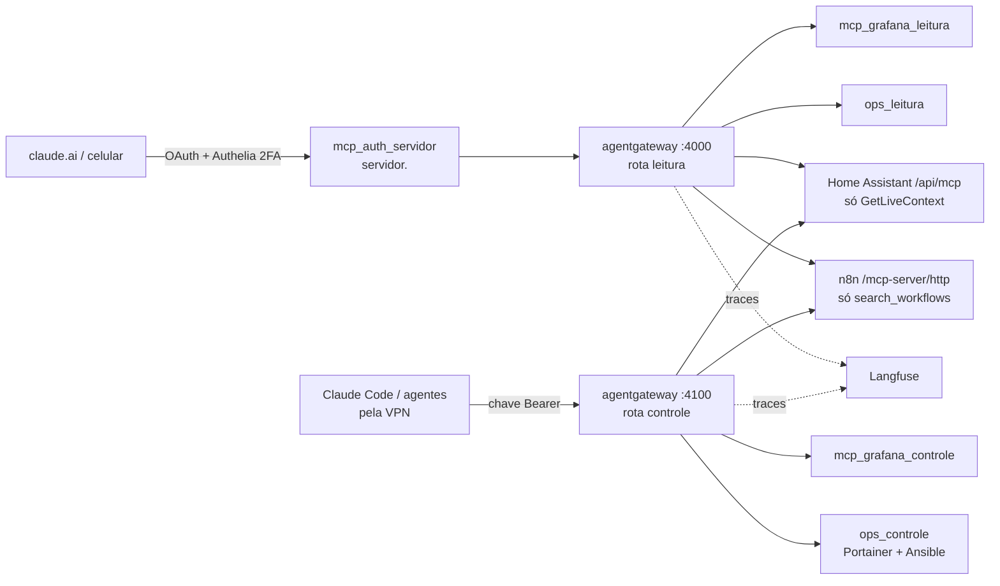

# Seção 13: Agentes — base (hub de MCPs, operações e rastreio)

A IA (Claude Code, app Claude, agentes) alcança o homeserver por um **hub de MCPs** na `core-services-vm`: **leitura de qualquer lugar** (métricas, logs, alertas, containers, a casa e as automações, pelo conector **Servidor**) e **ações só pela VPN** ([seção 14](14-vpn-tailscale.md): reiniciar containers, redeployar stacks, rodar playbooks Ansible, comandar a casa, executar workflows). Toda chamada de LLM e de ferramenta fica rastreada no **Langfuse**.

## Arquitetura



| Rota | Onde | Quem usa | Alcança |
|---|---|---|---|
| `leitura` | `https://servidor.<domínio>/mcp` (túnel → Traefik → `mcp_auth_servidor`) | claude.ai, app do celular | Grafana (Prometheus, Loki, alertas, painéis) só leitura; containers, logs, stacks e playbooks (listar); estado da casa; lista de workflows |
| `controle` | `http://<IP da core-services-vm>:4100/mcp` (só pela VPN: a LAN não alcança a 4100, [seção 14](14-vpn-tailscale.md)) | Claude Code com o Tailscale ligado (em casa ou fora), agentes (4c3) | tudo da leitura + silenciar alertas e editar painéis, reiniciar containers, redeploy de stacks, Ansible (`ansible_check` → `ansible_aplicar`), comandar a casa, executar e editar workflows liberados |

Por que duas rotas: a internet só alcança **código que não sabe escrever** (as instâncias `*_leitura` nem registram ferramentas de escrita) **e** uma lista fechada de ferramentas (`agents_leitura`); as ações ficam num endereço que só a VPN alcança (cifrado pelo WireGuard), com uma chave por cliente.

!!! warning "Fora dos snapshots ZFS"
    O config do hub, os segredos do runner, o clone do repositório e o estado OAuth do `mcp_auth_servidor` ficam no disco local da `core-services-vm` (`/opt/local-data/agentgateway`, `/opt/local-data/ops`, `/opt/local-data/mcp-auth-servidor`), e os dados do Langfuse no disco local da `ai-desktop-vm` (`/opt/local-data/langfuse`): **fora dos snapshots ZFS e sem backup**. Tudo é regerável pelos playbooks a partir do vault; os traces do Langfuse são descartáveis.

## Arquivos

Stack e preparação:

- `docker/stacks/agents/docker-compose.yml` — stack `agents` na `core-services-vm` (Portainer, endpoint `local`, variáveis em `/opt/portainer_stack_envs/agents.env`): `mcp_grafana_leitura`/`mcp_grafana_controle`, `ops_leitura`/`ops_controle` e o hub.
- `ansible/playbooks/setup-agents-volumes.yml` — diretórios em `/opt/local-data/ops`, chave SSH e senha do vault do runner (`0400`), clone do repositório, imagem `localhost/homeserver/ops` e `agents.env`.
- `docker/stacks/langfuse/docker-compose.yml` — stack `langfuse` na `ai-desktop-vm` (Portainer, endpoint `ai-desktop-vm`, variáveis em `/opt/portainer_stack_envs/langfuse.env`): web, worker, Postgres, ClickHouse, Redis e MinIO.
- `ansible/playbooks/setup-langfuse-volumes.yml` — diretórios em `/opt/local-data/langfuse` (com o dono que cada imagem usa) e `langfuse.env`.

MCP de operações (`ops`), código Python próprio, testado em `tools/wikisync/tests/test_ops.py` (sem rede):

- `docker/images/ops/ops/__init__.py` — descrição do pacote.
- `docker/images/ops/ops/config.py` — configuração lida das variáveis de ambiente (`OPS_MODO`, `PORTAINER_URL`, listas de protegidos e de playbooks).
- `docker/images/ops/ops/politica.py` — o que é recusado (containers e stacks protegidos) e a limpeza das saídas (segredos mascarados, texto longo truncado).
- `docker/images/ops/ops/portainer.py` — cliente da API do Portainer: containers das duas VMs, logs, reinício, stacks e redeploy.
- `docker/images/ops/ops/autenticacao.py` — exige o token interno do hub (`OPS_TOKEN`) em toda requisição: as redes Docker são compartilhadas com outras aplicações.
- `docker/images/ops/ops/auditoria.py` — registro de cada ação (JSON no log, coletado para o Loki) e aviso no Telegram pelo webhook do n8n.
- `docker/images/ops/ops/ferramentas.py` — as ferramentas MCP; no modo `leitura`, as que mudam algo nem existem.
- `docker/images/ops/ops/runner.py` — runner Ansible: `git pull`, `ansible-playbook --check --diff` com `plano_id`, aplicação só do plano simulado no mesmo commit, uma execução por vez.
- `docker/images/ops/ops/server.py` — registra as ferramentas do modo no FastMCP (com as anotações `readOnlyHint`/`destructiveHint`) e serve em `:8000/mcp`.
- `docker/images/ops/Dockerfile` — imagem `localhost/homeserver/ops` (Python 3.13, git, cliente SSH, coleções do `ansible/requirements.yml`), sem root.
- `docker/images/ops/.dockerignore` — deixa de fora da imagem o `__pycache__` que os testes criam ao importar o pacote.

As versões do FastMCP e do ansible-core vêm do `group_vars` por este template, gravado no diretório de build da imagem:

```jinja title="ansible/templates/agents/ops-requirements.txt.j2"
# Dependências do MCP ops (página 13). Versões em group_vars/all/main.yml.
fastmcp=={{ ops_fastmcp_version }}
ansible-core=={{ ops_ansible_core_version }}
```

## Hub de MCPs (agentgateway)

O hub junta os MCPs em dois endereços. A **rota `leitura`** (porta 4000, só na rede interna, com o token interno que só o `mcp_auth_servidor` tem) recebe o conector **Servidor** e só alcança instâncias que não sabem escrever (`mcp_grafana_leitura`, `ops_leitura`), mais o Home Assistant e o n8n limitados a uma lista de ferramentas de consulta (`agents_leitura`). A **rota `controle`** (porta 4100, publicada só no IP da `core-services-vm` na LAN) alcança tudo e exige a chave de um cliente (`agents_api_keys`); no config vai só o hash. Os tokens do Home Assistant, do n8n e o token interno que o `ops` e o `mcp-grafana` exigem (`agents_tokens_internos.backends`: as redes Docker são compartilhadas com outras aplicações, então sem ele qualquer container chamaria as ferramentas) ficam em arquivos `0400` montados no container, e a autenticação do rastreio no Langfuse vem da variável `OTEL_EXPORTER_OTLP_TRACES_HEADERS` — o arquivo não tem nenhum segredo. Se um alvo cair, as ferramentas dele somem e o resto continua (`failOpen`). O hub não guarda sessão com os alvos (`statefulMode: stateless`): cada requisição abre e fecha a sua, e um alvo reiniciado volta sem deixar sessão órfã. Cada linha de log do hub traz o campo `cliente` (o metadado da chave: `claude_code`, `agentes` ou `mcp_auth_servidor`), e o mesmo valor vai para o `ops` no cabeçalho `x-homeserver-cliente`, que entra no registro de auditoria. O cabeçalho é confiável porque só o hub tem o token interno do `ops`.

```jinja title="ansible/templates/agents/agentgateway.yaml.j2"
# Hub de MCPs da base dos agentes (página 13). Gerado pelo setup-agents-volumes.yml em
# {{ '{{' }} vm_local_data_path {{ '}}' }}/agentgateway/config.yaml. Sem segredos: chaves dos clientes só como hash;
# tokens dos alvos em arquivos (/segredos); autenticação do rastreio por variável de ambiente.
# yaml-language-server: $schema=https://agentgateway.dev/schema/config


          targets:
          # ops e mcp-grafana só aceitam o token interno do hub (as redes Docker são compartilhadas).
          - name: grafana
            mcp:
              host: http://mcp_grafana_{{ sufixo }}:8000/mcp
            policies:
              backendAuth:
                key:
                  file: /segredos/backends_token
          - name: ops
            mcp:
              host: http://ops_{{ sufixo }}:8000/mcp
            policies:
              backendAuth:
                key:
                  file: /segredos/backends_token
              # Quem pediu (metadado da chave) vai para o registro de auditoria do ops; 'set' sobrescreve
              # qualquer valor que o cliente tenha mandado.
              transformations:
                request:
                  set:
                    x-homeserver-cliente: 'apiKey.cliente'

          - name: {{ nome }}
            mcp:
              host: {{ alvo.host }}
            policies:
              backendAuth:
                key:
                  file: {{ alvo.token }}


config:
  statsAddr: 0.0.0.0:15020
  logging:
    format: json
    fields:
      add:
        cliente: 'apiKey.cliente' # qual chave chamou (claude_code, agentes, mcp_auth_servidor)
  tracing:
    otlpEndpoint: http://{{ ai_desktop_vm_ip_var }}:3100/api/public/otel
    otlpProtocol: http
    randomSampling: "true"

binds:
# Rota de leitura: atrás do mcp_auth_servidor (OAuth + Authelia, grupo admins), que repassa o token interno
# 'proxy' — sem ele, outro container das redes compartilhadas não lê nada.
- port: 4000
  listeners:
  - name: leitura
    routes:
    - name: leitura
      policies:
        apiKey:
          mode: strict
          location:
            header:
              name: Authorization
              prefix: "Bearer "
          keys:
          - keyHash: "sha256:{{ agents_tokens_internos.proxy | hash('sha256') }}"
            metadata:
              cliente: mcp_auth_servidor
        mcpAuthorization:
          rules:


          - allow: 'mcp.tool.target == "{{ alvo }}"'

          - allow: 'mcp.tool.target == "{{ alvo }}" && mcp.tool.name in {{ ferramentas | to_json }}'


      backends:
      - mcp:
          statefulMode: stateless # cada requisição abre e fecha a sessão com os alvos (sem estado no hub)
          prefixMode: always
          failureMode: failOpen
{{ alvos('leitura') }}
# Rota de controle: porta publicada no IP da core-services-vm, que a LAN não alcança (firewall_docker_portas):
# só pela VPN (página 14), com a chave de cada cliente.
- port: 4100
  listeners:
  - name: controle
    routes:
    - name: controle
      policies:
        apiKey:
          mode: strict
          location:
            header:
              name: Authorization
              prefix: "Bearer "
          keys:

          - keyHash: "sha256:{{ chave | hash('sha256') }}"
            metadata:
              cliente: {{ cliente }}

      backends:
      - mcp:
          statefulMode: stateless # cada requisição abre e fecha a sessão com os alvos (sem estado no hub)
          prefixMode: always
          failureMode: failOpen
{{ alvos('controle') }}
```

## Rastreio (Langfuse)

O **Langfuse** guarda cada chamada de LLM (o LiteLLM manda pelo callback `langfuse_otel`) e cada chamada de ferramenta pelo hub (traces OTLP), com custo, latência, entrada e saída. A tela fica em `https://langfuse.<domínio>`, atrás do Authelia; o login do próprio Langfuse é só pelo SSO (cliente OIDC `langfuse`, política `so_admins`): quem entra cai na organização **Homeserver** como admin. O `langfuse_web` e o `mcp_auth_servidor` falam com o Authelia pela LAN (`extra_hosts` de `auth.` para o Traefik na `core-services-vm`). A organização, o projeto e as chaves (`langfuse_secrets.public_key`/`secret_key`) são criados na primeira subida pelas variáveis `LANGFUSE_INIT_*` — não há passos na tela.

Os dados (Postgres, ClickHouse, MinIO, Redis) ficam no disco local da `ai-desktop-vm` e **não têm backup**: traces são descartáveis. O alerta **disco-cheio** avisa se o disco local encher.

### Limpeza dos traces

A retenção automática por projeto do Langfuse é um recurso pago (entitlement `data-retention`, só nos planos Enterprise e da nuvem); na versão aberta os traces ficam até alguém apagar. Para limpar:

- **Pela tela:** em **Tracing**, filtre por data (ex.: mais antigos que 30 dias), selecione e apague.
- **Tudo de uma vez:** pare a stack `langfuse` no Portainer, apague `/opt/local-data/langfuse/clickhouse/data` e `/opt/local-data/langfuse/minio` e suba de novo — a organização, o projeto e as chaves voltam pelas variáveis `LANGFUSE_INIT_*`.

## Tokens e chaves

Gerados uma vez, na tela de cada sistema, e guardados no vault (página 01):

1. **Grafana:** *Administration → Users and access → Service accounts* → duas contas, `mcp-leitura` (papel **Viewer**) e `mcp-controle` (papel **Editor**); um token em cada → `grafana_sa_tokens.leitura` e `grafana_sa_tokens.controle`.
2. **Home Assistant:** *Configurações → Dispositivos e serviços → Adicionar integração → Model Context Protocol Server* (escolha a API **Assist**, que expõe as entidades marcadas para o assistente); depois *Perfil → Segurança → Tokens de acesso de longa duração* → `homeassistant_mcp_token`.
3. **n8n:** *Settings → Instance-level MCP* → **Enable MCP access** → aba **API key** → `n8n_mcp_token`. Libere os workflows que a IA pode ver e executar (*Available in MCP* em cada workflow, ou **Workflows enabled**); nenhum fica liberado sem você marcar.
4. **Portainer:** *My account → Access tokens → Add access token* → `portainer_api_key`. Confira os nomes dos ambientes em *Environments* (`local` para a core e o agente da VM de IA) e ajuste `ops_endpoints` se forem outros.
5. **Runner do Ansible:** `ssh-keygen -t ed25519 -C ops-runner -f ops-runner` na máquina de controle → a privada vai para `ops_ssh_private_key`; a pública (`ops-runner.pub`) entra no `~/.ssh/authorized_keys` do usuário Ansible das VMs (`vm_ansible_user_name`). **Não** a coloque no host Proxmox: nenhum playbook liberado para o runner roda nele. `ops_vault_password` é a senha do `ansible-vault` deste repositório. O runner só funciona depois que o `vault.yml` criptografado existir no repositório (ele clona do GitHub).
6. **Clientes do hub:** `agents_api_keys.claude_code` e `agents_api_keys.agentes` (`ag-` + `openssl rand -hex 24`), e os tokens internos `agents_tokens_internos.backends` (hub → `ops`/`mcp-grafana`) e `agents_tokens_internos.proxy` (`mcp_auth_servidor` → rota de leitura), com `openssl rand -hex 32`.
7. **Langfuse:** `langfuse_secrets` (salt e segredos com `openssl rand -base64 32`, `encryption_key` com `openssl rand -hex 32`, chaves do projeto `pk-lf-…`/`sk-lf-…`) e o cliente OIDC `langfuse` (`oidc_clients.langfuse`, digest como nos outros clientes, página 05).

## Deploy

1. Na máquina de controle: `ansible-playbook -i inventories/home/hosts.ini playbooks/setup-agents-volumes.yml` (core: diretórios, segredos, clone, imagem `localhost/homeserver/ops`, config do hub, `agents.env`) e `playbooks/setup-langfuse-volumes.yml` (ai: diretórios e `langfuse.env`). Rode também `setup-ai-volumes.yml` (o `ai.env` ganha as chaves do Langfuse) e `setup-monitoring-stack-volumes.yml` (job do hub, sondas, alerta e painel).
2. **Portainer → Stacks → Add Stack** no endpoint da `ai-desktop-vm`: `langfuse` com `docker/stacks/langfuse/docker-compose.yml` e `/opt/portainer_stack_envs/langfuse.env`. A primeira subida cria a organização, o projeto e as chaves. Depois, **Update the stack** da `ai` (o LiteLLM passa a mandar as chamadas ao Langfuse).
3. **Portainer → Stacks → Add Stack** no endpoint `local` (core): `agents` com `docker/stacks/agents/docker-compose.yml` e `/opt/portainer_stack_envs/agents.env`.
4. Atualize a Authelia (página 05: cliente `langfuse`, redirect `servidor` no cliente `mcp`, regra `bypass` de `servidor.`) e o Traefik (router `langfuse.`). O hostname curinga do túnel já leva `servidor.` e `langfuse.` ao Traefik.

## Conectar o Claude

| Cliente | Como |
|---|---|
| claude.ai (navegador e celular) | **Configurações → Conectores → Adicionar conector personalizado** com `https://servidor.<domínio>/mcp` (nome `Servidor`). **Conectar** abre o login do Authelia (2FA, só o grupo `admins`). Só leitura. |
| Claude Code (PC, com o Tailscale ligado) | `claude mcp add --transport http servidor http://<IP da core-services-vm>:4100/mcp --header "Authorization: Bearer <agents_api_keys.claude_code>"`. A chave fica no `~/.claude.json` do seu usuário, nunca em repositório. Sem o Tailscale, a 4100 não responde (nem em casa): use a rota de leitura (`https://servidor.<domínio>/mcp`). |
| Agentes (4c3) | Mesma rota de controle, com a chave `agents_api_keys.agentes`. Eles rodam na `ai-desktop-vm`, que não tem Tailscale: quando a 4c3 chegar, o IP da ai entra nas `origens` da 4100 em `firewall_docker_portas` (página 01). |

As ferramentas aparecem com o prefixo do alvo: `grafana_…`, `ops_…`, `homeassistant_…`, `n8n_…`.

## Ações e aprovação

- As ferramentas que mudam algo (`ops_container_reiniciar`, `ops_stack_redeploy`, `ops_ansible_aplicar` e as de escrita do Grafana, da casa e do n8n) vêm marcadas como destrutivas: o Claude Code pede sua aprovação a cada uso. Não marque "sempre permitir" para elas.
- **Containers e stacks protegidos:** `ops_containers_protegidos` (Traefik, Authelia e o banco dela, cloudflared, Portainer e o Portainer Agent, o hub, o próprio `ops` e o n8n, que leva os avisos das ações ao Telegram) e `ops_stacks_protegidas` (`core`, `agents`) são recusados — o caminho de controle da IA não é mexido por ela. A proteção do `n8n_app` vale para reiniciar o container; o redeploy da stack `apps` (onde ele mora, com Grafana, Prometheus e Home Assistant) continua liberado, porque é a ação de rotina daquela stack. O n8n volta junto, e os avisos atrasam só enquanto ele sobe.
- **Mesmo nome nas duas VMs:** `ops_container_logs` e `ops_container_reiniciar` aceitam `vm` (`core` ou `ai`). Se o nome existir nas duas, a ferramenta recusa sem `vm` em vez de escolher sozinha.
- **Fora da lista de playbooks:** `setup-base-ubuntu.yml` (mexe no Docker, nas montagens e no Alloy de todas as VMs, inclusive a core, onde rodam o hub e o próprio `ops`), `setup-core-networking.yml`, `setup-proxmox-host.yml`, `vm-deploy.yml` e `full-deploy.yml`: esses continuam na máquina de controle.
- **Ansible em dois passos:** `ops_ansible_check(playbook, limite?)` faz `git pull`, roda `--check --diff` e devolve o diff e um `plano_id`; `ops_ansible_aplicar(plano_id)` aplica **o mesmo** playbook e limite, só se o repositório não mudou e o plano tem menos de `ops_plano_validade_min` (30) minutos. Só playbooks de `ops_playbooks_permitidos`; uma execução por vez. Para liberar outro playbook, acrescente-o à lista (página 01), rode o `setup-agents-volumes.yml` e, no Portainer, **Update the stack** `agents`: o `agents.env` só vale quando os containers são recriados. Um playbook que passa do tempo (15 min na simulação, 60 na aplicação) é encerrado junto com os `ssh` que abriu.
- **Registro:** cada ação (feita, recusada ou com erro) vira uma linha JSON `"evento": "ops_acao"` com o `cliente` que pediu no log do `ops` (Loki) e um aviso no Telegram; ação com erro dispara o alerta **ops-acao-falhou** (página 09). Cada chamada de ferramenta também aparece no Langfuse.
- **Riscos aceitos:**
    - **Logs brutos pela rota de leitura.** O `grafana` entra inteiro na lista de leitura (`"*"`), então a IA lê logs do Loki **sem máscara**. Já o `ops_container_logs` mascara linhas com cara de segredo. A rota exige 2FA e o grupo `admins` (a mesma pessoa que tem acesso total), e ler logs é justamente o trabalho do observador da 4c2. Não grave segredos em log.
    - **Chave admin no `ops_leitura`.** O Portainer CE não tem token só de leitura, então a mesma `portainer_api_key` vale para as duas instâncias. A de leitura nem registra ferramentas que mudam algo, e a chave fica num container sem porta publicada.
- **Injeção de prompt:** logs, notas e páginas lidos pela IA podem trazer instruções; a aprovação a cada ação, as listas de protegidos e de playbooks e a simulação obrigatória limitam o dano.

## Falhas

| Falha | Comportamento | O que fazer |
|---|---|---|
| Home Assistant, n8n ou Grafana fora | As ferramentas dele somem; o resto funciona (`failOpen`) | Ver a sonda e o log do hub (`docker logs agentgateway`) |
| Hub fora | Conector Servidor e Claude Code sem ferramentas do servidor; alerta **servico-fora-do-ar** (`agentgateway`, sonda nas métricas do próprio hub) | Portainer → stack `agents` |
| Portainer fora | `ops` responde erro claro nas ferramentas de containers e stacks | Restaurar o Portainer |
| `ops_ansible_aplicar` recusado | Plano vencido, já usado ou repositório mudou | Rodar `ops_ansible_check` de novo |
| Playbook falha no meio | Erro devolvido com o fim da saída, aviso no Telegram, alerta | Ver o log; corrigir e simular de novo |
| Langfuse fora | LiteLLM e hub seguem (envio assíncrono); rastreio perdido no período | Portainer → stack `langfuse` |
| Authelia fora | Login novo no Servidor falha; a rota de controle (chave) segue | Restaurar o Authelia |

## Teste de ponta a ponta

1. Com o Tailscale ligado, `curl -s http://<IP da core>:4100/mcp` sem cabeçalho → `401` (sem o Tailscale, não conecta); com `-H "Authorization: Bearer <chave>"` e um `initialize` MCP → resposta do hub.
2. No Claude Code: "liste os containers da VM de IA" (`ops_containers_listar`) e "quais alertas estão disparando?" (`grafana_…`).
3. "Simule o playbook setup-media-stack-volumes.yml" → diff e `plano_id`; "aplique" → aprovação pedida, execução, aviso no Telegram.
4. "Reinicie o traefik" → recusado (protegido), aviso no Telegram.
5. No claude.ai, conector Servidor: "o que o Home Assistant diz da sala?" funciona; "desligue a luz da sala" → a ferramenta não existe na rota de leitura.
6. No Langfuse (`https://langfuse.<domínio>`): as chamadas do LiteLLM e as do hub aparecem em **Tracing**.
