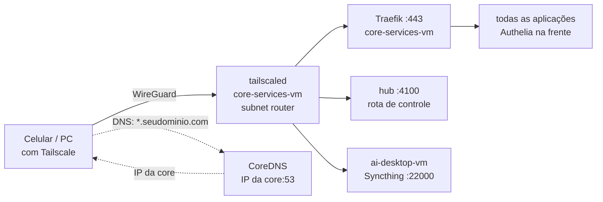

# Seção 14: VPN (Tailscale) e firewall das portas do Docker

O túnel da Cloudflare publica as aplicações na internet, mas recusa requisições acima de 100 MB e passa tudo pela Cloudflare. A **VPN** é o caminho privado: com o Tailscale ligado no PC ou no celular, os mesmos endereços `https://<app>.seudominio.com` vão direto ao Traefik de casa, cifrados pelo WireGuard e sem limite de tamanho. A rota de controle do hub de MCPs ([seção 13](13-agentes-base.md)) passa a existir **só** pela VPN.



| Peça | Onde | O que faz |
|---|---|---|
| `tailscaled` | `core-services-vm` e host Proxmox (pacote oficial, role `ansible/roles/infra/tailscale/`) | Cada um entra na sua rede Tailscale como nó próprio (`homeserver` e `pve`), com a tag `tag:homeserver`, e anuncia as mesmas três rotas `/32` (`tailscale_rotas`: host, core e ai) |
| CoreDNS | container `coredns` na core, porta 53 no IP da LAN | Para quem está na VPN, responde qualquer `<app>.seudominio.com` com o IP da core (Traefik); outras zonas são recusadas |
| Firewall das portas do Docker | as duas VMs (role `ansible/roles/infra/docker/`) | As portas publicadas pelo Docker não passam pelo UFW; a cadeia `DOCKER-USER` limita quem as alcança pela LAN |

!!! info "Por que rotas /32 e por que o host é um nó próprio"
    Rotas `/32` são mais específicas que a `/24` da LAN. Por isso um PC **em casa** com o Tailscale ligado também fala com as VMs pela VPN, e a rota de controle (que a LAN não alcança) funciona dentro de casa. O host Proxmox é um nó próprio do tailnet (hostname `pve`), e host e core anunciam as **mesmas** rotas: se a core cair, o host continua levando o tráfego para o Proxmox, a core e a ai (failover entre dois roteadores de sub-rede; o Tailscale escolhe o que estiver de pé). A tag `tag:homeserver` vai nos dois nós, e é por ela que a ACL aprova as rotas sozinha.

## Firewall das portas publicadas pelo Docker

Portas publicadas pelo Docker (`ports:`) passam por fora do UFW. Para cada porta em `firewall_docker_portas` (página 01), quem chega pela **interface da LAN** só passa se a origem estiver na lista; lista vazia quer dizer "ninguém pela LAN". Tráfego da VPN (`tailscale0`) e entre containers não passa por essas regras.

| VM | Porta | Quem alcança pela LAN | Por quê |
|---|---|---|---|
| core | 9090 (Prometheus) | host Proxmox e `ai-desktop-vm` | `remote_write` dos Alloys; sem isso, qualquer aparelho da LAN injetaria métricas |
| core | 3100 (Loki) | host Proxmox e `ai-desktop-vm` | Logs dos Alloys; o Loki não tem autenticação |
| core | 4100 (hub, rota de controle) | ninguém (só pela VPN) | Ações no servidor só por canal cifrado e com a chave do cliente |
| core | 4200 (hub, rota dos autônomos) | `ai-desktop-vm` | Agentes do posto e o assistente rodam lá ([seção 16](16-posto-agentes.md)) |
| ai | 9001 (Portainer Agent) | `core-services-vm` | Só o Portainer central gerencia a VM |
| ai | 3100 (Langfuse) | `core-services-vm` | O Traefik e o hub ficam na core |
| ai | 3005 (Vibe Kanban) | `core-services-vm` | Sem login próprio: só o Traefik, com o Authelia na frente ([seção 16](16-posto-agentes.md)) |

O LiteLLM (4000), a Open WebUI (3000), o painel e a sincronização do Syncthing (8384, 22000) continuam abertos na LAN: o PC e o celular os usam em casa, cada um com o próprio login.

O script é gerado pelo role `infra/docker` (página 04) e rodado pela unit `firewall-docker`, que roda **antes** de cada (re)início do Docker: as regras já estão lá quando os containers sobem, sem janela aberta no boot. Para conferir: `sudo iptables -L HOMESERVER -n -v`.

```bash title="ansible/roles/infra/docker/templates/firewall-docker.sh.j2"
#!/bin/bash
# ansible/roles/infra/docker/templates/firewall-docker.sh.j2
# Firewall das portas publicadas pelo Docker (o UFW não vê esse tráfego), na cadeia DOCKER-USER, que o Docker
# reserva para isso e não apaga. Para cada porta de firewall_docker_portas deste host, quem entra pela interface
# da LAN só passa se a origem estiver na lista (lista vazia: ninguém pela LAN). Tráfego da VPN (tailscale0) e
# entre containers não passa por aqui. Rodado pela unit firewall-docker antes de cada (re)início do Docker: cria a
# DOCKER-USER se ainda não existe, e o Docker a reaproveita (só acrescenta o salto na FORWARD).
# Página 14. Gerado pelo role infra/docker.
set -euo pipefail

LAN="{{ ansible_facts.default_ipv4.interface | default('eth0') }}"
CADEIA="HOMESERVER"
IPT="${IPTABLES:-iptables}"

$IPT -N DOCKER-USER 2>/dev/null || true
$IPT -N "$CADEIA" 2>/dev/null || $IPT -F "$CADEIA"
$IPT -C DOCKER-USER -j "$CADEIA" 2>/dev/null || $IPT -I DOCKER-USER -j "$CADEIA"


# {{ regra.porta }}: {{ regra.motivo }}

$IPT -A "$CADEIA" -i "$LAN" -p tcp -s {{ origem }} -m conntrack --ctorigdstport {{ regra.porta }} --ctdir ORIGINAL -j RETURN

$IPT -A "$CADEIA" -i "$LAN" -p tcp -m conntrack --ctorigdstport {{ regra.porta }} --ctdir ORIGINAL -j DROP

$IPT -A "$CADEIA" -j RETURN
```

## Arquivos

```yaml title="ansible/playbooks/setup-vpn.yml"
# ansible/playbooks/setup-vpn.yml
# VPN (página 14): Tailscale como subnet router e o DNS da VPN, na core-services-vm.
- name: VPN (Tailscale) e DNS da VPN
  hosts: core_services
  become: true
  gather_facts: true
  vars_files:
    - ../inventories/home/group_vars/all/main.yml
    - ../inventories/home/group_vars/all/vault.yml
  roles:
    - role: infra/tailscale
```

```yaml title="ansible/roles/infra/tailscale/tasks/main.yml"
# ansible/roles/infra/tailscale/tasks/main.yml
# VPN (página 14): Tailscale como nó do tailnet. Na core-services-vm e no host Proxmox é subnet router dos três
# IPs da casa (/32; as duas pontas anunciam as mesmas rotas, para failover); a core ainda roda o CoreDNS que
# responde *.<domínio> com o IP da core para quem está na VPN (split DNS configurado no painel do Tailscale).
# Serve a Ubuntu (VMs, VM do GCP) e a Debian (host Proxmox): o repositório sai de ansible_facts.distribution.

- name: "Tailscale: chave do repositório"
  ansible.builtin.get_url:
    url: "https://pkgs.tailscale.com/stable/{{ ansible_facts.distribution | lower }}/{{ ansible_facts.distribution_release }}.noarmor.gpg"
    dest: /usr/share/keyrings/tailscale-archive-keyring.gpg
    mode: '0644'

- name: "Tailscale: repositório"
  ansible.builtin.apt_repository:
    repo: "deb [signed-by=/usr/share/keyrings/tailscale-archive-keyring.gpg] https://pkgs.tailscale.com/stable/{{ ansible_facts.distribution | lower }} {{ ansible_facts.distribution_release }} main"
    filename: tailscale
    state: present

- name: "Tailscale: pacote"
  ansible.builtin.apt:
    name: tailscale
    state: present
    update_cache: true
  when: not ansible_check_mode # no --check o repositório só foi simulado: o apt não acharia o pacote

# Aplicado na hora (antes do tailscale up). Só IPv4: as rotas anunciadas são IPv4, e ligar o forwarding do
# IPv6 desligaria o accept_ra (o IPv6 por SLAAC da LAN).
- name: "Tailscale: encaminhamento de pacotes (subnet router)"
  ansible.posix.sysctl:
    name: net.ipv4.ip_forward
    value: '1'
    sysctl_file: /etc/sysctl.d/99-tailscale.conf
    reload: true

- name: "Tailscale: serviço"
  ansible.builtin.systemd_service:
    name: tailscaled
    enabled: true
    state: started
  when: not ansible_check_mode # no --check de uma VM nova o pacote só foi simulado

- name: "Tailscale: estado atual"
  ansible.builtin.command: tailscale status --json
  register: tailscale_status
  changed_when: false
  failed_when: false
  check_mode: false # só lê

# Fora da rede (sem login: NeedsLogin ou sem estado) e sem chave, o 'tailscale up' (no_log) falharia sem dizer por quê;
# um nó só desligado ('tailscale down') não precisa de chave. Os casos típicos são o DR (host Proxmox reinstalado ou
# core recriada: as chaves eram de uso único) e o host configurado sem o sysadmin: a chave dele não fica no vault
# (ele entra pelo preparar-host.sh).
- name: "Tailscale: há chave para entrar na rede"
  ansible.builtin.assert:
    that:
      - (tailscale_auth_key | default('') | string | trim | length) > 0
    fail_msg: >-
      Este nó não está no tailnet e não há chave de uso único (tailscale_auth_key vazia). Host Proxmox: gere uma
      chave nova com tag:homeserver e rode o scripts/gcp/preparar-host.sh (preparar_host do sysadmin, com a chave
      nova no segredo do GCP) ou grave-a em tailscale_auth_key_host no vault. Core: a chave anterior era de uso
      único; gere outra com tag:homeserver e grave-a em tailscale_auth_key no vault (vault_preencher). VM do GCP: tailscale_chave_sysadmin no segredo sysadmin-segredos (página 14).
    quiet: true
  when: (((tailscale_status.stdout | default('')) or '{}') | from_json).BackendState | default('') not in ['Running', 'Starting', 'Stopped']

# Só na primeira vez (ou depois de um logout): a auth key é de uso único. As tags (--advertise-tags) só entram
# aqui: o 'tailscale set' não troca tags sem reautenticar; para mudá-las num nó já na rede, rode
# 'tailscale up --force-reauth' à mão.
- name: "Tailscale: entrar na rede"
  ansible.builtin.command: >-
    tailscale up --auth-key={{ tailscale_auth_key }} --hostname={{ tailscale_hostname }}
    --advertise-routes={{ tailscale_rotas | join(',') }} --advertise-tags={{ tailscale_tags | join(',') }}
    --accept-routes={{ tailscale_aceitar_rotas | bool | lower }} --accept-dns=false
  when: (((tailscale_status.stdout | default('')) or '{}') | from_json).BackendState | default('') not in ['Running', 'Starting', 'Stopped']
  changed_when: true
  no_log: true # a auth key

# Já autenticado, mas desligado ('tailscale down', BackendState Stopped): religa sem chave, com as mesmas opções. Se o
# login tiver caído (máquina removida do painel, chave expirada), o 'up' sem chave esperaria o login interativo: o
# --timeout faz ele falhar em 60 s em vez de prender o playbook.
- name: "Tailscale: religar (estava desligado)"
  ansible.builtin.command: >-
    tailscale up --timeout=60s --hostname={{ tailscale_hostname }}
    --advertise-routes={{ tailscale_rotas | join(',') }} --advertise-tags={{ tailscale_tags | join(',') }}
    --accept-routes={{ tailscale_aceitar_rotas | bool | lower }} --accept-dns=false
  when: (((tailscale_status.stdout | default('')) or '{}') | from_json).BackendState | default('') == 'Stopped'
  changed_when: true

- name: "Tailscale: preferências atuais"
  ansible.builtin.command: tailscale debug prefs
  register: tailscale_prefs
  changed_when: false
  failed_when: false
  check_mode: false # só lê

# Mantém o nome e as rotas anunciadas iguais às do group_vars (aprovar no painel quando as rotas mudarem).
- name: "Tailscale: nome e rotas anunciadas"
  vars:
    prefs: "{{ ((tailscale_prefs.stdout | default('')) or '{}') | from_json }}"
  ansible.builtin.command: >-
    tailscale set --hostname={{ tailscale_hostname }} --advertise-routes={{ tailscale_rotas | join(',') }}
    --accept-dns=false
  when: >-
    (prefs.AdvertiseRoutes | default([]) or []) | sort != tailscale_rotas | sort
    or prefs.Hostname | default('') != tailscale_hostname
    or prefs.CorpDNS | default(true)
  changed_when: true

- name: "UFW: conexões diretas do Tailscale"
  community.general.ufw:
    rule: allow
    port: '41641'
    proto: udp
    comment: "Tailscale (WireGuard direto)"
  when: tailscale_ufw | bool

- name: "UFW: encaminhar da VPN para a LAN (rotas anunciadas)"
  community.general.ufw:
    rule: allow
    route: true
    interface_in: tailscale0
    interface_out: "{{ ansible_facts.default_ipv4.interface }}"
    comment: "Tailscale subnet router"
  when: tailscale_ufw | bool

- name: "CoreDNS: diretório"
  ansible.builtin.file:
    path: "{{ vm_local_data_path }}/coredns"
    state: directory
    owner: root
    group: root
    mode: '0755'
  when: tailscale_coredns | bool

- name: "CoreDNS: configuração"
  ansible.builtin.template:
    src: Corefile.j2
    dest: "{{ vm_local_data_path }}/coredns/Corefile"
    owner: root
    group: root
    mode: '0644'
  register: corefile
  when: tailscale_coredns | bool

- name: "CoreDNS: container"
  community.docker.docker_container:
    name: coredns
    image: "coredns/coredns:{{ coredns_version }}"
    command: ["-conf", "/Corefile"]
    restart_policy: unless-stopped
    restart: "{{ corefile.changed }}"
    ports:
      - "{{ core_services_vm_ip_var }}:53:53/udp"
      - "{{ core_services_vm_ip_var }}:53:53/tcp"
    volumes:
      - "{{ vm_local_data_path }}/coredns/Corefile:/Corefile:ro"
  when: tailscale_coredns | bool
```

```text title="ansible/roles/infra/tailscale/templates/Corefile.j2"
# ansible/roles/infra/tailscale/templates/Corefile.j2
# DNS da VPN (página 14): para quem está no Tailscale (split DNS restrito ao domínio), todo <app>.<domínio>
# aponta para o Traefik na core-services-vm, pela VPN. Outras zonas são recusadas: o resto da internet
# continua resolvendo pelo DNS normal do aparelho.
{{ base_domain }}:53 {
    template IN A {
        answer "{{ '{{' }} .Name {{ '}}' }} 60 IN A {{ core_services_vm_ip_var }}"
    }
    template IN AAAA {
        rcode NOERROR
    }
    # Os outros tipos (HTTPS/65, que navegadores e o iOS pedem em toda URL, TXT, MX…): resposta vazia, sem SERVFAIL.
    template IN ANY {
        rcode NOERROR
    }
    errors
}
```

```yaml title="ansible/roles/infra/tailscale/defaults/main.yml"
# ansible/roles/infra/tailscale/defaults/main.yml
# Padrões do role infra/tailscale (página 14). tailscale_hostname, tailscale_rotas e tailscale_auth_key não têm
# padrão: cada play informa (tailscale_rotas vem do group_vars, página 01).
# Tags do nó, aplicadas só na primeira entrada (tailscale up); a ACL (scripts/tailscale/acl.json) decide por elas.
tailscale_tags: ["tag:homeserver"]
# Aceitar as rotas anunciadas pelos outros nós: as máquinas da casa não precisam; um PC Linux de uso pessoal, sim.
tailscale_aceitar_rotas: false
# CoreDNS da VPN e regras do UFW: só a core usa; o host Proxmox (firewall próprio do PVE) desliga os dois.
tailscale_coredns: true
tailscale_ufw: true
```

```json title="scripts/tailscale/acl.json"
{
  "tagOwners": {
    "tag:sysadmin": ["autogroup:admin"],
    "tag:homeserver": ["autogroup:admin"]
  },
  "hosts": {
    "pve": "192.168.15.66",
    "core": "192.168.15.67",
    "ai": "192.168.15.68"
  },
  "acls": [
    {"action": "accept", "src": ["tag:sysadmin"], "dst": ["pve:22,8006", "core:22,443,53", "ai:22"]},
    {"action": "accept", "src": ["autogroup:member"], "dst": ["tag:sysadmin:22,443"]},
    {"action": "accept", "src": ["autogroup:member"], "dst": ["pve:*", "core:*", "ai:*", "tag:homeserver:*"]}
  ],
  "autoApprovers": {
    "routes": {
      "192.168.15.66/32": ["tag:homeserver"],
      "192.168.15.67/32": ["tag:homeserver"],
      "192.168.15.68/32": ["tag:homeserver"]
    }
  }
}
```

## Primeira configuração

1. **Conta Tailscale** (plano gratuito) em `login.tailscale.com`.
2. **ACL primeiro (painel → Access controls):** cole o conteúdo de `scripts/tailscale/acl.json` (bloco acima; JSON estrito, sem comentários, então a explicação fica aqui). Ela vem **antes** das chaves: o painel só cria chave com uma tag que esteja nos `tagOwners`. Ela faz quatro coisas:
    - `tagOwners`: só os administradores da conta (`autogroup:admin`) criam nós com `tag:homeserver` (as máquinas da casa) e `tag:sysadmin` (a VM do sysadmin no GCP).
    - `hosts`: apelidos `pve`, `core` e `ai` para os três IPs da LAN, usados nas regras.
    - `acls`: o `tag:sysadmin` alcança só o necessário (SSH e a interface web no `pve`; SSH, HTTPS e DNS na `core`; SSH na `ai`). Os seus aparelhos (`autogroup:member`) alcançam o sysadmin só em SSH e HTTPS e tudo na casa. Não existe regra da casa para o sysadmin: se a máquina da casa for comprometida, ela não chega à VM do GCP. O teste `test_acl_casa_nao_alcanca_o_sysadmin` garante isso.
    - `autoApprovers`: as três rotas `/32` são aprovadas sozinhas quando anunciadas por um nó com `tag:homeserver`.

    Com família na rede, acrescente grupos próprios à ACL em vez de usar `autogroup:member` para tudo.

    Esta ACL é **mais estreita que a antiga** ("todos alcançam todos"): um aparelho seu não alcança outro aparelho seu pelo Tailscale (celular para PC, por exemplo). Se quiser isso, acrescente em `acls` uma regra com `autogroup:member` na origem e `autogroup:member:*` no destino.
3. **Três chaves de uso único** (*Settings → Keys → Generate auth key*, **não reutilizável** e **pré-aprovada**, cada uma com a sua tag):
    - **core**, `tag:homeserver`: em `tailscale_auth_key` no vault (página 01; com o sysadmin, pelo `vault_preencher`). Só serve para o primeiro `tailscale up` da core.
    - **host Proxmox**, `tag:homeserver`: no segredo do GCP (`tailscale_chave_homeserver`, pedida pelo `criar-sysadmin.sh`); o `preparar-host.sh` entra com ela. Sem o sysadmin, ou se o host sair do tailnet e precisar entrar de novo, ela vai em `tailscale_auth_key_host` no vault e o `setup-proxmox-host.yml` faz a entrada.
    - **VM do sysadmin no GCP**, `tag:sysadmin`: no segredo do GCP (`tailscale_chave_sysadmin`, pedida pelo `criar-sysadmin.sh`).

    As tags só valem na primeira entrada (o `tailscale set` não as troca); para mudá-las num nó que já está na rede, rode `tailscale up --force-reauth` nele. **Core que já estava no tailnet sem tag** (rodou o `setup-vpn.yml` antigo): o role não refaz o `up` (o nó está `Running`), então ela continua sem tag, como aparelho do usuário, e a regra `autogroup:member` a deixaria alcançar `tag:sysadmin` (22 e 443); o `autoApprovers` também não aprovaria as rotas dela. Gere uma chave com `tag:homeserver` e reautentique uma vez, na core: `sudo tailscale up --force-reauth --auth-key=<chave tag:homeserver> --hostname=homeserver --advertise-tags=tag:homeserver --advertise-routes=<IP do host>/32,<IP da core>/32,<IP da ai>/32 --accept-dns=false`.
4. **Na máquina de controle:** `ansible-playbook -i inventories/home/hosts.ini playbooks/setup-vpn.yml --ask-vault-pass --check`, depois sem `--check`.
5. **No painel do Tailscale → Machines → `homeserver`:**
    - *Edit route settings*: aprove as três rotas (`<IP do host>/32`, `<IP da core>/32` e `<IP da ai>/32`). Com a ACL do passo 2 colada, o `autoApprovers` já as aprova e este passo vira só conferência. Repita no nó `pve`.
    - *Disable key expiry*: o servidor não pode cair da VPN a cada 180 dias.
6. **DNS (painel → DNS → Nameservers → Add nameserver → Custom):** o IP da `core-services-vm`, com **Restrict to domain** = `seudominio.com`. É o split DNS: só o seu domínio vai para o CoreDNS; o resto continua no DNS normal do aparelho.
7. **Aparelhos:** instale o Tailscale no PC e no celular e entre com a mesma conta. No Windows, as rotas anunciadas já valem; no Linux, use `tailscale up --accept-routes`.

## O que muda nas aplicações

| Aplicação | Com a VPN |
|---|---|
| Todas (`https://<app>.seudominio.com`) | Vão direto ao Traefik, sem a Cloudflare e sem o limite de 100 MB. O Authelia continua na frente de quem já estava atrás dele |
| Immich e Nextcloud | Vídeos e arquivos grandes sobem de qualquer lugar. A troca de URL pelo Wi-Fi no app do Immich vira opcional ([seção 11](11-fotos-arquivos.md)) |
| Syncthing | O celular conecta direto em `tcp://<IP da ai-desktop-vm>:22000`, sem relay ([seção 12](12-segundo-cerebro.md)) |
| Hub de MCPs (rota de controle) | `http://<IP da core>:4100/mcp` só responde pela VPN, também em casa ([seção 13](13-agentes-base.md)) |
| Proxmox | Nó próprio da VPN (`pve`): `https://<IP do host>:8006` responde pela rota `/32`, mesmo longe de casa |

## Falhas

| Falha | Comportamento | O que fazer |
|---|---|---|
| `core-services-vm` fora | O host Proxmox anuncia as mesmas rotas e assume | Se os dois estiverem fora, desligue o Tailscale e use a LAN |
| Rota não aprovada no painel (ou core antiga sem `tag:homeserver`) | O aparelho entra na VPN mas não alcança as VMs | Painel → Machines → `homeserver` e `pve` → *Edit route settings* (ou confira a tag `tag:homeserver` e o `autoApprovers`; core sem tag: reautentique como no passo 3) |
| Nome não resolve pela VPN | `fotos.seudominio.com` cai na Cloudflare (limite de 100 MB) | Confira o nameserver restrito ao domínio no painel e `docker logs coredns` |
| Claude Code sem as ferramentas do hub | A 4100 só responde pela VPN | Ligue o Tailscale no PC |
| Uma aplicação da LAN parou de alcançar a 9090, 3100, 3005, 4100, 4200 ou 9001 | Bloqueada pelo `firewall_docker_portas` | Acrescente a origem à lista (página 01) e rode o `setup-base-ubuntu.yml` |

## Teste de ponta a ponta

1. No celular, **fora do Wi-Fi** e com o Tailscale ligado: `https://fotos.seudominio.com` abre. Um vídeo acima de 100 MB sobe pelo app do Immich.
2. No PC com o Tailscale ligado: `Resolve-DnsName fotos.seudominio.com` (PowerShell) responde o IP da core. O `nslookup` do Windows ignora o split DNS do Tailscale e pode mostrar o IP da Cloudflare. `curl -s -o /dev/null -w '%{http_code}' http://<IP da core>:4100/mcp` responde `401` (o hub pede a chave).
3. Com o Tailscale **desligado**, na LAN: o mesmo `curl` na 4100 não conecta (tempo esgotado). `curl http://<IP da core>:9090/-/healthy` também não, a menos que venha do host Proxmox ou da `ai-desktop-vm`.
4. No host Proxmox: `curl -s http://<IP da core>:9090/-/healthy` responde `Prometheus Server is Healthy.`
