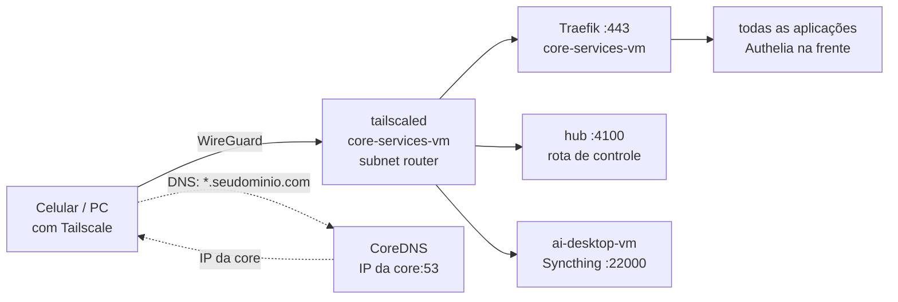

# Seção 14: VPN (Tailscale) e firewall das portas do Docker

O túnel da Cloudflare publica as aplicações na internet, mas recusa requisições acima de 100 MB e passa tudo pela Cloudflare. A **VPN** é o caminho privado: com o Tailscale ligado no PC ou no celular, os mesmos endereços `https://<app>.seudominio.com` vão direto ao Traefik de casa, cifrados pelo WireGuard e sem limite de tamanho. A rota de controle do hub de MCPs ([seção 13](13-agentes-base.md)) passa a existir **só** pela VPN.



| Peça | Onde | O que faz |
|---|---|---|
| `tailscaled` | `core-services-vm` (pacote oficial, role `ansible/roles/infra/tailscale/`) | Entra na sua rede Tailscale como `homeserver` e anuncia rotas só para as duas VMs (`tailscale_rotas`, `/32`) |
| CoreDNS | container `coredns` na core, porta 53 no IP da LAN | Para quem está na VPN, responde qualquer `<app>.seudominio.com` com o IP da core (Traefik); outras zonas são recusadas |
| Firewall das portas do Docker | as duas VMs (role `ansible/roles/infra/docker/`) | As portas publicadas pelo Docker não passam pelo UFW; a cadeia `DOCKER-USER` limita quem as alcança pela LAN |

!!! info "Por que rotas /32 e por que o host Proxmox fica de fora"
    Rotas `/32` são mais específicas que a `/24` da LAN. Por isso um PC **em casa** com o Tailscale ligado também fala com as VMs pela VPN, e a rota de controle (que a LAN não alcança) funciona dentro de casa. O host Proxmox não está nas rotas: a VPN roda na core, e se a core cair você precisa alcançar o Proxmox pela LAN. Em casa, desligue o Tailscale nesse caso.

## Firewall das portas publicadas pelo Docker

Portas publicadas pelo Docker (`ports:`) passam por fora do UFW. Para cada porta em `firewall_docker_portas` (página 01), quem chega pela **interface da LAN** só passa se a origem estiver na lista; lista vazia quer dizer "ninguém pela LAN". Tráfego da VPN (`tailscale0`) e entre containers não passa por essas regras.

| VM | Porta | Quem alcança pela LAN | Por quê |
|---|---|---|---|
| core | 9090 (Prometheus) | host Proxmox e `ai-desktop-vm` | `remote_write` dos Alloys; sem isso, qualquer aparelho da LAN injetaria métricas |
| core | 3100 (Loki) | host Proxmox e `ai-desktop-vm` | Logs dos Alloys; o Loki não tem autenticação |
| core | 4100 (hub, rota de controle) | ninguém (só pela VPN) | Ações no servidor só por canal cifrado e com a chave do cliente |
| ai | 9001 (Portainer Agent) | `core-services-vm` | Só o Portainer central gerencia a VM |
| ai | 3100 (Langfuse) | `core-services-vm` | O Traefik e o hub ficam na core |

O LiteLLM (4000), a Open WebUI (3000), o painel e a sincronização do Syncthing (8384, 22000) continuam abertos na LAN: o PC e o celular os usam em casa, cada um com o próprio login.

O script é gerado pelo role `infra/docker` (página 04) e rodado pela unit `firewall-docker`, que acompanha cada (re)início do Docker. Para conferir: `sudo iptables -L HOMESERVER -n -v`.

```bash title="ansible/roles/infra/docker/templates/firewall-docker.sh.j2"
#!/bin/bash
# ansible/roles/infra/docker/templates/firewall-docker.sh.j2
# Firewall das portas publicadas pelo Docker (o UFW não vê esse tráfego), na cadeia DOCKER-USER, que o Docker
# reserva para isso e não apaga. Para cada porta de firewall_docker_portas deste host, quem entra pela interface
# da LAN só passa se a origem estiver na lista (lista vazia: ninguém pela LAN). Tráfego da VPN (tailscale0) e
# entre containers não passa por aqui. Rodado pela unit firewall-docker, depois de cada (re)início do Docker.
# Página 14. Gerado pelo role infra/docker.
set -euo pipefail

LAN="{{ ansible_facts.default_ipv4.interface | default('eth0') }}"
CADEIA="HOMESERVER"
IPT="${IPTABLES:-iptables}"

$IPT -N "$CADEIA" 2>/dev/null || $IPT -F "$CADEIA"
$IPT -C DOCKER-USER -j "$CADEIA" 2>/dev/null || $IPT -I DOCKER-USER -j "$CADEIA"


# {{ regra.porta }}: {{ regra.motivo }}

$IPT -A "$CADEIA" -i "$LAN" -p tcp -s {{ origem }} -m conntrack --ctorigdstport {{ regra.porta }} --ctdir ORIGINAL -j RETURN

$IPT -A "$CADEIA" -i "$LAN" -p tcp -m conntrack --ctorigdstport {{ regra.porta }} --ctdir ORIGINAL -j DROP

$IPT -A "$CADEIA" -j RETURN
```

## Arquivos

```yaml title="ansible/playbooks/setup-vpn.yml"
# ansible/playbooks/setup-vpn.yml
# VPN (página 14): Tailscale como subnet router e o DNS da VPN, na core-services-vm.
- name: VPN (Tailscale) e DNS da VPN
  hosts: core_services
  become: true
  gather_facts: true
  vars_files:
    - ../inventories/home/group_vars/all/main.yml
    - ../inventories/home/group_vars/all/vault.yml
  roles:
    - role: infra/tailscale
```

```yaml title="ansible/roles/infra/tailscale/tasks/main.yml"
# ansible/roles/infra/tailscale/tasks/main.yml
# VPN (página 14): Tailscale na core-services-vm como subnet router das duas VMs, e o CoreDNS que responde
# *.<domínio> com o IP da core para quem está na VPN (split DNS configurado no painel do Tailscale).

- name: "Tailscale: chave do repositório"
  ansible.builtin.get_url:
    url: "https://pkgs.tailscale.com/stable/ubuntu/{{ ansible_facts.distribution_release }}.noarmor.gpg"
    dest: /usr/share/keyrings/tailscale-archive-keyring.gpg
    mode: '0644'

- name: "Tailscale: repositório"
  ansible.builtin.apt_repository:
    repo: "deb [signed-by=/usr/share/keyrings/tailscale-archive-keyring.gpg] https://pkgs.tailscale.com/stable/ubuntu {{ ansible_facts.distribution_release }} main"
    filename: tailscale
    state: present

- name: "Tailscale: pacote"
  ansible.builtin.apt:
    name: tailscale
    state: present
    update_cache: true

- name: "Tailscale: encaminhamento de pacotes (subnet router)"
  ansible.builtin.copy:
    dest: /etc/sysctl.d/99-tailscale.conf
    owner: root
    group: root
    mode: '0644'
    content: |
      net.ipv4.ip_forward = 1
      net.ipv6.conf.all.forwarding = 1
  notify: Aplicar sysctl

- name: "Tailscale: serviço"
  ansible.builtin.systemd_service:
    name: tailscaled
    enabled: true
    state: started
  when: not ansible_check_mode # no --check de uma VM nova o pacote só foi simulado

- name: "Tailscale: estado atual"
  ansible.builtin.command: tailscale status --json
  register: tailscale_status
  changed_when: false
  failed_when: false
  check_mode: false # só lê

# Só na primeira vez (ou depois de um logout): a auth key é de uso único.
- name: "Tailscale: entrar na rede"
  ansible.builtin.command: >-
    tailscale up --auth-key={{ tailscale_auth_key }} --hostname={{ tailscale_hostname }}
    --advertise-routes={{ tailscale_rotas | join(',') }} --accept-dns=false
  when: (((tailscale_status.stdout | default('')) or '{}') | from_json).BackendState | default('') != 'Running'
  changed_when: true
  no_log: true # a auth key

# A cada execução: mantém as rotas anunciadas iguais às do group_vars (aprovar no painel quando mudarem).
- name: "Tailscale: rotas anunciadas"
  ansible.builtin.command: >-
    tailscale set --hostname={{ tailscale_hostname }} --advertise-routes={{ tailscale_rotas | join(',') }}
    --accept-dns=false
  changed_when: false

- name: "UFW: conexões diretas do Tailscale"
  community.general.ufw:
    rule: allow
    port: '41641'
    proto: udp
    comment: "Tailscale (WireGuard direto)"

- name: "UFW: encaminhar da VPN para a LAN (rotas anunciadas)"
  community.general.ufw:
    rule: allow
    route: true
    interface_in: tailscale0
    interface_out: "{{ ansible_facts.default_ipv4.interface }}"
    comment: "Tailscale subnet router"

- name: "CoreDNS: diretório"
  ansible.builtin.file:
    path: "{{ vm_local_data_path }}/coredns"
    state: directory
    owner: root
    group: root
    mode: '0755'

- name: "CoreDNS: configuração"
  ansible.builtin.template:
    src: Corefile.j2
    dest: "{{ vm_local_data_path }}/coredns/Corefile"
    owner: root
    group: root
    mode: '0644'
  register: corefile

- name: "CoreDNS: container"
  community.docker.docker_container:
    name: coredns
    image: "coredns/coredns:{{ coredns_version }}"
    command: ["-conf", "/Corefile"]
    restart_policy: unless-stopped
    restart: "{{ corefile.changed }}"
    ports:
      - "{{ core_services_vm_ip_var }}:53:53/udp"
      - "{{ core_services_vm_ip_var }}:53:53/tcp"
    volumes:
      - "{{ vm_local_data_path }}/coredns/Corefile:/Corefile:ro"
```

```yaml title="ansible/roles/infra/tailscale/handlers/main.yml"
# ansible/roles/infra/tailscale/handlers/main.yml
- name: Aplicar sysctl
  ansible.builtin.command: sysctl --system
  changed_when: true
```

```text title="ansible/roles/infra/tailscale/templates/Corefile.j2"
# ansible/roles/infra/tailscale/templates/Corefile.j2
# DNS da VPN (página 14): para quem está no Tailscale (split DNS restrito ao domínio), todo <app>.<domínio>
# aponta para o Traefik na core-services-vm, pela VPN. Outras zonas são recusadas: o resto da internet
# continua resolvendo pelo DNS normal do aparelho.
{{ base_domain }}:53 {
    template IN A {
        answer "{{ '{{' }} .Name {{ '}}' }} 60 IN A {{ core_services_vm_ip_var }}"
    }
    template IN AAAA {
        rcode NOERROR
    }
    errors
}
```

## Primeira configuração

1. **Conta Tailscale** (plano gratuito) em `login.tailscale.com`. Em *Settings → Keys → Generate auth key*, gere uma chave **não reutilizável** e **pré-aprovada**, e grave em `tailscale_auth_key` no vault (página 01). Ela só serve para o primeiro `tailscale up`.
2. **Na máquina de controle:** `ansible-playbook -i inventories/home/hosts.ini playbooks/setup-vpn.yml --ask-vault-pass --check`, depois sem `--check`.
3. **No painel do Tailscale → Machines → `homeserver`:**
    - *Edit route settings*: aprove as duas rotas (`<IP da core>/32` e `<IP da ai>/32`).
    - *Disable key expiry*: o servidor não pode cair da VPN a cada 180 dias.
4. **DNS (painel → DNS → Nameservers → Add nameserver → Custom):** o IP da `core-services-vm`, com **Restrict to domain** = `seudominio.com`. É o split DNS: só o seu domínio vai para o CoreDNS; o resto continua no DNS normal do aparelho.
5. **ACL (painel → Access controls):** limite quem alcança o quê. Com um único usuário, a regra padrão (todos os seus aparelhos falam entre si) serve; com família na rede, libere só o necessário:
   ```json title="Exemplo: ACL com o administrador e a família"
   {
     "groups": {"group:admins": ["voce@exemplo.com"], "group:familia": ["fulano@exemplo.com"]},
     "acls": [
       {"action": "accept", "src": ["group:admins"], "dst": ["*:*"]},
       {"action": "accept", "src": ["group:familia"], "dst": ["192.168.15.67:443", "192.168.15.67:53"]}
     ]
   }
   ```
6. **Aparelhos:** instale o Tailscale no PC e no celular e entre com a mesma conta. No Windows, as rotas anunciadas já valem; no Linux, use `tailscale up --accept-routes`.

## O que muda nas aplicações

| Aplicação | Com a VPN |
|---|---|
| Todas (`https://<app>.seudominio.com`) | Vão direto ao Traefik, sem a Cloudflare e sem o limite de 100 MB. O Authelia continua na frente de quem já estava atrás dele |
| Immich e Nextcloud | Vídeos e arquivos grandes sobem de qualquer lugar. A troca de URL pelo Wi-Fi no app do Immich vira opcional ([seção 11](11-fotos-arquivos.md)) |
| Syncthing | O celular conecta direto em `tcp://<IP da ai-desktop-vm>:22000`, sem relay ([seção 12](12-segundo-cerebro.md)) |
| Hub de MCPs (rota de controle) | `http://<IP da core>:4100/mcp` só responde pela VPN, também em casa ([seção 13](13-agentes-base.md)) |
| Proxmox | Fica fora da VPN: acesse pela LAN |

## Falhas

| Falha | Comportamento | O que fazer |
|---|---|---|
| `core-services-vm` fora | VPN fora: nada alcançável por ela | Em casa, desligue o Tailscale e use a LAN (o Proxmox não está na VPN) |
| Rota não aprovada no painel | O aparelho entra na VPN mas não alcança as VMs | Painel → Machines → `homeserver` → *Edit route settings* |
| Nome não resolve pela VPN | `fotos.seudominio.com` cai na Cloudflare (limite de 100 MB) | Confira o nameserver restrito ao domínio no painel e `docker logs coredns` |
| Claude Code sem as ferramentas do hub | A 4100 só responde pela VPN | Ligue o Tailscale no PC |
| Uma aplicação da LAN parou de alcançar a 9090, 3100, 4100 ou 9001 | Bloqueada pelo `firewall_docker_portas` | Acrescente a origem à lista (página 01) e rode o `setup-base-ubuntu.yml` |

## Teste de ponta a ponta

1. No celular, **fora do Wi-Fi** e com o Tailscale ligado: `https://fotos.seudominio.com` abre. Um vídeo acima de 100 MB sobe pelo app do Immich.
2. No PC com o Tailscale ligado: `nslookup fotos.seudominio.com` responde o IP da core. `curl -s -o /dev/null -w '%{http_code}' http://<IP da core>:4100/mcp` responde `401` (o hub pede a chave).
3. Com o Tailscale **desligado**, na LAN: o mesmo `curl` na 4100 não conecta (tempo esgotado). `curl http://<IP da core>:9090/-/healthy` também não, a menos que venha do host Proxmox ou da `ai-desktop-vm`.
4. No host Proxmox: `curl -s http://<IP da core>:9090/-/healthy` responde `Prometheus Server is Healthy.`
