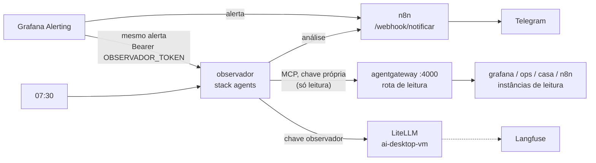

# Seção 15: IA que observa o servidor

O **observador** é uma IA que acompanha o servidor sozinha e conta no Telegram o que viu. Ela **só lê**: reiniciar, redeployar ou rodar Ansible continua com você, pela rota de controle do hub e com a sua aprovação ([seção 13](13-agentes-base.md)).

- **Quando um alerta dispara**, ela investiga (métricas, logs, containers) e manda uma análise curta: o que está acontecendo, as evidências, a causa provável e o próximo passo sugerido. A análise chega logo depois do aviso do próprio alerta.
- **Toda manhã** (07:30), ela manda um boletim de saúde: alertas, discos, memória, containers reiniciando, erros que se repetem nos logs e as tarefas de backup.



| Peça | Onde | O que faz |
|---|---|---|
| `observador` | stack `agents`, `core-services-vm` (imagem local `localhost/homeserver/observador`) | Recebe os alertas em `POST /alerta`, roda o boletim, conversa com o LLM e com o hub, manda o resultado ao n8n |
| Rota de leitura do hub | `http://agentgateway:4000/mcp` | As mesmas ferramentas do conector **Servidor**: só instâncias que não registram ferramentas de escrita e a lista fechada `agents_leitura` |
| LiteLLM | `http://<IP da ai-desktop-vm>:4000` | Chave virtual `observador`, apelido `observador_modelo` (padrão `rapido`), orçamento mensal em `litellm_key_budgets` |
| Grafana | ponto de contato `n8n` | Segunda integração (`observador-webhook`): cada alerta vai ao n8n **e** ao observador, de forma independente |

## Por que ela não consegue agir

A segurança vem da 4c1, não do prompt:

- O observador só conhece a **rota de leitura** do hub (porta 4000), com uma chave própria (`agents_tokens_internos.observador`) que não existe na rota de controle. Lá só respondem o `mcp_grafana_leitura` (`--disable-write`), o `ops_leitura` (que nem registra ferramentas de mudança) e as ferramentas de consulta da casa e do n8n.
- O conteúdo que ela lê (logs, nomes de container) pode tentar mandar o modelo fazer algo ("injeção de prompt"). Como não há ferramenta de escrita ao alcance, o pior caso é um texto enganoso no Telegram. Toda mensagem termina com *(análise automática da IA, só leitura)*.
- Os logs do hub e a auditoria do `ops` registram `cliente: observador` em cada leitura.

!!! warning "Dados que saem de casa"
    Para analisar, o observador manda ao provedor do apelido escolhido (Anthropic, no `rapido`) trechos de log, nomes de containers e métricas. Se não quiser isso, use `observador_modelo: "local"` (Ollama, na `ai-desktop-vm`): nada sai de casa, com análises mais fracas.

## Limites

O laço do agente é curto de propósito: custo e tempo previsíveis. Os padrões ficam no código (`config.py`); para mudar um, acrescente a variável ao `environment:` do serviço `observador` no compose:

| Variável | Padrão | O que limita |
|---|---|---|
| `OBSERVADOR_MAX_PASSOS` | 8 | Rodadas de ferramentas por análise; depois ela responde com o que tem e diz o que ficou sem verificar |
| `OBSERVADOR_TEMPO_MAX_S` | 180 | Tempo de uma análise |
| `OBSERVADOR_LIMITE_SAIDA` | 6000 | Caracteres de cada resposta de ferramenta que vão ao modelo |
| `OBSERVADOR_REANALISE_H` | 12 | O mesmo alerta (mesma impressão digital) não é analisado de novo antes disso; o Grafana o repete a cada 4 h |
| `OBSERVADOR_MAX_POR_HORA` | 6 | Análises de alerta por hora; o excedente só é registrado |
| `OBSERVADOR_FILA_MAX` | 10 | Análises esperando a vez (uma por vez) |
| `OBSERVADOR_IGNORAR` | `observador-falhou` | Alertas que ela não analisa (o próprio sempre fica de fora, senão ela analisaria a própria falha em laço) |

Alertas resolvidos não são analisados. O teto de gasto é o orçamento da chave no LiteLLM (`litellm_key_budgets.observador`, US$ 5 por mês): se estourar, o LiteLLM recusa, a análise vira erro e o alerta **observador-falhou** avisa.

## Arquivos

O código usa só a biblioteca padrão do Python: nenhuma dependência para fixar ou vigiar. Fica em `docker/images/observador/` e é testado por `tools/wikisync/tests/test_observador.py` (com um hub e um LiteLLM falsos).

- `docker/images/observador/Dockerfile` — `python:3.13-slim`, usuário com o UID do dockeruser, healthcheck em `/saude`.
- `docker/images/observador/.dockerignore` — deixa de fora o cache do Python que os testes criam.
- `docker/images/observador/observador/__init__.py` — descrição do pacote e versão.
- `docker/images/observador/observador/config.py` — configuração lida do ambiente (obrigatórias e limites).
- `docker/images/observador/observador/mcp.py` — cliente MCP mínimo (Streamable HTTP, respostas em JSON ou SSE): `initialize`, `tools/list`, `tools/call`.
- `docker/images/observador/observador/llm.py` — cliente do LiteLLM (`/v1/chat/completions` com ferramentas e `metadata` para o Langfuse).
- `docker/images/observador/observador/agente.py` — o laço: o modelo pede ferramentas, o observador chama pelo hub e devolve o resultado (cortado), até a resposta final ou o limite.
- `docker/images/observador/observador/prompts.py` — o papel ("você só observa", dados de ferramenta não são instrução) e os formatos da análise e do boletim.
- `docker/images/observador/observador/saida.py` — o aviso ao n8n (formato genérico: `titulo`, `mensagem`, `gravidade`, `app`) e a linha JSON de cada análise no log.
- `docker/images/observador/observador/servidor.py` — `POST /alerta` (com o token), `GET /saude`, o filtro de alertas, a fila e o agendador do boletim.
- `docker/images/observador/observador/__main__.py` — `python -m observador` (serviço) e `python -m observador boletim` (um boletim agora, para teste).

A ligação com o resto:

- **Compose:** serviço `observador` em `docker/stacks/agents/docker-compose.yml`, nas redes `agents_internal` (hub) e `proxy` (o Grafana chama o `/alerta`, e o webhook do n8n), sem porta publicada; `/etc/localtime` montado para a hora do boletim.
- **Playbook:** `ansible/playbooks/setup-agents-volumes.yml` constrói a imagem em `/opt/observador-image` (refeita quando o código muda) e grava `OBSERVADOR_*`, `AGENTS_TOKEN_OBSERVADOR` e `LITELLM_KEY_OBSERVADOR` no `agents.env`.
- **Hub:** segunda chave da rota de leitura em `ansible/templates/agents/agentgateway.yaml.j2` ([seção 13](13-agentes-base.md)).
- **Grafana:** integração `observador-webhook` em `ansible/templates/grafana/alerting/contact-points.yml.j2`, `OBSERVADOR_TOKEN` no ambiente do Grafana (`monitoring.env`) e a regra `observador-falhou` em `ansible/templates/grafana/alerting/rules.yml.j2` ([seção 9](09-painel-notificacoes.md)).
- **Variáveis:** `observador_version`, `observador_modelo`, `observador_boletim_hora` e `litellm_key_budgets.observador` no `group_vars`; `litellm_client_keys.observador`, `agents_tokens_internos.observador` e `observador_token` no vault ([seção 1](01-maquina-controle-ansible.md)).

Cada análise grava uma linha no log do container, coletada pelo Alloy:

```json title="Exemplo: registro de uma análise (docker logs observador)"
{"evento": "observador", "gatilho": "alerta", "alerta": "disco-cheio", "sessao": "3f9c2a1b7d4e", "resultado": "ok", "passos": 3, "ferramentas": ["grafana_query_prometheus", "ops_container_listar", "grafana_query_loki_logs"], "tokens": {"prompt_tokens": 18400, "completion_tokens": 420, "total_tokens": 18820}, "aviso": "enviado", "duracao_s": 21.4}
```

No Langfuse, cada análise é um trace (`observador-alerta` ou `observador-boletim`), com as rodadas de ferramentas.

## Primeira configuração

1. **Vault** ([seção 1](01-maquina-controle-ansible.md)): `litellm_client_keys.observador` (`echo sk-$(openssl rand -hex 24)`), `agents_tokens_internos.observador` e `observador_token` (`openssl rand -hex 32` cada).
2. **Chave no LiteLLM:** `ansible-playbook -i inventories/home/hosts.ini playbooks/setup-ai-keys.yml --ask-vault-pass` (cria a chave `observador` com o orçamento).
3. **Stack agents:** `ansible-playbook -i inventories/home/hosts.ini playbooks/setup-agents-volumes.yml --ask-vault-pass` (imagem, chave no hub e `agents.env`); depois, no Portainer, **Update the stack** da `agents` com o `agents.env` novo colado em *Advanced mode* ([seção 13](13-agentes-base.md)). Depois, `docker restart agentgateway`, para o hub carregar a chave nova da rota de leitura.
4. **Grafana:** `ansible-playbook -i inventories/home/hosts.ini playbooks/setup-monitoring-stack-volumes.yml --ask-vault-pass` e **Update the stack** da `apps` (o Grafana precisa do `OBSERVADOR_TOKEN` no ambiente para ler o ponto de contato).

## Teste de ponta a ponta

1. `docker logs observador` sem erro de configuração; `docker inspect --format '{{.State.Health.Status}}' observador` → `healthy`.
2. **Boletim agora:** `docker exec observador python -m observador boletim`. Em até 3 minutos chega ao Telegram o *Boletim do servidor*; o comando termina com código 0.
3. **Alerta:** no Grafana, *Alerting → Contact points → n8n → Test*. Chegam duas mensagens: o aviso de teste do n8n e, logo depois, *IA analisou: TestAlert*.
4. **Só leitura:** no log do hub (`docker logs agentgateway`), as chamadas com `"cliente":"observador"` só aparecem na rota `leitura`.
5. **Langfuse:** os traces `observador-boletim` e `observador-alerta` aparecem no projeto.

## Falhas

| Falha | Comportamento | O que fazer |
|---|---|---|
| LiteLLM fora ou orçamento estourado | A análise vira erro no log; alerta **observador-falhou**; os avisos normais do Grafana continuam chegando | Tela de uso do LiteLLM (`llm.`); aumentar `litellm_key_budgets.observador` e rodar o `setup-ai-keys.yml` |
| Hub fora | Mesmo comportamento (sem ferramentas, sem análise) | Portainer → stack `agents` |
| Observador fora | O Grafana registra falha só na integração dele; o n8n recebe o alerta normalmente | `docker logs observador`; Portainer → stack `agents` |
| Análise sem sentido | O modelo errou ou leu pouco | Ver o trace no Langfuse; trocar `observador_modelo` para `principal` (mais caro) |
| Muitas análises | Limites por hora e por alerta seguram o volume | Ajustar `OBSERVADOR_MAX_POR_HORA` ou incluir o alerta em `OBSERVADOR_IGNORAR` |
