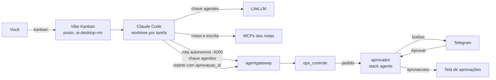

# Seção 16: Posto de agentes e aprovação humana

O **posto** roda agentes Claude Code no servidor, em paralelo, cada tarefa num *worktree* próprio de um repositório, e você os acompanha numa tela web: o **Vibe Kanban** (`https://kanban.seudominio.com`). Você cria a tarefa, escolhe o agente, revisa o diff e pede o PR.

Os agentes trabalham sem você olhando. Por isso, **toda ação deles no servidor** (reiniciar um container, redeployar uma stack, aplicar um playbook) vira um **pedido** que espera o seu "aprovar". Você decide por botões no Telegram ou na tela `https://aprovacoes.seudominio.com`. A mesma regra vale para o assistente do Telegram ([seção 17](17-assistente.md)).

| Peça | Onde | O que faz |
|---|---|---|
| `posto` | stack `posto`, `ai-desktop-vm` (imagem local `localhost/homeserver/posto`) | Vibe Kanban (servidor local, um usuário, SQLite) e os agentes que ele roda: Claude Code, git e `gh` |
| Vibe Kanban | compilado do código-fonte na tag `posto_vibe_kanban_tag` | Tarefas em colunas, um *worktree* e um terminal por tentativa, revisão de diff com comentários, PR |
| `posto_porteiro` | stack `posto`, mesma rede do container `posto` (imagem `caddy`) | Atende a porta 3005 e só repassa ao Vibe Kanban o que veio pelo Traefik ([abaixo](#porteiro-do-vibe-kanban)) |
| `aprovador` | stack `agents`, `core-services-vm` (imagem local `localhost/homeserver/aprovador`) | Pedidos de ação com botões no Telegram e a tela `aprovacoes.`; o `ops` só executa com um pedido aprovado |
| Rota `autonomos` do hub | `http://<IP da core>:4200/mcp`, só da `ai-desktop-vm` | O que a rota de leitura mostra e as ações do `ops`, sem as escritas do Grafana, da casa e do n8n ([seção 13](13-agentes-base.md)) |

## Por que compilar o Vibe Kanban

O pacote npm do Vibe Kanban baixa um binário de um CDN da Bloop, que encerrou a nuvem paga em abril de 2026, e traz chaves de telemetria embutidas. O `ansible/playbooks/setup-posto-volumes.yml` baixa o código na tag fixada e usa o `Dockerfile` do próprio projeto, com os argumentos de telemetria vazios: nada sai para a PostHog nem para a Sentry, e o posto não depende do CDN. O custo é uma compilação Rust de dezenas de minutos na `ai-desktop-vm`, uma vez por versão. A imagem do posto (`docker/images/posto/Dockerfile`) copia o servidor dessa compilação para uma base Node e deixa no cache a versão do Claude Code que o Vibe Kanban chama (`posto_claude_code_version`). A tag da imagem junta as três versões (`posto_version`, a tag do Vibe Kanban e a do Claude Code): mudou qualquer uma, o `posto.env` aponta para a imagem nova.

!!! note "\"Claude Code não detectado\""
    A tela de configurações do Vibe Kanban procura o Claude Code em `~/.claude`, e o posto o configura em `CLAUDE_CONFIG_DIR`. O aviso é só cosmético: as tarefas rodam o Claude Code normalmente.

## Porteiro do Vibe Kanban

O Vibe Kanban não tem login e aceita qualquer requisição que chegue nele. Por isso ele escuta só no `127.0.0.1` do próprio container (`HOST=127.0.0.1`), e quem atende a porta 3005 é o **porteiro**: um Caddy (`posto_porteiro`) que divide a rede do container `posto` (`network_mode: service:posto`). O porteiro:

- deixa passar `/api/health`, para as sondas do Prometheus e do painel;
- repassa o resto só se a requisição trouxer o cabeçalho `X-Posto-Chave` com o segredo `posto_chave_proxy`, que o Traefik injeta **depois** do Authelia (middleware `posto-chave`, [seção 5](05-rede-segura.md)), e retira o cabeçalho antes de repassar;
- responde 403 a todo o resto, sem painel de administração (`admin off`).

Assim, nenhum container das redes `ai_network` e `notes_mcp` (Open WebUI, LiteLLM, as notas, o assistente) chega ao Vibe Kanban, e a porta 3005 continua aceitando só a core (firewall das portas do Docker). O `Caddyfile` sai de `ansible/templates/posto/Caddyfile.j2`, com o segredo, em `0600`; o playbook para se o segredo tiver menos de 32 caracteres. O preço: a pré-visualização de apps do Vibe Kanban (outra porta, também no `127.0.0.1`) não abre de fora.

!!! warning "Futuro do projeto"
    A Bloop encerrou o serviço em nuvem em abril de 2026; o repositório continua aberto (Apache-2.0) e recebeu a versão fixada aqui em setembro de 2026. Se o projeto parar, o posto (Claude Code), o `aprovador` e a rota `autonomos` continuam funcionando; só a tela muda.

## Aprovação humana

Há duas camadas, e as duas valem ao mesmo tempo:

| Camada | O que pede aprovação | Onde você decide |
|---|---|---|
| **Tela do Vibe Kanban** | Comandos e arquivos do agente **dentro do posto** (o perfil `DEFAULT` do Claude Code tem `approvals: true`) | Na própria tarefa, no Vibe Kanban |
| **Aprovador** | **Ações no servidor** pelo `ops`: `container_reiniciar`, `stack_redeploy`, `ansible_check` e `ansible_aplicar` | Botões no Telegram ou `https://aprovacoes.seudominio.com` |

Para tarefas de confiança, escolha o perfil `AUTONOMO` ao criar a tentativa: o agente deixa de pedir permissão para comandos e arquivos do posto. As ações no servidor continuam pedindo.

### Como um pedido funciona

1. O agente chama, por exemplo, `ops_container_reiniciar` com `nome: jellyfin`.
2. O `ops` confere as regras de sempre (containers e stacks protegidos são recusados na hora, sem incomodar você).
3. Todo cliente **fora** de `ops_clientes_sem_aprovacao` (padrão: só `claude_code`, que pede aprovação na própria tela) passa pelo `aprovador`: `agentes`, `assistente`, uma chave nova esquecida e uma chamada sem o cabeçalho do hub. A lista diz quem **não** precisa, e não quem precisa, para que uma variável perdida (lista vazia) faça todos pedirem aprovação em vez de nenhum. O `ops` cria o pedido e responde ao agente: *aguardando aprovação: pedido X*. Cada cliente tem no máximo 5 pedidos pendentes; o sexto é recusado até você decidir os outros.
4. Chega no Telegram (bot de avisos) uma mensagem com o que o agente quer fazer e os botões **✅ Aprovar** e **❌ Recusar**. O mesmo pedido aparece na tela `aprovacoes.`.
5. Você decide. A mensagem é atualizada com a decisão e quem decidiu.
6. **Avise o agente** na tarefa (ou na conversa, no assistente): "aprovei, pode seguir". Ele não fica perguntando sozinho; a resposta do `ops` manda esperar o seu aviso.
7. O agente chama de novo com `aprovacao_id: X`. O `ops` só executa se o pedido estiver aprovado, for **do mesmo cliente, ação, alvo e argumentos**, ainda **não tiver sido usado** e estiver **no prazo** (`aprovador_validade_min`, 30 min). Depois de usado, ele não vale de novo.

### Ansible: duas aprovações

Mesmo em `--check`, o Ansible roda código do repositório (lookups, templates, tarefas com `check_mode: false`) com a senha do vault. Por isso um agente autônomo pede aprovação **para simular** (`ansible_check`, depois do `git pull` da `main`) e **de novo para aplicar** (`ansible_aplicar`). O pedido de aplicar mostra o commit simulado com o **autor e o assunto** (`git log -1`) e o **PLAY RECAP** do `--check`: confira se o commit é o que você espera antes de aprovar. Playbook fora de `ops_playbooks_permitidos` é recusado sem virar pedido.

!!! danger "O repositório é a outra porta"
    O `ops` aplica o que estiver na `main` do `wiki-home-server`. Nunca dê ao `posto_github_token` permissão de escrita (*Contents*) nesse repositório, e proteja a `main` no GitHub (*Settings → Branches*: exigir PR com revisão, sem *push* direto). Um agente que conseguisse escrever na `main` mudaria o que você aprova sem que a descrição do pedido parecesse diferente.

Quem pode decidir: no Telegram, só o seu usuário (`telegram_chat_id`, mais `aprovador_telegram_usuarios`); clique de outra pessoa num grupo responde "Sem permissão". Na tela, só quem passou pelo Authelia com 2FA e o grupo `admins`. A tela só responde a requisições com o segredo que o Traefik injeta (`aprovador_chave_proxy`, no middleware `aprovador-chave@file` de `ansible/roles/infra/traefik-config/templates/dynamic_agents.yml.j2`, e não num label que o `docker inspect` mostraria), então outro container da rede `proxy` não decide no seu lugar, e o POST precisa vir da própria tela (`Origin`), então outra página aberta no navegador também não. Cada evento (criado, aprovado, recusado, expirado, usado) vira uma linha JSON no log do `aprovador`, coletada pelo Alloy.

!!! info "Bot de avisos e o `aprovador`"
    O `aprovador` lê os cliques do bot de avisos (o mesmo das notificações) por `getUpdates`. O Grafana e o n8n só **enviam** por esse bot, então não há conflito. Não configure um *webhook* nesse bot, senão o `getUpdates` para de receber. O assistente tem um bot próprio pelo mesmo motivo.

## O que os agentes alcançam

| Recurso | Como | Observação |
|---|---|---|
| LLM | `ANTHROPIC_BASE_URL=http://litellm:4000` (rede `ai_network`), chave `litellm_client_keys.agentes` | Orçamento em `litellm_key_budgets.agentes`; uso na tela do LiteLLM (`llm.`) e traces no Langfuse. Nomes reais dos modelos Claude ([seção 8](08-stack-ia.md)) |
| Servidor | MCP `servidor` → rota `autonomos` (chave `agents_autonomos_keys.agentes`) | Lê métricas, logs, alertas, containers e stacks; age só pelo `ops`, com aprovação |
| Notas | MCPs `notas` (`http://qmd:8181/mcp`, busca) e `escrita` (`http://notes_escrita:8000/mcp`, só Trabalho e Estudos) | Pela rede interna `notes_mcp` ([seção 12](12-segundo-cerebro.md)) |
| Repositórios | `/repos` no disco local da VM (`/opt/local-data/posto/repos`) | Você clona; o agente trabalha num *worktree* por tentativa |
| GitHub | `gh` com `GH_TOKEN=posto_github_token` (opcional) | Token *fine-grained*, só os repositórios de trabalho, com *Contents* e *Pull requests*; **nunca** escrita no `wiki-home-server` |
| Prometheus e Loki da core | Portas 9090 e 3100 da core, abertas à `ai-desktop-vm` para o Alloy | Limite conhecido: o firewall vê o IP da VM, não o container, então um agente com o perfil `AUTONOMO` também alcança essas portas (consultar métricas e mandar métricas ou logs falsos). Nada muda no servidor por elas; desconfie de métricas e logs estranhos com origem na VM de IA |

Os MCPs vêm de `/etc/claude-code/managed-mcp.json` (gerado de `ansible/templates/posto/managed-mcp.json.j2`, montado só leitura): todo agente usa esses três, e nenhum agente os troca. Os perfis do Claude Code no Vibe Kanban vêm de `ansible/templates/posto/profiles.json.j2`, gravado uma vez (o que você mudar na tela fica).

## Arquivos

- `docker/stacks/posto/docker-compose.yml` — o serviço `posto` (Vibe Kanban em `127.0.0.1`) e o `posto_porteiro` (porta 3005 só no IP da VM, aceita só da core).
- `ansible/templates/posto/Caddyfile.j2` — o porteiro: `/api/health` livre, o resto só com `X-Posto-Chave`.
- `docker/images/posto/Dockerfile` — o servidor do Vibe Kanban sobre `node:22-bookworm-slim`, com git, `gh`, `tini` e o Claude Code em cache.
- `ansible/playbooks/setup-posto-volumes.yml` — clona e compila o Vibe Kanban, constrói o posto, cria os diretórios e gera os MCPs, os perfis e o `posto.env`.
- `ansible/templates/posto/managed-mcp.json.j2` e `ansible/templates/posto/profiles.json.j2` — acima.
- `docker/images/aprovador/Dockerfile` e `docker/images/aprovador/.dockerignore` — só a biblioteca padrão do Python.
- `docker/images/aprovador/aprovador/__init__.py` — descrição e versão.
- `docker/images/aprovador/aprovador/config.py` — variáveis de ambiente e quem pode decidir.
- `docker/images/aprovador/aprovador/pedidos.py` — o registro: criar, decidir, usar uma vez, expirar; JSON no disco.
- `docker/images/aprovador/aprovador/telegram.py` — mensagem com botões, leitura dos cliques e atualização da mensagem.
- `docker/images/aprovador/aprovador/servidor.py` — API do `ops` (token), tela (chave do proxy, `Remote-User`, `Origin`).
- `docker/images/aprovador/aprovador/__main__.py` — `python -m aprovador`.
- `docker/images/ops/ops/aprovacao.py` — o cliente do `aprovador` no `ops` (falha fechada se não estiver configurado).
- Serviço `aprovador` e as variáveis do `ops_controle` em `docker/stacks/agents/docker-compose.yml`; imagem e `agents.env` em `ansible/playbooks/setup-agents-volumes.yml` ([seção 13](13-agentes-base.md)).
- Testes: `tools/wikisync/tests/test_aprovacao.py` (o `aprovador` e o fluxo no `ops`, de ponta a ponta) e `tools/wikisync/tests/test_posto_assistente.py`.

## Primeira configuração

1. **Vault** ([seção 1](01-maquina-controle-ansible.md)): `litellm_client_keys.agentes` (`echo sk-$(openssl rand -hex 24)`), `agents_autonomos_keys.agentes` (`ag-` + `openssl rand -hex 24`), `aprovador_token`, `aprovador_chave_proxy` e `posto_chave_proxy` (`openssl rand -hex 32` cada) e, se quiser PRs pelo `gh`, `posto_github_token` (sem escrita no `wiki-home-server`; proteja a `main`, veja acima).
2. **Chave no LiteLLM:** `ansible-playbook -i inventories/home/hosts.ini playbooks/setup-ai-keys.yml --ask-vault-pass`.
3. **Firewall, rotas e Authelia:** `setup-base-ubuntu.yml` (portas 4200 e 3005, [seção 14](14-vpn-tailscale.md)), `setup-core-networking.yml` (rota `kanban.` com o segredo do porteiro, o middleware `aprovador-chave` e os domínios `kanban`/`aprovacoes` só para `admins`) e `setup-monitoring-stack-volumes.yml` (sondas e painel).
4. **Hub e aprovador:** `setup-agents-volumes.yml`; no Portainer, **Update the stack** da `agents` com o `agents.env` novo em *Advanced mode*; depois `docker restart agentgateway`.
5. **Posto:** `ansible-playbook -i inventories/home/hosts.ini playbooks/setup-posto-volumes.yml --ask-vault-pass` (a primeira compilação demora). No Portainer, ambiente `ai-desktop-vm`: **Add stack** `posto` com `docker/stacks/posto/docker-compose.yml` e o `posto.env` em *Advanced mode*.
6. **Primeiro uso:** clone o repositório no posto (`docker exec -it posto git clone https://github.com/<você>/<repo>.git /repos/<repo>`), abra `https://kanban.seudominio.com`, crie o projeto apontando para `/repos/<repo>` e escolha o agente **Claude Code**.

## Teste de ponta a ponta

1. `https://kanban.seudominio.com` pede o login do Authelia; um usuário fora de `admins` é recusado. Na LAN, `curl http://<IP da ai>:3005/api/health` não conecta (só a core alcança). Da core, `curl http://<IP da ai>:3005/api/health` responde e `curl http://<IP da ai>:3005/` dá 403 (sem o segredo). De outro container da VM de IA, `docker exec open-webui curl -m 3 http://posto:3000/` não conecta.
2. Numa tarefa de teste, peça ao agente "liste os containers da core pelo MCP servidor": funciona sem aprovação (é leitura).
3. Peça "reinicie o container `homepage`": o agente responde que está aguardando aprovação; no Telegram chega o pedido com botões. Aprove e diga ao agente "aprovei, pode seguir": ele repete com `aprovacao_id` e o container reinicia. A mensagem mostra *Aprovado e executado*.
4. Peça "reinicie o `traefik`": recusado na hora (protegido), sem pedido.
5. Crie um pedido e não decida: em 30 min a mensagem passa a *Expirado*. A tela `aprovacoes.` mostra o histórico.
6. Peça "simule o playbook de mídia": chega um pedido para o `ansible_check`; aprovado, ele simula e devolve o `plano_id`. Peça para aplicar: o novo pedido mostra o autor, o assunto do commit e o PLAY RECAP.

## Falhas

| Falha | Comportamento | O que fazer |
|---|---|---|
| `aprovador` fora | Ações dos autônomos são recusadas (falha fechada); leitura e o Claude Code do seu PC seguem normais | Portainer → stack `agents` |
| Telegram fora | O pedido continua na tela `aprovacoes.` | Decida pela tela |
| Botões não respondem | Outro programa usa o bot por *webhook* ou `getUpdates` | `docker logs aprovador`; `deleteWebhook` no bot de avisos |
| Orçamento dos agentes estourado | O Claude Code recebe erro do LiteLLM | Tela do LiteLLM (`llm.`); aumente `litellm_key_budgets.agentes` e rode o `setup-ai-keys.yml` |
| `kanban.` responde 403 | O segredo do Traefik e o do porteiro diferem (vault mudou e só um playbook rodou) | Rode `setup-core-networking.yml` e `setup-posto-volumes.yml` e reinicie o `posto_porteiro` |
| Agente diz "5 pedidos pendentes" | Limite por cliente no `aprovador` | Decida (ou recuse) os pendentes em `aprovacoes.` |
| Vibe Kanban não compila | O `setup-posto-volumes.yml` falha na tarefa de compilação | Veja o log do build; mantenha a tag anterior em `posto_vibe_kanban_tag` |
