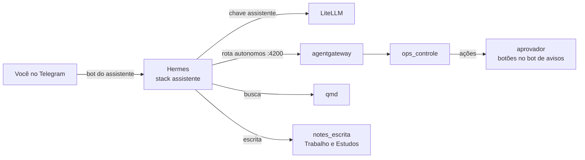

# Seção 17: Assistente sempre ligado (Hermes Agent)

O **assistente** é um agente que você chama pelo Telegram, de qualquer lugar: "como está o servidor?", "anota isso em estudos", "o que eu escrevi sobre o backup?", "me lembra amanhã às 9h de trocar o disco". Ele roda o [Hermes Agent](https://github.com/NousResearch/hermes-agent) (Nous Research) na `ai-desktop-vm`, em modo *gateway*, e conversa por um **bot próprio** do Telegram.

| Peça | Onde | O que faz |
|---|---|---|
| `assistente` | stack `assistente`, `ai-desktop-vm` (imagem `nousresearch/hermes-agent:v0.22.5`) | Conversa pelo Telegram, guarda memória e agenda lembretes |
| Bot do assistente | `hermes_telegram_bot_token` | Separado do bot de avisos, que o `aprovador` lê ([seção 16](16-posto-agentes.md)) |
| Modelo | LiteLLM, `assistente_modelo` (padrão `principal`), chave `litellm_client_keys.assistente` | Orçamento em `litellm_key_budgets.assistente`; traces no Langfuse |

## O que ele pode e o que não pode

| Pode | Como |
|---|---|
| Ler o servidor (métricas, logs, alertas, containers, stacks) | MCP `servidor`, pela rota `autonomos` do hub (chave `agents_autonomos_keys.assistente`) |
| Agir no servidor (reiniciar, redeploy, Ansible) | Pelo mesmo MCP, **cada ação esperando a sua aprovação** no bot de avisos ou em `aprovacoes.` ([seção 16](16-posto-agentes.md#aprovação-humana)) |
| Buscar em todas as notas e documentos | MCP `notas` (`http://qmd:8181/mcp`) |
| Escrever notas em Trabalho e Estudos | MCP `escrita` (`http://notes_escrita:8000/mcp`); o vault Pessoal nem está montado lá ([seção 12](12-segundo-cerebro.md)) |
| Lembrar de você e do que conversaram | Memória do Hermes (`memory`) e lembretes (`cronjob`), entregues no seu chat |

**Não pode:** rodar comandos (`terminal`), executar código (`code_execution`), mexer em arquivos do container (`file`), navegar ou buscar na internet (`browser`, `web`, `search`), acrescentar MCPs (`connections`), instalar skills (`skills`), delegar a subagentes (`delegation`). Esses grupos estão em `agent.disabled_toolsets` no `config.yaml`. Um assistente aberto a mensagens e que lê conteúdo de notas e logs é alvo de injeção de prompt; sem terminal, código nem conexões novas, o pior caso fica restrito às notas de Trabalho e Estudos (com snapshots a cada 15 minutos) e a ações que você precisa aprovar.

!!! warning "Só você conversa com ele"
    O Hermes só responde a quem está em `TELEGRAM_ALLOWED_USERS` (`assistente_telegram_usuarios`, padrão: o seu `telegram_chat_id`). Mensagens de outras pessoas são ignoradas. Se o token do bot vazar, revogue no BotFather (`/revoke`) e troque no vault.

!!! info "Dados que saem de casa"
    O que você conversa, as notas que ele lê e os dados do servidor que ele consulta vão ao provedor do apelido escolhido (no `principal`, a Anthropic; com fallback na OpenAI).

## Arquivos

- `docker/stacks/assistente/docker-compose.yml` — o serviço `assistente`: `gateway run`, sem porta, sem painel (`HERMES_DASHBOARD` desligado), sem API (`API_SERVER_ENABLED` desligado), sem o socket do Docker, `no-new-privileges`, usuário do dockeruser (`HERMES_UID`/`HERMES_GID`), redes `ai_network` e `notes_mcp`.
- `ansible/playbooks/setup-assistente-volumes.yml` — cria `/opt/local-data/hermes` (disco local: SQLite), gera o `config.yaml` e o `.env` (0600) e o `assistente.env` da stack.
- `ansible/templates/assistente/config.yaml.j2` — modelo pelo LiteLLM, os três MCPs e os grupos de ferramentas desligados. Sem segredos: `${VAR}` vem do `.env`.
- `ansible/templates/assistente/env.j2` — token do bot, usuários permitidos, chat dos lembretes, chave do LiteLLM e chave do hub.

O `config.yaml` é regravado a cada execução do playbook: o que mudar por comando no Hermes (`/model`, por exemplo) volta ao que esta página diz. Para mudar de vez, mude aqui.

## Primeira configuração

1. **Bot:** no Telegram, fale com o @BotFather, `/newbot`, e guarde o token em `hermes_telegram_bot_token` no vault.
2. **Vault** ([seção 1](01-maquina-controle-ansible.md)): `litellm_client_keys.assistente` (`echo sk-$(openssl rand -hex 24)`) e `agents_autonomos_keys.assistente` (`ag-` + `openssl rand -hex 24`).
3. **Chaves:** `ansible-playbook -i inventories/home/hosts.ini playbooks/setup-ai-keys.yml --ask-vault-pass` (LiteLLM) e `setup-agents-volumes.yml` + `docker restart agentgateway` (hub), se ainda não fez na [seção 16](16-posto-agentes.md).
4. **Assistente:** `ansible-playbook -i inventories/home/hosts.ini playbooks/setup-assistente-volumes.yml --ask-vault-pass`. No Portainer, ambiente `ai-desktop-vm`: **Add stack** `assistente` com `docker/stacks/assistente/docker-compose.yml` e o `assistente.env` em *Advanced mode*.
5. No Telegram, abra o bot novo e mande `/start`.

## Teste de ponta a ponta

1. `docker logs assistente` mostra o gateway conectado ao Telegram e os três MCPs (`servidor`, `notas`, `escrita`) com as ferramentas carregadas.
2. "Como está o servidor?" → ele responde com dados reais (alertas, containers).
3. "Anota em estudos/inbox.md: testar o assistente" → a nota aparece no Obsidian depois da sincronização. "Anota em pessoal/…" → ele não consegue (o vault Pessoal não existe para o `notes_escrita`).
4. "Reinicie o container homepage" → chega o pedido com botões no **bot de avisos**; aprove, e ele confirma.
5. "Rode `ls /`" → ele diz que não tem como executar comandos.
6. De outra conta do Telegram, mande uma mensagem ao bot: nenhuma resposta.
7. "Me lembre em 5 minutos de beber água" → a mensagem chega no horário.

## Falhas

| Falha | Comportamento | O que fazer |
|---|---|---|
| Bot não responde | Token errado, ou outro programa lendo o mesmo bot | `docker logs assistente`; um bot por programa |
| Ferramentas do servidor somem | Hub fora ou chave errada (401 na rota `autonomos`) | `docker logs agentgateway`; confira `agents_autonomos_keys.assistente` |
| Notas não aparecem | `qmd` ou `notes_escrita` fora, ou a stack `notes` subiu depois | Portainer → stack `notes`; depois **Restart** do `assistente` |
| Orçamento estourado | Erro do LiteLLM na conversa | Tela do LiteLLM (`llm.`); ajuste `litellm_key_budgets.assistente` e rode o `setup-ai-keys.yml` |
