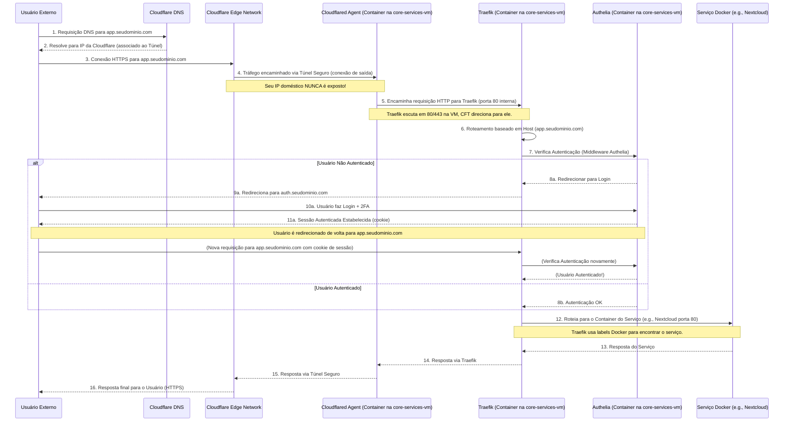

# Fluxo de Rede e Acesso Externo Seguro

A capacidade de acessar seus serviços auto-hospedados de qualquer lugar, de forma segura, é uma das principais funcionalidades desta arquitetura. Utilizamos uma combinação de Cloudflare Tunnel, Traefik como proxy reverso e Authelia para autenticação de dois fatores (2FA) para alcançar este objetivo.

## Diagrama de Fluxo Detalhado

Este diagrama ilustra o caminho que uma requisição de um usuário externo percorre até alcançar um serviço Docker hospedado na sua `core-services-vm`.

## Componentes Chave e Suas Funções

### 1. Cloudflare DNS e Edge Network

*   **Gerenciamento DNS:** Seu domínio (`{{ base_domain }}`) utiliza os nameservers da Cloudflare.
*   **Ocultação de IP:** Os registros DNS para seus serviços não apontam para o seu IP doméstico, mas para a rede da Cloudflare. Isso protege seu IP de ser exposto diretamente na internet.
*   **Proteção DDoS e WAF:** O tráfego passa pela infraestrutura da Cloudflare, que oferece mitigação de ataques DDoS e um Web Application Firewall (WAF) básico (configurações mais avançadas podem estar disponíveis em planos pagos).
*   **Cache (Opcional):** Cloudflare pode armazenar em cache conteúdo estático dos seus sites, acelerando o carregamento para os usuários e reduzindo a carga no seu servidor.

### 2. Cloudflare Tunnel (`cloudflared` Agent)

*   **Conexão de Saída Segura:** O container `cloudflared` (rodando na `core-services-vm`) estabelece uma conexão criptografada de **saída** para a rede da Cloudflare.
*   **Sem Abertura de Portas no Roteador:** Como a conexão é iniciada de dentro da sua rede local para fora, você **não precisa configurar nenhum encaminhamento de porta (port forwarding)** no seu roteador doméstico. Isso aumenta significativamente a segurança da sua rede local.
*   **Ingress Rules ou `--hostname`:**
    *   Você pode definir "Public Hostnames" (Ingress Rules) no dashboard Cloudflare Zero Trust para especificar quais subdomínios são expostos através do túnel e para qual serviço interno eles devem ser encaminhados (neste caso, para o Traefik).
    *   Alternativamente, a flag `--hostname` no comando `cloudflared` pode registrar automaticamente um ou mais hostnames para o túnel.
*   **Encaminhamento para Traefik:** O `cloudflared` é configurado para encaminhar todo o tráfego recebido do túnel para o serviço Traefik na rede Docker interna (e.g., `http://traefik:80`).

### 3. Traefik (Proxy Reverso)

Traefik é um componente central para gerenciar o tráfego interno para seus containers.

*   **Entrypoints:** Traefik escuta em pontos de entrada definidos, como a porta `80` (HTTP) e `443` (HTTPS) na `core-services-vm`.
*   **Redirecionamento HTTP para HTTPS:** Todo o tráfego chegando na porta `80` é automaticamente redirecionado para `HTTPS` na porta `443`.
*   **Roteamento Baseado em Host:** Traefik examina o cabeçalho `Host` da requisição HTTP (e.g., `nextcloud.{{ base_domain }}`) para determinar para qual serviço interno a requisição deve ser encaminhada.
*   **Descoberta de Serviços Docker:** Traefik monitora o socket Docker e automaticamente descobre novos containers que possuem *labels* específicas do Traefik. Essas labels definem como o tráfego deve ser roteado para aquele container (e.g., qual subdomínio, qual porta interna do container).
*   **Provedor de Arquivos (File Provider):** Além da descoberta Docker, Traefik pode carregar configurações de roteamento de arquivos YAML. Isso é usado para rotear tráfego para serviços que não estão na mesma instância Docker que o Traefik (como o OpenWebUI rodando na `ai-desktop-vm`).
*   **Gerenciamento de Certificados SSL/TLS (Let's Encrypt):**
    *   Traefik automaticamente solicita, renova e gerencia certificados SSL/TLS da Let's Encrypt para todos os seus subdomínios expostos.
    *   Ele utiliza o **desafio DNS-01** com a API da Cloudflare. Isso significa que Traefik (usando o token API da Cloudflare que você forneceu) cria temporariamente um registro TXT no DNS do seu domínio para provar à Let's Encrypt que ele controla o domínio. Este método é robusto e não requer que portas HTTP estejam abertas para o mundo.
    *   Os certificados são armazenados no arquivo `acme.json` (mapeado para um volume NFS).
*   **Middlewares:** Traefik usa middlewares para processar requisições antes de encaminhá-las aos serviços. Exemplos:
    *   Middleware de redirecionamento HTTP para HTTPS.
    *   Middleware para adicionar headers de segurança (como os em `security_headers.yml`).
    *   **Middleware de Forward Authentication para Authelia.**

### 4. Authelia (Servidor de Autenticação e Autorização)

Authelia adiciona uma camada crucial de segurança, exigindo autenticação (e opcionalmente 2FA) antes que os usuários possam acessar os serviços protegidos.

*   **Integração com Traefik:** Traefik é configurado para usar Authelia como um [middleware de forward authentication](https://doc.traefik.io/traefik/middlewares/http/forwardauth/).
    *   Quando uma requisição chega para um serviço protegido, Traefik envia informações sobre a requisição para o endpoint `/api/verify` do Authelia.
    *   Authelia verifica se o usuário tem uma sessão válida (através de um cookie).
*   **Portal de Login:** Se o usuário não estiver autenticado, Authelia instrui Traefik a redirecionar o navegador do usuário para o portal de login do Authelia (e.g., `https://auth.{{ base_domain }}`).
*   **Autenticação de Múltiplos Fatores (MFA):** Após fornecer credenciais válidas (usuário/senha), Authelia pode exigir um segundo fator (e.g., código TOTP de um app autenticador).
*   **Políticas de Acesso:** Authelia permite definir políticas granulares em seu arquivo `configuration.yml` para determinar qual nível de autenticação é necessário para diferentes domínios ou redes.
*   **Single Sign-On (SSO) Básico:** Uma vez que o usuário está logado no Authelia, ele pode acessar outros serviços protegidos pelo mesmo Authelia sem precisar logar novamente (dentro da validade da sessão Authelia).

## Vantagens desta Abordagem

*   **Segurança Aprimorada:**
    *   Nenhum IP doméstico exposto.
    *   Nenhuma porta aberta no roteador.
    *   Todo o tráfego externo é HTTPS.
    *   Proteção centralizada com 2FA via Authelia.
    *   Benefícios da rede Cloudflare (DDoS, WAF).
*   **Simplicidade de Gerenciamento:**
    *   Gerenciamento de certificados SSL automatizado por Traefik.
    *   Configuração de proxy reverso centralizada no Traefik.
    *   Fácil adicionar novos serviços e protegê-los com labels Docker e regras Authelia.
*   **Flexibilidade:**
    *   Suporte para diversos tipos de aplicações e protocolos.