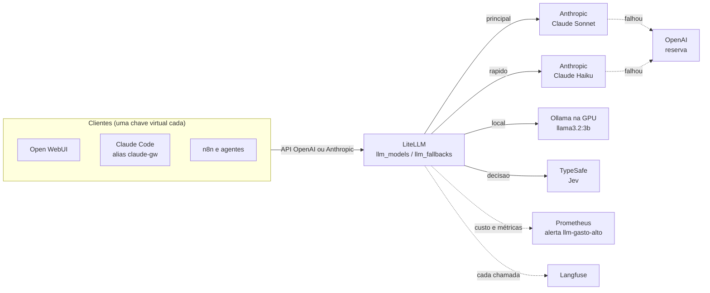

# Estratégia de APIs de LLM e Arquitetura Híbrida de IA

Com a introdução do LiteLLM em nossa stack, a capacidade de processamento de linguagem do nosso home server evolui de um sistema puramente local para uma **arquitetura de IA híbrida, elástica e consciente dos custos**. Esta página aprofunda a visão estratégica por trás dessa abordagem, detalhando como, quando e por que utilizar modelos de linguagem locais (via Ollama) versus modelos de ponta na nuvem (via APIs externas).

O objetivo não é substituir o Ollama, mas sim aumentá-lo, criando um sistema inteligente que utiliza o recurso certo para a tarefa certa, otimizando a relação entre performance, custo e privacidade.

## O Modelo Híbrido: O Melhor de Dois Mundos

A combinação de LLMs locais e em nuvem nos permite superar as limitações inerentes de cada abordagem quando usadas isoladamente.

| Característica | Ollama (Local) | APIs Externas (Nuvem) |
| :--- | :--- | :--- |
| **Performance** | Limitada pelo hardware (GPU/RAM). Rápido para modelos pequenos. | Acesso a modelos de última geração (SOTA). Altamente escalável. |
| **Custo** | Custo de capital (hardware) e energia. Custo marginal por inferência é zero. | Custo operacional (pago por token). Pode se tornar caro com uso intenso. |
| **Privacidade** | Máxima. Os dados nunca saem da sua rede local. | Os dados são enviados para o provedor da API. Requer confiança nas políticas de privacidade do provedor. |
| **Disponibilidade** | Dependente da estabilidade do seu servidor e conexão. | Alta disponibilidade garantida pelo provedor de nuvem (SLA). |
| **Manutenção** | Requer gerenciamento de modelos, drivers e atualizações. | Nenhuma manutenção de modelo ou infraestrutura necessária. |

Nossa estratégia combina esses pontos fortes com **um gateway só**: todo cliente fala com o LiteLLM, com uma chave virtual própria, e escolhe um **apelido** pela intenção. O LiteLLM traduz o apelido no modelo real, cai para a reserva se o provedor falhar e registra o custo e o rastro de cada chamada:

Os modelos e as reservas exatos estão em `llm_models` e `llm_fallbacks` (página 01), renderizados no `config.yaml` pelo template `ansible/templates/litellm_config.yaml.j2` ([Stack de IA](../01-manual-implementacao/08-stack-ia.md#modelos-e-apelidos)). O LiteLLM não decide sozinho pelo tamanho do prompt: quem escolhe é o cliente, pelo apelido.

## Estratégias de Roteamento e Casos de Uso

O roteamento do homeserver é feito por **apelidos** declarados em `llm_models` (`group_vars/all/main.yml`) e renderizados no `config.yaml` do LiteLLM ([Stack de IA](../01-manual-implementacao/08-stack-ia.md#modelos-e-apelidos)). O cliente escolhe a intenção; o código decide o modelo.

| Apelido | Estratégia | Exemplos de uso |
|---|---|---|
| `rapido` | custo baixo e latência baixa | resumir, classificar, responder notificações, automações do n8n |
| `principal` | qualidade | análise de documentos, geração de código, textos técnicos |
| `local` | privacidade e custo zero | dados que não devem sair de casa; tarefas leves |
| `decisao` | decisão tipada (Jev) | triagem, roteamento, "aprovar ou não" dentro de automações e agentes |

* **Fallback:** `principal` e `rapido` têm um modelo de outro provedor como reserva (`llm_fallbacks`): se a Anthropic cair, a chamada vai para a OpenAI sem o cliente perceber.
* **Modelo específico:** quando a tarefa exige um modelo exato, o cliente pede pelo nome próprio (ex.: `claude-opus-5-5`), que também está no `llm_models`. O Claude Code usa sempre nomes de modelos Claude.
* **Trocar de LLM:** muda-se o `model` do apelido e roda-se o `setup-ai-volumes.yml`; nenhum cliente é alterado.
* **Contexto pessoal (segundo cérebro):** as notas e os documentos não passam pelo gateway: a busca e os embeddings rodam localmente no qmd, e o Claude (app, claude.ai, Claude Code) ou o Open WebUI só leem o trecho que consultam pelos MCPs `notas` e `escrita` ([Segundo cérebro](../01-manual-implementacao/12-segundo-cerebro.md)). O modelo que responde continua sendo escolhido pelo cliente.
* **Ferramentas e rastreio (base dos agentes):** o acesso da IA ao servidor (métricas, logs, containers, Ansible, casa, automações) passa por um hub de MCPs com leitura pela internet e ações só na LAN, e cada chamada de LLM do LiteLLM e de ferramenta do hub fica registrada no **Langfuse** ([Agentes: base](../01-manual-implementacao/13-agentes-base.md)).

## Gerenciamento de Custos e Orçamentos

O maior risco de uma arquitetura híbrida é o custo inesperado com APIs externas. No homeserver:

*   **Orçamento por cliente:** cada cliente tem uma chave virtual própria (`litellm_client_keys`) com orçamento mensal (`litellm_key_budgets`), aplicado pelo `setup-ai-keys.yml`. Estourou, aquele cliente recebe erro; os outros seguem.
*   **Alerta de gasto:** o Prometheus raspa as métricas do LiteLLM e o alerta `llm-gasto-alto` avisa no Telegram quando o gasto das últimas 24 h passa de `llm_gasto_diario_alerta`.
*   **Observabilidade:** a tela do LiteLLM em `https://llm.seudominio.com` (atrás do Authelia) mostra gasto, tokens e chamadas por chave e por modelo. O rastro de cada chamada (entrada, saída, custo e latência) fica no Langfuse, em `https://langfuse.seudominio.com`.
*   **Cache:** o cache de respostas do LiteLLM não está ligado; pode ser acrescentado em `litellm_settings` se houver muitas perguntas repetidas.

Ao adotar esta arquitetura de IA híbrida, seu home server se torna uma plataforma de IA resiliente e flexível, com um único lugar para trocar modelos, controlar custos e ver o uso.
