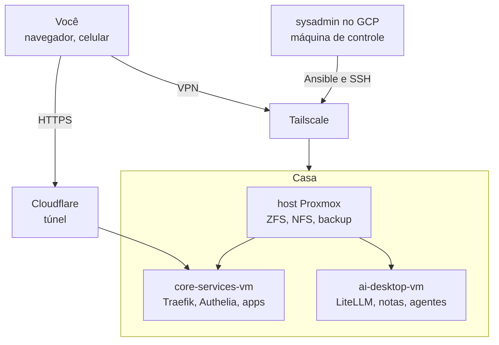

# 💡 Visão Geral da Arquitetura

Bem-vindo à seção de Visão Geral da Arquitetura! Após a implementação detalhada no [Manual de Implementação](../01-manual-implementacao/index.md), esta seção tem como objetivo fornecer um entendimento conceitual de como os diversos componentes do seu servidor doméstico se integram e operam em conjunto.

## Objetivo

Aqui, exploraremos a lógica por trás das escolhas de design, o fluxo de dados e interações entre as principais tecnologias utilizadas:

*   **[Fluxo de Rede e Acesso Externo Seguro](01-fluxo-rede-acesso-externo.md):** Como seus serviços são expostos à internet de forma segura.
*   **[Virtualização com Proxmox VE](02-virtualizacao-proxmox.md):** A base para hospedar seus serviços em máquinas virtuais isoladas.
*   **[Estratégia de Armazenamento com ZFS e NFS](03-armazenamento-zfs-nfs.md):** Como os dados são armazenados de forma resiliente e compartilhados.
*   **[Automação da Infraestrutura com Ansible](04-automacao-ansible.md):** O poder da Infraestrutura como Código para gerenciamento e repetibilidade.
*   **[Gerenciamento de Containers com Docker e Portainer](05-gerenciamento-containers.md):** Como as aplicações são empacotadas e executadas.
*   **[Princípios de Segurança Aplicados](06-principios-seguranca.md):** As camadas de segurança implementadas em toda a stack.
*   **[Estratégia de APIs de LLM](07-apis-llm-estrategia.md):** Como combinar Ollama local, LiteLLM e provedores externos de forma coerente.
*   **[Catálogo de Aplicações](09-catalogo-aplicacoes.md):** Os fatos de cada aplicação (stack, exposição, dados, métricas) que guiam as integrações.
*   **[Índice de Integrações](10-indice-integracoes.md):** As integrações entre aplicações, com regras verificáveis e os passos para adicionar ou remover.

Esta seção é ideal para quem deseja entender o "porquê" das escolhas de arquitetura e como os diferentes sistemas colaboram, sem necessariamente se aprofundar nos comandos exatos de implementação (que já foram cobertos no manual).

## Componentes Chave e Suas Interações

A arquitetura do nosso servidor doméstico é composta por várias camadas e tecnologias que trabalham em harmonia:

Navegue pelas subseções para um mergulho mais profundo em cada um desses aspectos da arquitetura.