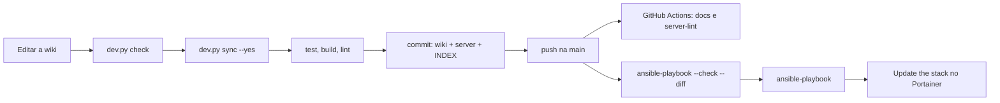

# CI/CD Básico para Infraestrutura como Código

O repositório tem integração contínua de verdade (dois workflows no GitHub Actions) e um deploy **deliberadamente manual**. Toda mudança passa por testes, pela coerência wiki ↔ server, pelo build da wiki e pelo lint antes de chegar à `main`. Já a aplicação nos hosts é sempre feita por alguém, com simulação antes. Não há deploy automático: um playbook com erro pode derrubar o acesso ao próprio servidor (Traefik, Authelia, NFS).

## Fluxo de uma mudança



1. **Wiki primeiro.** A mudança começa na página que documenta o arquivo (`INDEX.md` diz qual). Bloco literal = conteúdo exato do arquivo; `python tools/dev.py sync --yes` grava no `server/`.
2. **Validação local**, na raiz do repositório (Windows ou Linux; o Ansible só fora do Windows):

    | Comando | O que faz |
    |---|---|
    | `python tools/dev.py setup` | cria o ambiente (`.venv/` ou `$HOMESERVER_VENV`) com `requirements-dev.txt` |
    | `python tools/dev.py test` | testes do `wikisync` e dos templates, composes e playbooks (`tools/wikisync/tests/`); mostra o motivo de cada teste pulado |
    | `python tools/dev.py check` | coerência wiki ↔ server: blocos literais, caminhos citados, nav, vault criptografado, finais de linha |
    | `python tools/dev.py build` | `mkdocs build --strict`: qualquer aviso falha |
    | `python tools/dev.py lint` | yamllint, ansible-lint, `--syntax-check` de cada playbook e `docker compose config` de cada stack com as variáveis do `.env.template` |

    Alguns testes usam binários reais quando eles estão no `PATH` (`agentgateway`, `alloy`, `authelia`, `node`) e são pulados sem eles. O `test` mostra quais pularam.
3. **Commit único** com a wiki, o `server/` e o `INDEX.md` (skill `update-index`), em português.
4. **Push na `main`.** Dois workflows rodam sozinhos:
    - `.github/workflows/server-lint.yml` (mudanças em `server/`, `tools/` ou no lint): `setup`, `lint` e `check`.
    - `.github/workflows/docs.yml` (mudanças em `wiki/` ou `tools/`): `test`, `check`, `build` e publicação em `https://wiki.seudominio.com` (branch `gh-pages`).

    Acompanhe em *Actions* no GitHub (ou `gh run list`). Um vermelho na `main` se corrige antes de qualquer deploy.
5. **Aplicar nos hosts**, a partir de `server/ansible` na máquina de controle, sempre simulando antes:

    ```bash
    ansible-playbook -i inventories/home/hosts.ini playbooks/<playbook>.yml --ask-vault-pass --check --diff
    ansible-playbook -i inventories/home/hosts.ini playbooks/<playbook>.yml --ask-vault-pass
    ```

    Se o playbook gerou um `.env` novo, abra a stack no Portainer, recarregue o arquivo em **Env** e clique em **Update the stack**.

!!! tip "Branches"
    Para mudanças grandes (um sub-projeto inteiro), trabalhe numa branch e abra um pull request: o `server-lint` roda também em PRs. Mudanças pequenas vão direto na `main`, já validadas localmente.

## Deploy assistido pela IA

O MCP `ops` ([seção 13](../01-manual-implementacao/13-agentes-base.md)) é a forma controlada de "CD" deste servidor. A IA pode simular (`ops_ansible_check`) e aplicar (`ops_ansible_aplicar`) só os playbooks liberados em `ops_playbooks_permitidos`, sempre no commit que acabou de simular e com a sua aprovação a cada aplicação. Os playbooks de base (host Proxmox, VMs, rede core) continuam só na máquina de controle.

## Deploy completo (`full-deploy.yml`)

Para o primeiro deploy ou para reconstruir tudo ([Reconstruindo a infraestrutura](04-reconstruindo-infraestrutura.md)), o `full-deploy.yml` roda os playbooks de configuração na ordem certa. Ele **não** cria as VMs (isso é o `vm-deploy.yml`, [seção 3](../01-manual-implementacao/03-provisionamento-vms.md)) nem implanta as stacks no Portainer, e deixa de fora o `setup-ai-keys.yml`, que só funciona com a stack `ai` no ar.

```yaml title="ansible/playbooks/full-deploy.yml"
# ansible/playbooks/full-deploy.yml
# Orquestra a configuração completa da infraestrutura (sem criar VMs e sem implantar as stacks).
# Ordem: host e VMs, rede core, depois os volumes e .env de cada stack. O setup-ai-keys.yml fica de fora:
# ele só funciona com a stack ai no ar (rode-o depois do deploy dela, página 08).

- import_playbook: setup-proxmox-host.yml
- import_playbook: setup-base-ubuntu.yml
- import_playbook: setup-core-networking.yml
- import_playbook: setup-productivity-automation-volumes.yml
- import_playbook: setup-n8n-volumes.yml
- import_playbook: setup-monitoring-stack-volumes.yml
- import_playbook: setup-media-stack-volumes.yml
- import_playbook: setup-photos-stack-volumes.yml
- import_playbook: setup-cloud-stack-volumes.yml
- import_playbook: setup-ai-volumes.yml
- import_playbook: setup-notes-volumes.yml
- import_playbook: setup-langfuse-volumes.yml
- import_playbook: setup-agents-volumes.yml
```

O `scripts/restore.sh` só entra em `server/ansible` e roda o `full-deploy.yml` pedindo a senha do vault:

```bash title="scripts/restore.sh"
#!/usr/bin/env bash
set -euo pipefail
cd "$(dirname "$0")/.."
cd ansible
ansible-playbook -i inventories/home/hosts.ini playbooks/full-deploy.yml --ask-vault-pass
```

Depois dele, implante as stacks no Portainer na ordem do manual (seções 6 a 13) e siga o roteiro [A conferir no primeiro deploy](../01-manual-implementacao/index.md#a-conferir-no-primeiro-deploy).
